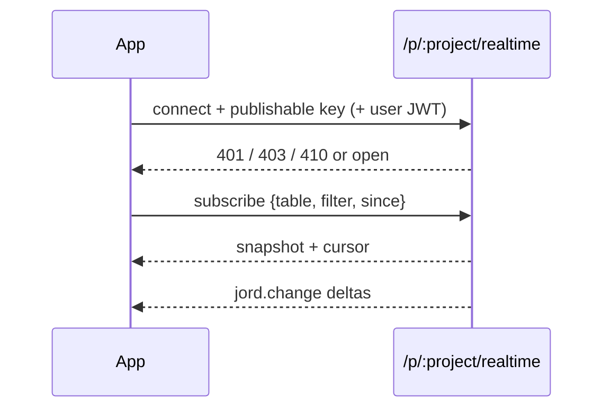

# S0084 — app-facing realtime endpoint

> **Status:** todo · **Depends on** [[S0043-project-registry-api|S0043]] + [[S0037-listen-seq-fanout|S0037]] · **Phase:** [[README]] · Parent: [[../../../feature_list/Jord/todo/jord-F0026-live-data-client|jord-F0026]] · After ship: [[../../../tech_space/jord/realtime/README]]

## Routing (who / how long / which model)

| | |
|--|--|
| **Suggested agent** | mimir → **sindri** · **heimdall** reviews key handling |
| **Companion skills** | `.agents/skills/security-and-hardening/` · `.agents/skills/graft/` · `.agents/skills/hono-typescript/` |
| **Suggested model** | `claude-sonnet-5-5-high` |
| **Est. time** | **3 h** |
| **Parallel?** | **No** |

## Goal

A client app connects to `wss://<server>/p/<project>/realtime` (SSE fallback) with the **publishable** key and an optional end-user JWT, subscribes to one table with an optional filter, receives a snapshot plus a `since` cursor, then `jord.change` deltas with policies applied at delivery. Bad key → 401, wrong project → 403, archived/paused project → 410 with a reason.

## Why now

Today realtime is Studio-oriented; `jord-F0026` is the contract apps integrate against, and every subsequent client feature assumes it.

## Context (read before coding)

| Kind | Where |
|------|-------|
| Intent | [[../../../feature_list/Jord/todo/jord-F0026-live-data-client|jord-F0026]] (endpoint, auth, delivery, failure) |
| Depends on | [[S0043-project-registry-api|S0043]] (keys) · [[S0037-listen-seq-fanout|S0037]] (fan-out) |
| Code today | `cloud/jord/src/realtime/{deliver,bus,types}.ts` · `cloud/jord/src/auth/{access,principal}.ts` |
| Tests | `cloud/jord/src/realtime/ws-policy.test.ts` |

**Do not break:** the existing Studio stream; secret key must never be accepted from a browser (publishable or JWT only).

## In scope

- Route + handshake: publishable key header/query, optional `Authorization: Bearer <user JWT>`; reject the **secret** key outright with a clear error.
- Subscribe: `{ table, filter?, since? }`, one table per subscription (documented limit).
- Deliver: snapshot (bounded, with cursor) → deltas from `since`; policy evaluated per row at delivery; filtered rows skipped silently.
- Errors: 401 bad/missing key, 403 wrong project key or denied table, 410 archived/paused with `reason`, 409 cursor too old → resync required (documented).
- Rate/size caps: subscriptions per connection, max filter complexity.
- Tests: snapshot + delta sequencing; denied table; secret-key rejection; archived project 410.

## Out of scope

Reconnect/backoff logic ([[S0085-realtime-reconnect|S0085]]) · Studio live toggle ([[S0086-live-toggle-snippet|S0086]]) · presence ([[S0083-presence-broadcast|S0083]]).

## Diagram

## Steps (do in order)

1. Read the deliver path + principal resolution; sketch the subscription state machine.
2. Add the route + handshake auth (publishable only).
3. Implement snapshot with cursor, then delta streaming with policy filtering.
4. Add the error contract + caps.
5. Tests for each status code and the snapshot/delta equivalence.
6. Typecheck + test; paste proof.
7. **docs_man**: realtime tech_space app endpoint; tick card.

## Done when

- [ ] Snapshot + deltas produce the same final state as a fresh snapshot (tested)
- [ ] Denied table → 403 and no rows delivered
- [ ] Secret key rejected from this endpoint
- [ ] Archived/paused project → 410 with reason
- [ ] Proof pasted

## Proof

| Date | Command | Result |
|------|---------|--------|
| | `pnpm --filter @altr/jord-server test` | |

## After ship

| Update | Path |
|--------|------|
| tech_space | `Docs/tech_space/jord/realtime/README.md` |
| Queue | [[README]] |
