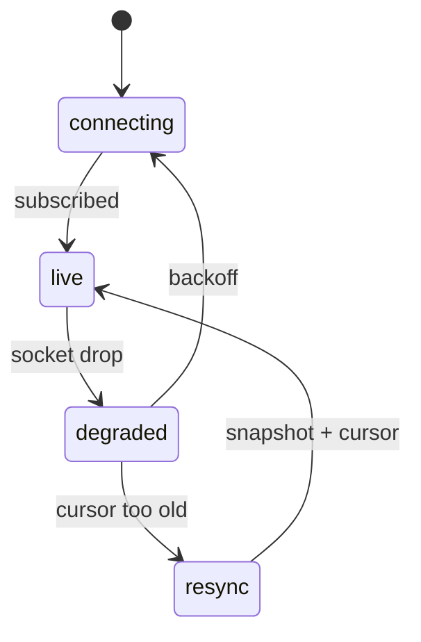

# S0085 — realtime reconnect, resume and ordering

> **Status:** todo · **Depends on** [[S0084-realtime-app-endpoint|S0084]] · **Phase:** [[README]] · Parent: [[../../../feature_list/Jord/todo/jord-F0026-live-data-client|jord-F0026]] · After ship: [[../../../tech_space/jord/apis/README]]

## Routing (who / how long / which model)

| | |
|--|--|
| **Suggested agent** | mimir → **sindri** (client + server resume) |
| **Companion skills** | `.agents/skills/graft/` · `.agents/skills/nodejs-backend-patterns/` |
| **Suggested model** | `gpt-5.6-sol-medium` |
| **Est. time** | **2–3 h** |
| **Parallel?** | **No** |

## Goal

`@altr/jord-client` realtime survives a 30 s network drop: backoff reconnect, heartbeat detection, resume from the last cursor, duplicate events dropped by sequence number, and a deterministic resync (snapshot again) when the server reports the cursor is past retention — never a silent gap.

## Why now

`jord-F0026` acceptance includes the reconnect scenario, and apps cannot ship a subscription that silently misses writes.

## Context (read before coding)

| Kind | Where |
|------|-------|
| Intent | [[../../../feature_list/Jord/todo/jord-F0026-live-data-client|jord-F0026]] (Reconnect, Ordering) |
| Depends on | [[S0084-realtime-app-endpoint|S0084]] |
| Code today | `elements/jord-client` (client SDK) · server retention in `elements/jord/src/schema/` / `cloud/jord/src/realtime/outbox.ts` |
| Tests | `elements/jord-client` test setup; add a fault-injection harness (close the socket server-side) |

**Do not break:** existing client methods; no unbounded in-memory event buffer.

## In scope

- Client: connect state machine (`connecting → live → degraded → resync`), exponential backoff with jitter and a cap, heartbeat timeout detection.
- Resume: send `since`, apply deltas > cursor, drop duplicates by `(table, seq)`, persist the cursor in memory (optional localStorage opt-in).
- Server: distinguish "cursor too old" (explicit `resync_required`) from a transient error; keep retention configurable.
- Tests: drop mid-stream → reconnect → no duplicates/no gaps; cursor past retention → resync_required → snapshot path taken; backoff values bounded.
- Doc: the exact event/state contract for consumers.

## Out of scope

Offline-first writes · client-side conflict resolution · presence reconnection (covered by S0083 semantics).

## Diagram

## Steps (do in order)

1. Read the client SDK + server resume path; define the state machine in the card.
2. Implement backoff + heartbeat + resume with dedupe.
3. Add `resync_required` on the server and handle it in the client.
4. Build the fault-injection test (server closes the connection mid-stream).
5. Typecheck + test (client + server); paste proof.
6. **docs_man**: apis/realtime tech_space client contract; tick card.

## Done when

- [ ] 30 s drop then reconnect → no duplicate and no missed rows (tested)
- [ ] Cursor past retention triggers a documented resync, not a gap
- [ ] Backoff is bounded and jittered
- [ ] Event/state contract documented for consumers
- [ ] Proof pasted

## Proof

| Date | Command | Result |
|------|---------|--------|
| | `pnpm --filter @altr/jord-client test` | |

## After ship

| Update | Path |
|--------|------|
| tech_space | `Docs/tech_space/jord/apis/README.md` |
| Queue | [[README]] |
