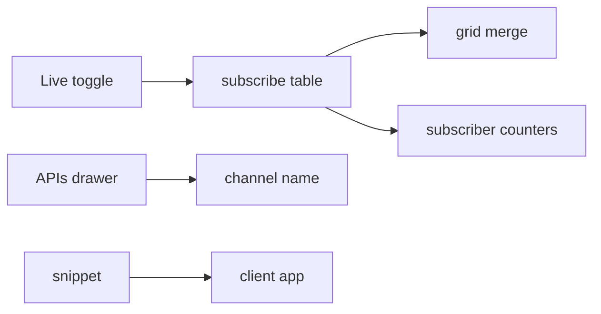

# S0086 — Studio live toggle, subscriber counters and client snippet

> **Status:** todo · **Depends on** [[S0084-realtime-app-endpoint|S0084]] · **Phase:** [[README]] · Parent: [[../../../feature_list/Jord/todo/jord-F0026-live-data-client|jord-F0026]] · After ship: [[../../../tech_space/jord/studio/README]]

## Routing (who / how long / which model)

| | |
|--|--|
| **Suggested agent** | mimir → **apollo** (UI) + **sindri** (counters) |
| **Companion skills** | `.agents/skills/apollo/` · `.agents/skills/graft/` |
| **Suggested model** | `gpt-5.6-sol-medium` |
| **Est. time** | **2–3 h** |
| **Parallel?** | **No** |

## Goal

Operators can see live data working: a **Live** toggle on the tables grid that subscribes/unsubscribes, subscriber count + recent events on the project dashboard, per-table channel names in the APIs drawer, and a generated per-project snippet (env block + connect + subscribe) that matches the real contract.

## Why now

The app contract shipped (S0084) but nothing in Studio proves it; the snippet also keeps docs and code from drifting.

## Context (read before coding)

| Kind | Where |
|------|-------|
| Intent | [[../../../feature_list/Jord/todo/jord-F0026-live-data-client|jord-F0026]] (Studio, Client snippet) |
| Depends on | [[S0084-realtime-app-endpoint|S0084]] · [[S0058-inline-edit-live-sync|S0058]] (grid merge) · [[S0066-bucket-registry|S0066]] unrelated |
| Code today | `lib/realtime-table.ts` · `components/{table-browser,table-api-playground}.tsx` · dashboard cards from [[S0096-dashboard-ui|S0096]] (coordinate, do not duplicate) |
| Tests | typecheck + build; subscriber counter asserted via a server endpoint test |

**Do not break:** the grid merge from S0058 stays the single merge path; snippet never embeds the secret key.

## In scope

- Live toggle per table tab: on → subscribe with the active filter, badge shows "live"; off → unsubscribe. Errors surface as a dismissible banner.
- Dashboard counters: current subscribers, events/min, last event age (endpoint `GET /admin/projects/:id/realtime-stats`).
- APIs drawer: channel name per table (`p:<project>:<schema>.<table>`), copy button.
- Snippet generator: language tabs (JS/TS, Python, cURL where applicable) with the publishable key placeholder, env var names, connect + subscribe + unsubscribe, and a note that the secret key is server-only.
- Test: snippet output references only real endpoints/fields (assert against a fixture).

## Out of scope

Multi-table subscriptions · presence UI · SDK publishing.

## Diagram

## Steps (do in order)

1. Read `realtime-table.ts` + S0058 merge; wire the toggle into that path.
2. Add the stats endpoint + dashboard cards (coordinate with S0096).
3. Add channel names + snippet generator.
4. Tests for snippet accuracy and counter endpoint.
5. Typecheck + build; paste proof.
6. **docs_man**: studio tech_space live section; tick card.

## Done when

- [ ] Toggle subscribes/unsubscribes and shows a live badge
- [ ] Dashboard shows subscribers + events/min
- [ ] APIs drawer shows the channel name
- [ ] Snippet connects successfully in a scratch app
- [ ] Proof pasted

## Proof

| Date | Command | Result |
|------|---------|--------|
| | `pnpm --filter @altr/jord-studio build` | |

## After ship

| Update | Path |
|--------|------|
| tech_space | `Docs/tech_space/jord/studio/README.md` |
| Queue | [[README]] |
