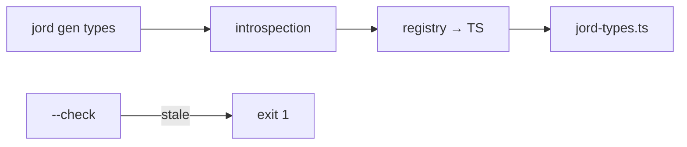

# S0087 — `jord gen types`

> **Status:** todo · **Phase:** [[README]] · Parent: [[../../../feature_list/Jord/todo/jord-F0014-typed-dx|jord-F0014]] · After ship: [[../../../tech_space/jord/apis/README]]

## Routing (who / how long / which model)

| | |
|--|--|
| **Suggested agent** | mimir → **sindri** (CLI + generation) with **saga** for the type mapping |
| **Companion skills** | `.agents/skills/graft/` · `.agents/skills/supabase-postgres-best-practices/` |
| **Suggested model** | `gpt-5.6-sol-medium` |
| **Est. time** | **2–3 h** |
| **Parallel?** | **No** — S0088 builds on the generated types |

## Goal

`jord gen types --url … --out lib/jord-types.ts [--schema app]` prints TypeScript: one interface per table (`Row`, `Insert`, `Update`), nullable columns as `| null`, a `Database` map keyed `schema.table`, and deterministic ordering/formatting so diffs are reviewable. Fails loudly on an unreachable database.

## Why now

`jord-F0014` starts with types; the client builder and React hooks are useless without them.

## Context (read before coding)

| Kind | Where |
|------|-------|
| Intent | [[../../../feature_list/Jord/todo/jord-F0014-typed-dx|jord-F0014]] |
| Depends on | [[S0052-type-registry|S0052]] (type → TS mapping) · [[S0049-schema-scoped-introspection|S0049]] (schema scope) |
| Code today | CLI entry in `elements/jord` or `cloud/jord` (locate it) · `cloud/jord/src/table-api/openapi.ts` as an alternative source |
| Tests | snapshot test of the generated file for a fixture schema |

**Do not break:** no network calls at runtime — output is a plain `.ts` file; no secrets in it.

## In scope

- Command registration + flags (`--url`/env, `--schema`, `--out`, `--check` to fail when the file is stale).
- Mapping: registry id → TS type (int → number, bigint → string, numeric → string, json → unknown, timestamptz → string, bytea → Uint8Array/string — decide and document).
- `Insert` (defaults/identity optional) and `Update` (all optional) derivations; PK marked.
- Deterministic output (sorted tables/columns, single quotes, no timestamps) + header comment with the command that produced it.
- `--check` used in CI: failing when the schema changed but types were not regenerated.
- Tests: snapshot fixture; `--check` exit codes; unreachable URL → clear error, non-zero exit.

## Out of scope

Runtime validation (zod) · generating client methods ([[S0088-typed-client-builder|S0088]]) · watching mode.

## Diagram

## Steps (do in order)

1. Locate the CLI entry and the introspection API usable from a script.
2. Implement mapping + deterministic emitter.
3. Add `--check` and the CI hook note (do not wire CI yet if it needs secrets).
4. Snapshot tests + error paths.
5. Typecheck + test; paste the generated header in proof.
6. **docs_man**: apis tech_space typed DX; tick card.

## Done when

- [ ] Generates valid TypeScript for a fixture schema on both dialects
- [ ] Output is deterministic across runs
- [ ] `--check` fails on stale types
- [ ] Unreachable database exits non-zero with a clear message
- [ ] Proof pasted

## Proof

| Date | Command | Result |
|------|---------|--------|
| | `pnpm --filter @altr/jord test` | |

## After ship

| Update | Path |
|--------|------|
| tech_space | `Docs/tech_space/jord/apis/README.md` |
| Queue | [[README]] |
