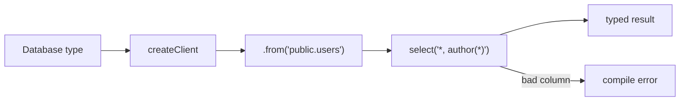

# S0088 — typed table builder in `@altr/jord-client`

> **Status:** todo · **Depends on** [[S0087-gen-types-cli|S0087]] · **Phase:** [[README]] · Parent: [[../../../feature_list/Jord/todo/jord-F0014-typed-dx|jord-F0014]] · After ship: [[../../../tech_space/jord/apis/README]]

## Routing (who / how long / which model)

| | |
|--|--|
| **Suggested agent** | mimir → **sindri** (client SDK) |
| **Companion skills** | `.agents/skills/graft/` · `.agents/skills/vercel-react-best-practices/` |
| **Suggested model** | `claude-sonnet-5-5-high` — generic typing over a schema map |
| **Est. time** | **3 h** |
| **Parallel?** | **No** |

## Goal

`createClient<Database>({ url, key })` exposes `.from('public.users')` with typed `select`, `insert`, `update`, `delete`, `eq/neq/gt/lt/in/or`, `order`, `limit`, `range`, and `select` strings that type the result — including the `author(*)` embed from [[S0078-fk-embeds|S0078]]. Wrong column names and wrong insert shapes are compile errors.

## Why now

`jord-F0014` acceptance is "a column rename breaks the consumer app's typecheck"; that only exists once the builder is typed end to end.

## Context (read before coding)

| Kind | Where |
|------|-------|
| Intent | [[../../../feature_list/Jord/todo/jord-F0014-typed-dx|jord-F0014]] |
| Depends on | [[S0087-gen-types-cli|S0087]] · [[S0078-fk-embeds|S0078]] · [[S0079-keyset-pagination|S0079]] |
| Code today | `elements/jord-client` (existing untyped HTTP client — extend, do not fork) |
| Tests | type-level tests (`expectTypeOf` / `@ts-expect-error` cases) + runtime tests against a stub server |

**Do not break:** existing client methods and their response shapes; no runtime dependency added for types.

## In scope

- `createClient<Database>()` with a table builder over the `schema.table` map.
- Filter operators typed by column type (no `gt` on boolean unless allowed), `order` restricted to columns, `range`/`limit` numeric.
- Select-string typing for a reasonable subset (`*`, explicit columns, one-level embeds with alias).
- `single()`/`maybeSingle()` result typing; insert returns the selected projection.
- Type tests: valid calls compile; wrong column, wrong insert shape, bad embed all fail with `@ts-expect-error`.
- Consumer proof: a small fixture app (or test file) that fails to typecheck after a simulated column rename.

## Out of scope

Codegen of methods per table · zod runtime validation · React hooks ([[S0089-react-bindings|S0089]]).

## Diagram

## Steps (do in order)

1. Read the existing client; keep its transport, add the builder facade.
2. Implement types + operators.
3. Add select-string typing incl. one embed.
4. Type tests + runtime stub tests.
5. Prove the rename scenario breaks the fixture typecheck; paste output.
6. Typecheck + test; **docs_man** tick card.

## Done when

- [ ] Builder compiles for valid chains and rejects invalid ones (type tests)
- [ ] Embed select returns typed nested objects
- [ ] Renaming a column breaks the fixture typecheck (pasted)
- [ ] Existing client tests still green
- [ ] Proof pasted

## Proof

| Date | Command | Result |
|------|---------|--------|
| | `pnpm --filter @altr/jord-client typecheck` | |

## After ship

| Update | Path |
|--------|------|
| tech_space | `Docs/tech_space/jord/apis/README.md` |
| Queue | [[README]] |
