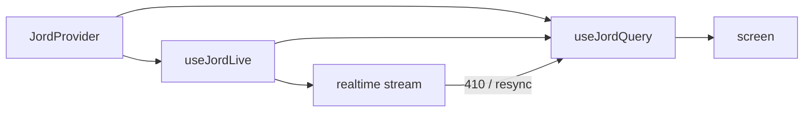

# S0089 — React bindings package

> **Status:** todo · **Depends on** [[S0088-typed-client-builder|S0088]] + [[S0085-realtime-reconnect|S0085]] · **Phase:** [[README]] · Parent: [[../../../feature_list/Jord/todo/jord-F0014-typed-dx|jord-F0014]] · After ship: [[../../../tech_space/jord/apis/README]]

## Routing (who / how long / which model)

| | |
|--|--|
| **Suggested agent** | mimir → **sindri** (package) + **apollo** (consumer screen) |
| **Companion skills** | `.agents/skills/vercel-react-best-practices/` · `.agents/skills/apollo/` · `.agents/skills/graft/` |
| **Suggested model** | `claude-sonnet-5-5-high` |
| **Est. time** | **3 h** |
| **Parallel?** | **No** |

## Goal

A **separate** package (`@altr/jord-react`) with `<JordProvider>`, `useJordQuery` (typed fetch with cache + refetch) and `useJordLive` (subscription merged into the cached list, resync on `resync_required`/410). One Apolyx app screen consumes it as the first real user.

## Why now

`jord-F0014` explicitly keeps React bindings out of the core client; without them every app reimplements cache + live merge.

## Context (read before coding)

| Kind | Where |
|------|-------|
| Intent | [[../../../feature_list/Jord/todo/jord-F0014-typed-dx|jord-F0014]] |
| Depends on | [[S0088-typed-client-builder|S0088]] · [[S0085-realtime-reconnect|S0085]] |
| Code today | `elements/jord-client` · workspace conventions for new packages (`elements/*` naming, `@altr/*` scope) |
| Consumer | an existing Apolyx app screen (pick the smallest real one) |

**Do not break:** base has no element dependency; keep the package independently add/removable per the dependency rules doc.

## In scope

- Package scaffold matching workspace conventions (`elements/jord-react`, `@altr/jord-react`, typecheck/test/lint scripts).
- `JordProvider` (client, defaults), `useJordQuery({ table, select, filter, order, limit })` with in-memory cache keyed by the query, stale/refetch semantics, and abort on unmount.
- `useJordLive(query)` = query + subscription: apply deltas to the cached list by PK, drop duplicates, resync (refetch snapshot) on `resync_required` or 410.
- Optimistic helpers optional: expose `mutate` to update the cache after a write.
- Tests: cache reuse, abort, live merge, resync path (stub transport).
- Consumer screen migrated and typechecked.

## Out of scope

Suspense data fetching · server-side rendering integration · offline persistence · publishing to npm.

## Diagram

## Steps (do in order)

1. Scaffold the package per workspace conventions; confirm dependency rules.
2. Implement provider + query cache.
3. Implement live merge + resync.
4. Write transport-stub tests.
5. Migrate one screen; typecheck the whole workspace.
6. **docs_man**: apis tech_space + elements README entry; tick card.

## Done when

- [ ] Package typechecks and tests independently
- [ ] `useJordQuery` caches and refetches correctly
- [ ] `useJordLive` applies deltas and resyncs on 410
- [ ] One real screen uses it; workspace typecheck green
- [ ] Proof pasted

## Proof

| Date | Command | Result |
|------|---------|--------|
| | `pnpm --filter @altr/jord-react test` | |
| | `pnpm typecheck` (or the workspace equivalent) | |

## After ship

| Update | Path |
|--------|------|
| tech_space | `Docs/tech_space/jord/apis/README.md` |
| Queue | [[README]] |
