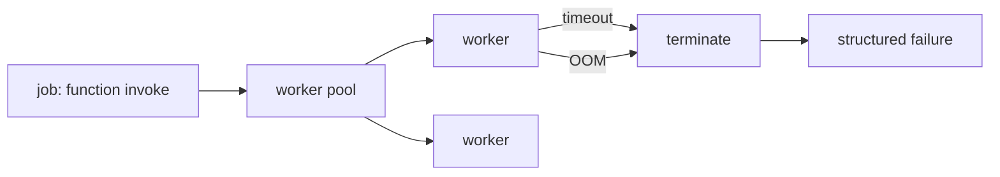

# S0090 — Functions worker pool + caps (GATED)

> **Status:** **gated — do not implement** · **Phase:** [[README]] · Parent: [[../../../feature_list/Jord/todo/jord-F0015-functions-runtime|jord-F0015]] · ADR: [[../../../tech_space/jord/apis/ADR-functions-v2]] · After ship: [[../../../tech_space/jord/apis/README]]

## Routing (who / how long / which model)

| | |
|--|--|
| **Suggested agent** | mimir → **sindri** · **heimdall** reviews the isolation boundary |
| **Companion skills** | `.agents/skills/graft/` · `.agents/skills/nodejs-backend-patterns/` · `.agents/skills/security-and-hardening/` |
| **Suggested model** | `claude-sonnet-5-5-high` |
| **Est. time** | **3 h** (after the gate opens) |
| **Parallel?** | **No** |

## Gate

`STATUS.md` says: **do not ship** the Functions v2 runtime until the ADR recommendation is approved for implementation. This card exists so the work is queued and scoped — **do not start it** without an explicit instruction in the repo status.

## Goal

A `worker_threads` pool that executes a user function in isolation with a hard timeout, a memory cap, a per-project concurrency limit, and a clean kill path (`terminate()` on timeout), replacing the phase-01 built-in kinds-only path for user code.

## Why now

`jord-F0015` is the last blocked capability; shipping the pool without the caps would leak memory and hang the server.

## Context (read before coding)

| Kind | Where |
|------|-------|
| Intent | [[../../../feature_list/Jord/todo/jord-F0015-functions-runtime|jord-F0015]] · [[../../../tech_space/jord/apis/ADR-functions-v2|ADR]] |
| Code today | `cloud/jord/src/functions/{runner,kinds,slug,index}.ts` · `cloud/jord/src/queue.ts` |
| Tests | `elements/jord/src/functions.test.ts` |
| Constraint | worker must not inherit full `process.env`; pass an allowlist |

**Do not break:** built-in function kinds keep working; the job runner's queue semantics.

## In scope

- Pool: N workers per project (configurable), warm reuse where safe, recycle after M invocations.
- Caps: wall-clock timeout, memory (`resourceLimits`), output size limit, and a kill that cannot be caught by user code.
- Env isolation: allowlisted env only.
- Errors: `function_timeout`, `function_oom`, `function_crashed` mapped to a structured job failure.
- Tests: infinite loop killed at timeout; allocation bomb hits the memory cap; pool recovers and serves the next call.

## Out of scope

The principal-bound client ([[S0091-functions-client-logs|S0091]]) · WASM sandboxing · per-invocation CPU accounting.

## Diagram

## Steps (do in order)

1. Confirm the gate is lifted (status line changed) before writing code.
2. Read the ADR + current runner; keep built-in kinds on their path.
3. Implement pool + caps + env allowlist.
4. Map failures to structured job errors.
5. Tests for timeout, OOM, recovery.
6. Typecheck + test; paste proof.
7. **docs_man**: apis tech_space runtime section; tick card.

## Done when

- [ ] Infinite loop killed at the configured timeout (tested)
- [ ] Memory cap enforced
- [ ] `process.env` secrets not reachable in the worker (tested)
- [ ] Built-in kinds unaffected
- [ ] Proof pasted

## Proof

| Date | Command | Result |
|------|---------|--------|
| | `pnpm --filter @altr/jord-server test` | |

## After ship

| Update | Path |
|--------|------|
| tech_space | `Docs/tech_space/jord/apis/README.md` |
| Queue | [[README]] |
