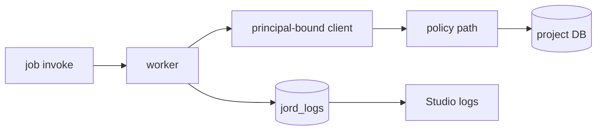

# S0091 — Functions principal-bound client + logs (GATED)

> **Status:** **gated — do not implement** · **Phase:** [[README]] · Parent: [[../../../feature_list/Jord/todo/jord-F0015-functions-runtime|jord-F0015]] · After ship: [[../../../tech_space/jord/apis/README]]

## Routing (who / how long / which model)

| | |
|--|--|
| **Suggested agent** | mimir → **sindri** · **heimdall** reviews the policy boundary |
| **Companion skills** | `.agents/skills/security-and-hardening/` · `.agents/skills/graft/` |
| **Suggested model** | `claude-sonnet-5-5-high` |
| **Est. time** | **3 h** (after the gate opens) |
| **Parallel?** | **No** |

## Gate

Depends on [[S0090-functions-worker-pool|S0090]] and the same status gate. Do not start before the runtime decision is approved in `STATUS.md`.

## Goal

Inside a function, `jord.from('public.orders')` acts as **the invoking principal** (no god mode): reads and writes pass through the normal policy path, and every invocation writes a log row (start, end, status, duration, captured `console` output) visible in Studio.

## Why now

A function that bypasses policies is a privilege-escalation hole; logging is how operators debug functions at all.

## Context (read before coding)

| Kind | Where |
|------|-------|
| Intent | [[../../../feature_list/Jord/todo/jord-F0015-functions-runtime|jord-F0015]] · [[../../../feature_list/Jord/todo/jord-F0030-auth-console|jord-F0030]] (not this UI) |
| Depends on | [[S0090-functions-worker-pool|S0090]] · `cloud/jord/src/policies/` |
| Code today | `cloud/jord/src/functions/runner.ts` · `cloud/jord/src/logs/` · `jord_logs` |
| Tests | `elements/jord/src/functions.test.ts` · policy tests |

**Do not break:** policy evaluation for HTTP requests; log retention rules; no secret values in captured logs.

## In scope

- Client passed into the worker: table read/write + blob sign, scoped to the principal id; no admin routes, no raw SQL by default.
- Policy enforcement test: function run as a limited principal cannot read a restricted table (403 inside the function, surfaced as a job error).
- Invocation logs: structured start/end + `console.log` capture (bounded, truncated), correlated by invocation id; Studio list endpoint reuse from `logs/`.
- Failure logging: timeout/crash rows include the reason from S0090.

## Out of scope

Function editor UI changes · log search UI (existing logs screen suffices) · long-running background functions.

## Diagram

## Steps (do in order)

1. Confirm the gate; read the runner + policy entry.
2. Build the scoped client and pass it into the worker context.
3. Add invocation logging with capture + truncation.
4. Tests for policy denial inside a function and log rows for each outcome.
5. Typecheck + test; paste proof.
6. **docs_man**: apis tech_space functions; tick card.

## Done when

- [ ] Function writes/reads respect the invoking principal's policies (tested)
- [ ] No admin escape hatch on the in-worker client
- [ ] Every invocation writes a log row with status + duration
- [ ] Logs contain no secret values
- [ ] Proof pasted

## Proof

| Date | Command | Result |
|------|---------|--------|
| | `pnpm --filter @altr/jord-server test` | |

## After ship

| Update | Path |
|--------|------|
| tech_space | `Docs/tech_space/jord/apis/README.md` |
| Queue | [[README]] |
