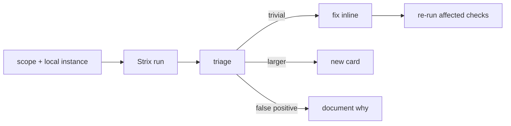

# S0092 — authorized Strix pentest + triage

> **Status:** in progress · **Phase:** [[README]] · Parent: [[../../../feature_list/Jord/todo/jord-F0019-security-pass|jord-F0019]] · Threat model: [[../../../plan/Jord/phase-02/Jord-S0021/ADR-threat-model]] · After ship: [[../../../tech_space/jord/overview/README]]

## Scope statement (recorded 2026-11-11)

Authorized **local lab only** — `http://127.0.0.1:8787` owned by this workspace. Surfaces: `/api/v1`, `/auth`, `/blobs`, `/realtime` (+ admin probes for function-level authz). Out of scope: DoS, social, physical, any non-loopback host. Full text: [[../../../temp/input/S0092-scope]]. Seed creds staging: `Docs/temp/input/S0092-seed-creds.json`.

## Routing (who / how long / which model)

| | |
|--|--|
| **Suggested agent** | **heimdall** |
| **Companion skills** | `.agents/skills/penetration-testing-with-strix/` · `.agents/skills/owasp-top-10-testing/` · `.agents/skills/fix-security-vulnerabilities-with-strix/` |
| **Suggested model** | `claude-sonnet-5-5-high` — triage judgment |
| **Est. time** | **2–3 h** |
| **Parallel?** | **No** |

## Goal

An authorized pentest of the four public surfaces on a **local/staging** instance, with results triaged: each confirmed finding becomes a card (or is fixed inline if trivial), and the phase ends with **no open high/critical**.

## Why now

`jord-F0019` is the security pass before the Studio v2 surface grows further; new routes (projects, buckets, auth settings) make the inventory bigger.

## Context (read before coding)

| Kind | Where |
|------|-------|
| Intent | [[../../../feature_list/Jord/todo/jord-F0019-security-pass|jord-F0019]] |
| Threat model | `Docs/plan/Jord/phase-02/Jord-S0021/ADR-threat-model.md` |
| Surfaces | `/api/v1` (table API) · `/auth` · `/blobs` · `/realtime` |
| Authorization | **Only** test an instance you own locally or in a lab environment; never a third-party host |

**Do not break:** do not "fix" findings by weakening tests or disabling routes; keep a record of what was probed.

## In scope

- Scope statement (hosts, credentials, rate limits) written before the run.
- Run Strix against the local instance with a test project, seeded data, one restricted principal, one admin.
- Verify the OWASP API top-10 classes that apply: BOLA on records/blobs, function-level authz on admin routes, mass assignment, SSRF via outbound URL fields, injection via filters/`select`, auth/token flaws, enumeration.
- Triage table: finding, severity, proof, owner card (new `jord-F####` if it is new scope).
- Fix trivial findings inline; file the rest.

## Out of scope

Third-party hosts · DoS/load testing · social engineering · physical.

## Diagram

## Steps (do in order)

1. Load the pentest skill; write the scope statement into this card.
2. Seed a local project (admin + restricted user + blobs + policies).
3. Run the scan; keep the raw report under `Docs/temp/` (staging, not truth).
4. Triage into the table below; fix trivial issues and re-run.
5. Record the outcome: open high/critical count (target 0).
6. **docs_man**: findings summary into `tech_space/jord/overview/` security section; tick card.

## Triage

| # | Finding | Severity | Proof | Outcome |
|---|---------|----------|-------|---------|
| 1 | Prod high/critical SCA: drizzle-orm SQLi identifiers, Next RCE/DoS, postcss/source-map-js/sharp | critical/high | `pnpm audit:ci` was FAIL (7 blocking) | **Fixed** 2026-11-24 — drizzle `^0.45.2`, next/`@next/mdx` `^15.5.29`, pnpm overrides for postcss/source-map-js/sharp → `audit:ci PASS` |
| 2 | Function definition disclosure: `GET /functions` + `GET /functions/:id` returned `steps` to editor/readonly | high | heimdall white-box; `app.test.ts` S0092 | **Fixed** — both GETs use `requireManageApis()`; Studio tolerates 403 |
| 3 | Admin bucket endpoint probe SSRF (caller-supplied S3 URL) | medium | `/admin/buckets/:name/test` | Accepted residual (admin-only); optional later block RFC1918/metadata |
| 4 | `GET /custom-apis` without manage (slug/method leak, not steps) | low | `app.ts` list route | Open low — leave for Studio discovery |
| 5 | Live Strix exploit-validated pentest of `/api/v1` `/auth` `/blobs` `/realtime` | — | scope in card + `Docs/temp/input/S0092-scope.md` | **Blocked** — `strix` not on PATH; `STRIX_LLM` / `LLM_API_KEY` unset |

## Done when

- [ ] Authorized scope recorded
- [ ] Scan completed on a local/staging instance
- [ ] Every finding triaged with a proof or a reason it is not one
- [ ] No open high/critical
- [ ] Proof pasted

## Proof

| Date | Command | Result |
|------|---------|--------|
| 2026-11-24 | `pnpm audit:ci` | **PASS** (0 high/critical after bumps) |
| 2026-11-24 | `pnpm --filter @altr/jord test` | **138 passed** \| 12 skipped |
| 2026-11-24 | `pnpm --filter @altr/jord-server exec vitest run src/app.test.ts src/auth/principals.test.ts` | **38 passed** |
| | strix run / report path | blocked — install Strix + set `STRIX_LLM` / `LLM_API_KEY` (or `strix cloud login`) |

## After ship

| Update | Path |
|--------|------|
| tech_space | `Docs/tech_space/jord/overview/README.md` |
| feature_list (if a new class of work appears) | new `jord-F####` |
| Queue | [[README]] |
