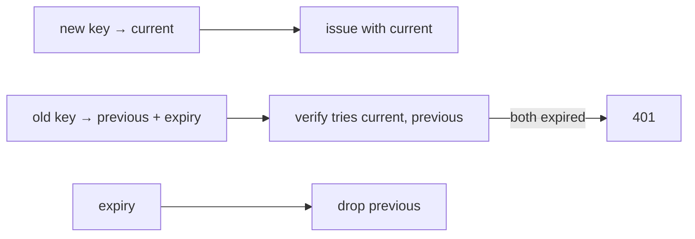

# S0093 — key-rotation runbook

> **Status:** todo · **Phase:** [[README]] · Parent: [[../../../feature_list/Jord/todo/jord-F0019-security-pass|jord-F0019]] · After ship: [[../../../tech_space/jord/auth/README]]

## Routing (who / how long / which model)

| | |
|--|--|
| **Suggested agent** | **heimdall** (runbook) + **sindri** (multi-key verification) |
| **Companion skills** | `.agents/skills/security-and-hardening/` · `.agents/skills/graft/` · `.agents/skills/documentation-and-adrs/` |
| **Suggested model** | `claude-sonnet-5-5-high` |
| **Est. time** | **2–3 h** |
| **Parallel?** | **No** |

## Goal

Every signing secret can be rotated without an outage: JWT signing key, local blob HMAC key, project secret/publishable keys, and (from S0067/S0071) provider credentials. Verification accepts old **and** new during a documented overlap window; the runbook says exactly what to run, in what order, and how to prove it.

## Why now

`jord-F0019` requires a rotation runbook; without multi-key verification, rotating the JWT key logs every user out at once.

## Context (read before coding)

| Kind | Where |
|------|-------|
| Intent | [[../../../feature_list/Jord/todo/jord-F0019-security-pass|jord-F0019]] |
| Code today | `cloud/jord/src/auth/{jwt,token}.ts` · `cloud/jord/src/storage/{sign-policy,local}.ts` · project keys from [[S0043-project-registry-api|S0043]] |
| As-built | [[../../../tech_space/jord/auth/README]] · [[../../../tech_space/jord/blobs/README]] |
| Tests | `cloud/jord/src/auth/token.test.ts` |

**Do not break:** existing tokens during rotation; the signed-URL 1 h TTL clamp; revoke semantics from [[done/S0076-sessions-claims|S0076]].

## In scope

- Key sets (not single keys): `current` + `previous` with an expiry; verification tries each; issuance always uses `current`.
- Commands: rotate JWT key, rotate blob HMAC key, rotate a project key, revoke a compromised key immediately (no overlap).
- Runbook: pre-checks, order of operations, overlap duration, what breaks if you skip a step, rollback.
- Drill: rotate in a local instance, prove a token minted before rotation still verifies (within overlap) and fails after `previous` expires.
- Tests: dual-key verification; expired previous key rejected; re-signed URLs with the new key work.

## Out of scope

KMS integration (the runbook states it as the production hardening path) · automatic rotation schedules.

## Diagram

## Steps (do in order)

1. Read jwt/token + sign-policy; list every secret with a verification path.
2. Implement the key-set model for each.
3. Add rotation commands/endpoints.
4. Write the runbook with the drill transcript.
5. Tests: overlap, expiry, immediate revoke.
6. Typecheck + test; paste proof.
7. **docs_man**: auth + blobs tech_space rotation sections; tick card.

## Done when

- [ ] Rotation accepts old + new during the overlap (tested)
- [ ] After overlap, old keys fail (tested)
- [ ] Immediate revoke path exists for a compromised key
- [ ] Runbook has exact commands and a pasted drill
- [ ] Proof pasted

## Proof

| Date | Command | Result |
|------|---------|--------|
| | `pnpm --filter @altr/jord-server test` | |

## After ship

| Update | Path |
|--------|------|
| tech_space | `Docs/tech_space/jord/auth/README.md` |
| Queue | [[README]] |
