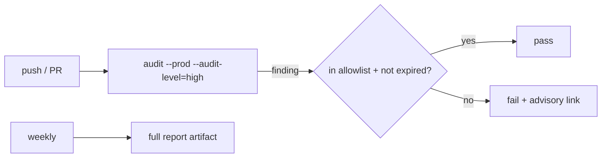

# S0094 — dependency audit in CI

> **Status:** todo · **Phase:** [[README]] · Parent: [[../../../feature_list/Jord/todo/jord-F0019-security-pass|jord-F0019]] · After ship: [[../../../tech_space/jord/overview/README#ci]]

## Routing (who / how long / which model)

| | |
|--|--|
| **Suggested agent** | **heimdall** |
| **Companion skills** | `.agents/skills/security-and-hardening/` · `.agents/skills/ci-security-scanning-with-strix/` (only if a deeper scan is wanted) |
| **Suggested model** | `composer-2.5-fast` — one workflow job plus a policy file |
| **Est. time** | **45–75 min** |
| **Parallel?** | **No** |

## Goal

CI fails on a known high/critical vulnerability in **production** dependencies, with a checked-in allowlist (package, advisory id, reason, expiry) so a false positive or an unavoidable transitive cannot silently break the build, and a non-blocking weekly report for dev dependencies.

## Why now

`jord-F0019` asks for it, and the workspace has grown (`@aws-sdk`, OTel, Monaco, image codecs) exactly where advisories appear.

## Context (read before coding)

| Kind | Where |
|------|-------|
| Intent | [[../../../feature_list/Jord/todo/jord-F0019-security-pass|jord-F0019]] |
| CI today | `.github/workflows/jord.yml` (`jord` + `jord-postgres` jobs, MinIO) |
| Package manager | pnpm workspace (`pnpm-lock.yaml`) |
| Tests | the workflow job itself is the proof; run locally with the same command |

**Do not break:** do not add a job that needs secrets; keep the existing jobs' runtime reasonable.

## In scope

- `pnpm audit --prod --audit-level=high` (or the equivalent that respects the lockfile) as a blocking job.
- Allowlist file with expiry dates; expired entries fail the job.
- Weekly scheduled run over all dependencies (non-blocking) with a summary artifact.
- Local script `pnpm audit:ci` so developers reproduce the failure.
- Doc: how to triage, how to add an exception, when to drop one.

## Out of scope

SAST of source code (that is S0092's pentest) · license compliance · container image scanning.

## Diagram

## Steps (do in order)

1. Read the workflow; add the job to the existing file (same runner + pnpm cache).
2. Add the allowlist file + expiry validation.
3. Add the scheduled full report.
4. Run the command locally; paste real output.
5. **docs_man**: overview CI section; tick card.

## Done when

- [ ] PR job fails on a high production advisory (demonstrated with a temporary pin)
- [ ] Allowlist entry requires a reason + expiry; expired entry fails
- [ ] Weekly job runs without secrets
- [ ] Proof pasted

## Proof

| Date | Command | Result |
|------|---------|--------|
| | `pnpm audit --prod --audit-level=high` | |

## After ship

| Update | Path |
|--------|------|
| tech_space | `Docs/tech_space/jord/overview/README.md` |
| Queue | [[README]] |
