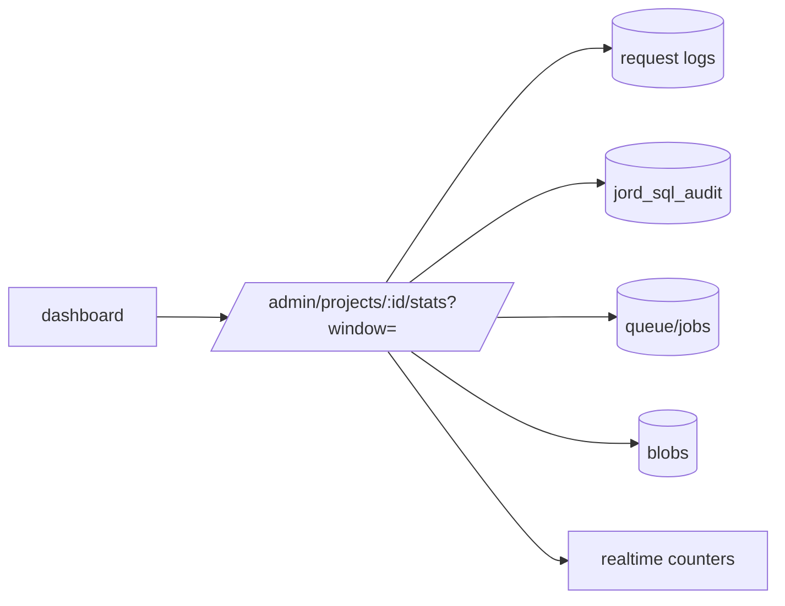

# S0095 — `GET /admin/projects/:id/stats`

> **Status:** todo · **Depends on** [[S0043-project-registry-api|S0043]] · **Phase:** [[README]] · Parent: [[../../../feature_list/Jord/todo/jord-F0022-project-dashboard|jord-F0022]] · After ship: [[../../../tech_space/jord/studio/README]]

## Routing (who / how long / which model)

| | |
|--|--|
| **Suggested agent** | mimir → **sindri** |
| **Companion skills** | `.agents/skills/supabase-postgres-best-practices/` · `.agents/skills/graft/` |
| **Suggested model** | `claude-sonnet-5-5-high` — aggregate query correctness |
| **Est. time** | **2.5–3 h** |
| **Parallel?** | **No** — the dashboard UI is built against this shape |

## Goal

One endpoint returns the dashboard's numbers for a window (`?window=1h|24h|7d`): request counts by method/status, error rate, p50/p95 latency, write-queue depth, table count + row estimates, database size, blob bytes, policy count, job failures, realtime subscribers/events. No second telemetry pipeline — read existing logs/audit/queue tables.

## Why now

`jord-F0022` names this endpoint; building charts against ad-hoc client queries would drift from what the server actually records.

## Context (read before coding)

| Kind | Where |
|------|-------|
| Intent | [[../../../feature_list/Jord/todo/jord-F0022-project-dashboard|jord-F0022]] (Blocks + "not a second telemetry pipeline") |
| Code today | `cloud/jord/src/logs/` · `jord_sql_audit` · `cloud/jord/src/queue.ts` · `cloud/jord/src/jobs/` · `blobs/` |
| Realtime | subscriber counters from [[S0086-live-toggle-snippet|S0086]] |
| Tests | `cloud/jord/src/app.test.ts` + a fixtures test for the aggregate |

**Do not break:** read-only route, admin-only, no full table scans on large request logs (bound the window and use indexes).

## In scope

- Response shape (versioned): `{ window, requests: { total, byStatus, byMethod, series[] }, latency: { p50, p95 }, errors: [...], queue: { depth }, db: { tables, rowsEstimate, sizeBytes }, blobs: { bytes, objects }, policies: n, jobs: { failures }, realtime: { subscribers, eventsPerMin } }`.
- Aggregates from existing sources only; percentile computation documented (approximate vs exact).
- Bounded cost: window + limit, index check, and a timeout that returns partial data with a flag rather than hanging.
- Tests: fixed fixture → known counts/percentiles; large-window cost check; unreachable DB → error shape the UI can render.
- OpenAPI entry.

## Out of scope

Retention/Prometheus · alerting · per-table breakdown beyond "top N".

## Diagram

## Steps (do in order)

1. Inventory what each source already records; drop anything not recorded instead of inventing instrumentation.
2. Write the aggregate queries + percentile approach.
3. Implement the endpoint with the window + timeout + partial flag.
4. Fixtures test with exact expected numbers.
5. OpenAPI + docs.
6. Typecheck + test; paste proof.
7. **docs_man**: studio tech_space dashboard data section; tick card.

## Done when

- [ ] Numbers reconcile with recorded requests for a fixed window (tested)
- [ ] Window bounded; query plan uses indexes
- [ ] Unreachable DB returns a renderable error
- [ ] No new telemetry pipeline added
- [ ] Proof pasted

## Proof

| Date | Command | Result |
|------|---------|--------|
| | `pnpm --filter @altr/jord-server test` | |

## After ship

| Update | Path |
|--------|------|
| tech_space | `Docs/tech_space/jord/studio/README.md` |
| Queue | [[README]] |
