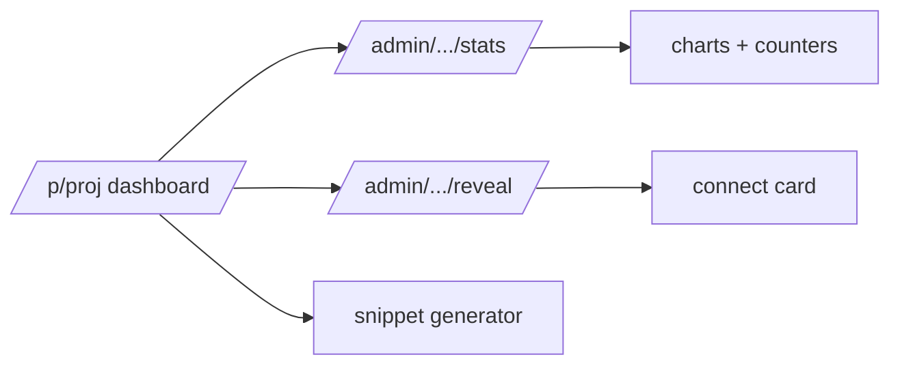

# S0096 — project dashboard UI

> **Status:** todo · **Depends on** [[S0095-project-stats-endpoint|S0095]] · **Phase:** [[README]] · Parent: [[../../../feature_list/Jord/todo/jord-F0022-project-dashboard|jord-F0022]] · After ship: [[../../../tech_space/jord/studio/README]]

## Routing (who / how long / which model)

| | |
|--|--|
| **Suggested agent** | mimir → **apollo** |
| **Companion skills** | `.agents/skills/apollo/` · `.agents/skills/animate/` (chart motion, restrained) · `.agents/skills/web-design-guidelines/` |
| **Suggested model** | `claude-sonnet-5-5-high` |
| **Est. time** | **3 h** |
| **Parallel?** | **No** |

## Goal

`/p/[project]` lands on a dashboard: health, request charts (reads/writes/errors, p50/p95, queue depth) with a 1 h · 24 h · 7 d switch, database report (tables, row estimates, size, blob bytes, policies, job failures), top tables, realtime counters, recent errors, and a **connect card** with the DB URL, publishable key, secret key reveal-once + rotate, barrier key, and a copy-ready env block + client init snippet.

## Why now

`jord-F0022` is the first menu item of every project and the handoff surface for app teams; everything else in Studio v2 assumes operators land here.

## Context (read before coding)

| Kind | Where |
|------|-------|
| Intent | [[../../../feature_list/Jord/todo/jord-F0022-project-dashboard|jord-F0022]] |
| Depends on | [[S0095-project-stats-endpoint|S0095]] · [[S0043-project-registry-api|S0043]] (keys, reveal/rotate) |
| Code today | `apps/jord-studio/src/app/p/[project]/page.tsx` (placeholder) · `components/connection-panel.tsx` |
| Charts | Apolyx charts (SVG + visx per kit rules) — do not add a chart library |
| Realtime snippet | reuse the generator from [[S0086-live-toggle-snippet|S0086]] |

**Do not break:** no credential in page HTML or the client bundle — reveal is a separate audited call; archived project shows the 410 state; unreachable DB shows the failure, not empty charts.

## In scope

- Layout: health row → charts (window switch) → database report → top tables → realtime → recent errors → connect card.
- Charts: reads/writes/errors series, latency percentiles, queue depth; accessible (labels, values available as text, no color-only meaning).
- Connect card: fields with copy buttons, secret key reveal (audited) + rotate with confirm, and a reveal-once note; env block + client snippet tabs.
- States: loading skeletons, empty (new project), error (DB unreachable), archived.
- Window switch persists in the URL (`?window=24h`).

## Out of scope

Alerting thresholds · long-term history beyond the windows · billing/quota cards.

## Diagram

## Steps (do in order)

1. Load apollo; read the placeholder page + connection panel.
2. Build the layout + data binding to the stats endpoint.
3. Build the charts from Apolyx primitives with accessible text equivalents.
4. Build the connect card (reveal/rotate audited; snippet tabs).
5. Wire loading/empty/error/archived states; window in the URL.
6. Typecheck + build; verify no secret in the bundle; paste proof.
7. **docs_man**: studio tech_space dashboard section; tick card.

## Done when

- [ ] Dashboard loads real numbers and reconciles with the endpoint
- [ ] Window switch works and is URL-persisted
- [ ] Secret key is reveal-once and never in HTML/bundle (checked)
- [ ] Rotation invalidates the old secret (checked with a client request)
- [ ] Unreachable DB shows a failure state
- [ ] Proof pasted

## Proof

| Date | Command | Result |
|------|---------|--------|
| | `pnpm --filter @altr/jord-studio build` | |

## After ship

| Update | Path |
|--------|------|
| tech_space | `Docs/tech_space/jord/studio/README.md` |
| Queue | [[README]] |
