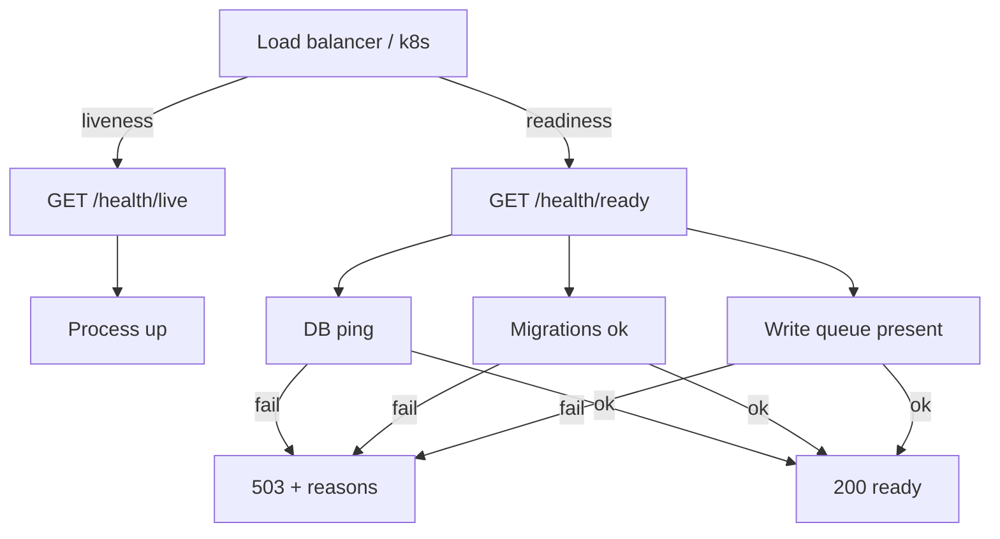

# S0034 — health live + ready probes

> **Status:** done  
> **Phase:** [[../README]] · Parent feature: [[../../../../feature_list/Jord/done/jord-F0013-production-ops|jord-F0013]] · After ship: [[../../../../tech_space/jord/overview/README]]

## Routing (who / how long / which model)

| | |
|--|--|
| **Suggested agent** | **mimir → sindri** (server HTTP). heimdall reviews route inventory only if auth matrix changes |
| **Companion skills** | `.agents/skills/graft/` · `.agents/skills/hono-typescript/` · (optional) `.agents/skills/nodejs-backend-patterns/` |
| **Suggested model** | `composer-2.5-fast` or `gpt-5.6-sol-medium` — small, well-bounded HTTP change |
| **Est. time** | **45–75 min** |
| **Parallel?** | **No** — one AI on this file only |

## Goal

Replace the single opaque `/health` “always ok” signal with **Kubernetes-style** probes: **live** = process up; **ready** = DB reachable + migrations applied + write queue accepting work.

## Why now

jord-F0013 needs deployability. Operators cannot put Jord behind a load balancer without a ready check that fails when the DB is down. Keep `/health` as a thin alias or deprecate clearly — do not leave three conflicting shapes undocumented.

## Context (read before coding)

| Kind | Open |
|------|------|
| Intent | [[../../../../feature_list/Jord/INDEX]] P1 · [[../../../../feature_list/Jord/done/jord-F0006-apis]] |
| As-built | [[../../../../tech_space/jord/overview/README]] |
| Code today | `cloud/jord/src/http/health.ts` · wired from `cloud/jord/src/app.ts` |
| Auth | `cloud/jord/src/auth/route-inventory.ts` treats `/health` and `/health/*` as public `health` |
| Tests | `cloud/jord/src/http/health.test.ts` · `app.test.ts` · `http-hardening.test.ts` · `principals.test.ts` · `part-c.test.ts` inventory |

**Do not break:** public unauthenticated access to probes; CORS behavior on health paths; existing clients that hit `/health` (kept as live + dialect metadata).

## In scope

- `GET /health/live` → **200** `{ ok: true }` when the HTTP process is serving (no DB required)
- `GET /health/ready` → **200** when all ready checks pass; **503** with a small JSON reason map when any fail:
  - DB: one cheap query / ping via `deps.jord`
  - Migrations: baseline applied (reuse existing migration bookkeeping if present; do not invent a second ledger)
  - Write queue: `enqueueWrite` exists and `pending()` is finite (queue object present — not “draining forever”)
- Keep `GET /health` as **live + dialect metadata** for back-compat
- Route inventory + principal tests updated so probes stay public
- Vitest coverage for live 200, ready 200 on healthy fixture, ready 503 when jord ping fails (mock or close client)

## Out of scope

- OpenTelemetry · structured JSON logs → [[S0035-structured-json-logs|S0035]]
- Shared rate-limit / idempotency tables · LISTEN · Dockerfile · backup drill (later P1 cards)
- Auth on probes · Studio UI for health

## Diagram

## Steps (do in order)

1. Graft / read `createJordApp` health handler and route inventory.
2. Add `live` + `ready` handlers next to existing `/health` (prefer small module under `cloud/jord/src/http/` if `app.ts` is already huge).
3. Ready check: try/catch around dialect-safe ping; surface `{ ok: false, reasons: { db?: string, migrations?: string, queue?: string } }` on 503.
4. Update route inventory + any allow-lists that hardcode `/health`.
5. Tests: live without jord; ready success; ready failure path.
6. `pnpm --filter @altr/jord-server typecheck` + targeted vitest.
7. **docs_man**: update [[../../../../tech_space/jord/overview/README]] “not in yet” / HTTP section; tick this card; note on [[../README]].

## Done when (acceptance)

- [x] `GET /health/live` → 200 without DB
- [x] `GET /health/ready` → 200 on normal test app; 503 when DB ping fails
- [x] `/health` still works for existing callers (alias or documented equivalent)
- [x] Route inventory / auth tests still green for public health
- [x] Proof commands pasted below

## Proof

| Date | Command | Result |
|------|---------|--------|
| 2026-10-29 | `pnpm --filter @altr/jord-server typecheck` | exit 0 |
| 2026-10-29 | `pnpm --filter @altr/jord-server exec vitest run src/http/health.test.ts` | 5 passed |
| 2026-10-29 | `pnpm --filter @altr/jord-server exec vitest run src/app.test.ts -t "health reports"` | 1 passed |
| 2026-10-29 | `pnpm --filter @altr/jord-server exec vitest run src/policies/part-c.test.ts -t "fails the inventory"` | 1 passed |
| 2026-10-29 | `pnpm --filter @altr/jord-server exec vitest run src/auth/principals.test.ts` | 11 passed |

## After ship

| Update | Path |
|--------|------|
| tech_space | [[../../../../tech_space/jord/overview/README]] · [[../../../../tech_space/jord/auth/README]] |
| feature_list | [[../../../../feature_list/Jord/done/jord-F0013-production-ops\|jord-F0013]] (S0034 row → done) |
| Phase queue | [[../README]] S0034 → done |
