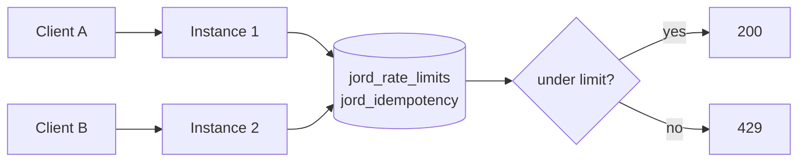

# S0036 — shared rate limit + idempotency in Postgres

> **Status:** **done** 2026-10-29 · **Phase:** [[../README]] · Parents: [[../../../../feature_list/Jord/done/jord-F0013-production-ops|jord-F0013]] + [[../../../../feature_list/Jord/done/jord-F0006-apis|jord-F0006]] · After ship: [[../../../../tech_space/jord/apis/README]]

## Routing (who / how long / which model)

| | |
|--|--|
| **Suggested agent** | mimir → **sindri** (server); **saga** reviews the migration only |
| **Companion skills** | `.agents/skills/graft/` · `.agents/skills/supabase-postgres-best-practices/` · `.agents/skills/hono-typescript/` |
| **Suggested model** | `claude-sonnet-5-5-high` — cross-instance correctness, not a mechanical edit |
| **Est. time** | **2–3 h** |
| **Parallel?** | **No** — one AI on this file |

## Goal

Rate-limit counters and idempotency records live in the project database, so N server instances behind one URL share the same budget and the same replay cache. libSQL keeps the in-process path.

## Why now

`jord-F0013` is the deployability feature; a second instance today doubles every limit and replays POSTs it never saw. No Redis — Postgres is the store by decision.

## Context (read before coding)

| Kind | Where |
|------|-------|
| Intent | [[../../../../feature_list/Jord/done/jord-F0013-production-ops|jord-F0013]] |
| As-built | [[../../../../tech_space/jord/apis/README]] · [[../../../../tech_space/jord/overview/README]] |
| Code today | `cloud/jord/src/http/data-rate-limit.ts` (in-memory buckets) · `cloud/jord/src/idempotency/store.ts` + `middleware.ts` (in-memory map) |
| Dialect seam | `elements/jord/src/adapter/{postgres,libsql}.ts` — new tables need both paths or a clear libSQL fallback |
| Tests | `cloud/jord/src/idempotency/idempotency.test.ts` · `cloud/jord/src/http/s0028.test.ts` |

**Do not break:** single-instance behavior and the current 429 body shape; libSQL file mode must still work offline.

## In scope

- Migration `00xx_rate_limit_idempotency`: `jord_rate_limits(bucket, window_start, count)` and `jord_idempotency(key, principal, route, request_hash, status, response_json, expires_at)`, with a TTL index.
- Postgres store implementations behind the existing interfaces; libSQL keeps memory.
- Atomic upsert (`INSERT … ON CONFLICT DO UPDATE … RETURNING count`) so the check is one round trip.
- Idempotency replay returns the stored status + body; same key with a different request hash → **409**.
- Sweeper for expired rows (job kind or `pg_cron`-free interval on the existing job runner).
- Tests: two clients sharing one limit; replay across two "instances" (two stores on one DB).

## Out of scope

Redis · per-tenant quotas · rate-limit dashboards → later cards. LISTEN fan-out → [[S0037-listen-seq-fanout|S0037]].

## Diagram

## Steps

1. Read the current store interfaces with graft; keep them, swap the implementation.
2. Add migration + schema types in `elements/jord` (both dialects: libSQL no-op table or memory fallback documented).
3. Implement `pg` stores; select by dialect at app wiring in `cloud/jord/src/app.ts`.
4. Add the expiry sweep to `cloud/jord/src/jobs/kinds.ts`.
5. Tests for shared limit, replay, hash mismatch.
6. `pnpm --filter @altr/jord-server typecheck && pnpm --filter @altr/jord-server test`.
7. **docs_man**: update `tech_space/jord/apis/README` + overview; tick this card.

## Done when

- [x] Two app instances on one Postgres share one budget (test)
- [x] Replayed idempotent POST returns the original response, second instance included
- [x] Different body with the same key → 409
- [x] libSQL tests unchanged and green
- [x] Proof pasted below

## Proof

| Date | Command | Result |
|------|---------|--------|
| 2026-10-29 | `pnpm --filter @altr/jord-server typecheck` | pass (tsc --noEmit, 0 errors) |
| 2026-10-29 | `pnpm --filter @altr/jord-server test` (no PG, file only) | 23 files passed · 141 tests passed · 15 skipped (PG-gated) |
| 2026-10-29 | `pnpm --filter @altr/jord-server test` (`JORD_TEST_POSTGRES_URL` → pgvector/pg16) | 23 files passed · 201 tests passed · 8 skipped (pre-existing, unrelated) · incl. 12/12 in `idempotency/shared-state.test.ts` |
| 2026-10-29 | `pnpm --filter @altr/jord typecheck && test` | pass · 84 passed · 9 skipped (PG-gated) |

## After ship

| Update | Path |
|--------|------|
| tech_space | `Docs/tech_space/jord/apis/README.md` |
| tech_space | `Docs/tech_space/jord/writes/README.md` |
| feature_list | [[../../../../feature_list/Jord/done/jord-F0006-apis|jord-F0006-apis]] · [[../../../../feature_list/Jord/done/jord-F0003-writes|jord-F0003-writes]] |
| feature_list | [[../../../../feature_list/Jord/done/jord-F0013-production-ops|jord-F0013]] task row |
| Queue | [[../README]] |
