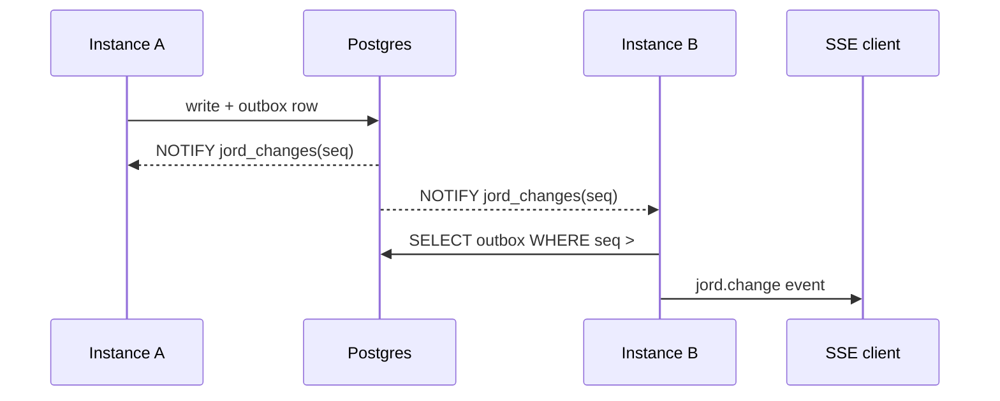

# S0037 — LISTEN/NOTIFY seq fan-out + shared watermark

> **Status:** **done** 2026-10-29 · **Phase:** [[../README]] · Parent: [[../../../../feature_list/Jord/todo/jord-F0013-production-ops|jord-F0013]] · After ship: [[../../../../tech_space/jord/realtime/README]]

## Routing (who / how long / which model)

| | |
|--|--|
| **Suggested agent** | mimir → **sindri** |
| **Companion skills** | `.agents/skills/graft/` · `.agents/skills/supabase-postgres-best-practices/` · `.agents/skills/hono-typescript/` |
| **Suggested model** | `claude-sonnet-5-5-high` — connection lifecycle and ordering |
| **Est. time** | **2–3 h** |
| **Parallel?** | **No** |

## Goal

Every instance receives new outbox sequence numbers through one dedicated `LISTEN` connection and delivers them to its own SSE clients; the commit watermark is read from the shared table instead of process memory.

## Why now

`jord-F0009` shipped the trigger + outbox + SSE to one process. A second instance serves a subscriber that never hears about the other's writes — the exact failure `jord-F0013` exists to remove.

## Context (read before coding)

| Kind | Where |
|------|-------|
| Intent | [[../../../../feature_list/Jord/todo/jord-F0013-production-ops|jord-F0013]] · [[../../../../feature_list/Jord/todo/jord-F0026-live-data-client|jord-F0026]] consumes this |
| As-built | [[../../../../tech_space/jord/realtime/README]] |
| Code today | `cloud/jord/src/realtime/bus.ts` · `outbox.ts` · `watermark.ts` · `deliver.ts` · `pg_notify` trigger in `elements/jord/migrations` |
| Tests | `cloud/jord/src/realtime/bus.test.ts` · `outbox.test.ts` · `ws-policy.test.ts` |

**Do not break:** libSQL path (polling stays), retention/410 resync contract, per-table seq monotonicity.

## In scope

- One long-lived `pg` client reserved for `LISTEN jord_changes`; reconnect with backoff; log on drop.
- NOTIFY payload carries `{ table, seq, txid }` only — rows are re-read from the outbox, never trusted from the payload.
- Fan out to local subscribers through the existing bus; dedupe by seq.
- Watermark read from the shared table; do not advance past an in-flight local transaction.
- One LISTEN connection per process, released on shutdown (no leaks in tests).
- Tests: two app instances on one Postgres, write on A, SSE on B receives it.

## Out of scope

Presence/broadcast ([[S0083-presence-broadcast|S0083]]) · cross-project channels ([[S0084-realtime-app-endpoint|S0084]]) · subscription auth changes.

## Diagram

## Steps (do in order)

1. Graft the realtime module; identify where the local bus currently publishes.
2. Add `listen.ts` with connect/retry/shutdown and route events into `bus.ts`.
3. Replace the process-local watermark with a DB read; keep the libSQL polling branch.
4. Wire start/stop in `app.ts` startup + graceful shutdown.
5. Add the two-instance SSE test (skip when `JORD_TEST_PG_URL` is unset).
6. Typecheck + test; paste proof.
7. **docs_man**: update realtime tech_space; tick card.

## Done when

- [x] Write on instance A arrives on an SSE stream held by instance B (test)
- [x] LISTEN reconnects after a forced drop without losing seqs (no silent gap; 410 resync allowed)
- [x] libSQL suite unchanged
- [x] Proof pasted

## Proof

| Date | Command | Result |
|------|---------|--------|
| 2026-10-29 | `pnpm --filter @altr/jord-server typecheck` | pass |
| 2026-10-29 | `pnpm --filter @altr/jord-server test` | **142 passed**, 17 skipped (incl. 2 live LISTEN cases when `JORD_TEST_POSTGRES_URL` unset) |
| 2026-10-29 | `parseNotifyPayload` unit cases in `listen.test.ts` | pass |

Shipped: `cloud/jord/src/realtime/listen.ts` · shared watermark in `outbox.ts` · migration `elements/jord/migrations/postgres/0008_listen_watermark.sql` · boot wires `realtimeListenUrl` from `DATABASE_URL`. Live two-instance + reconnect tests run when `JORD_TEST_POSTGRES_URL` is set.

## After ship

| Update | Path |
|--------|------|
| tech_space | `Docs/tech_space/jord/realtime/README.md` |
| Queue | [[../README]] |
