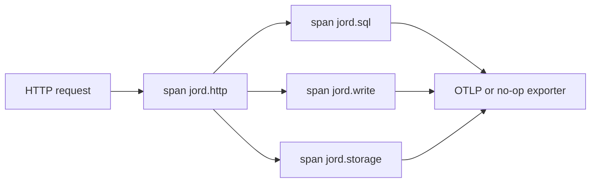

# S0039 — OpenTelemetry traces + metrics

> **Status:** **done** 2026-11-01 · **Phase:** [[../README]] · Parent: [[../../../../feature_list/Jord/done/jord-F0013-production-ops|jord-F0013]] · After ship: [[../../../../tech_space/jord/overview/README]]

## Routing (who / how long / which model)

| | |
|--|--|
| **Suggested agent** | mimir → **sindri** |
| **Companion skills** | `.agents/skills/graft/` · `.agents/skills/nodejs-backend-patterns/` |
| **Suggested model** | `gpt-5.6-sol-medium` |
| **Est. time** | **2–3 h** |
| **Parallel?** | **No** |

## Goal

An opt-in OTel pipeline: one request span (method, route, status, duration), child spans for SQL, write-queue jobs and storage calls, plus counters for requests, SQL errors, queue depth and blob bytes.

## Why now

Operators have JSON logs ([[S0035-structured-json-logs|S0035]]) and probes; nothing yet shows where a slow request spends its time.

## Context (read before coding)

| Kind | Where |
|------|-------|
| Intent | [[../../../../feature_list/Jord/done/jord-F0013-production-ops|jord-F0013]] |
| As-built | [[../../../../tech_space/jord/overview/README]] |
| Code today | `cloud/jord/src/telemetry/` · `cloud/jord/src/app.ts` · `cloud/jord/src/queue.ts` · `cloud/jord/src/sql/routes.ts` · `cloud/jord/src/storage/` |
| Tests | `cloud/jord/src/telemetry/otel.test.ts` |

**Do not break:** tests must not need a collector; no PII or SQL parameter values in span attributes.

## In scope

- `@opentelemetry/sdk-node` + HTTP auto-instrumentation, opt-in via `JORD_OTEL_ENABLED` (endpoint optional → no-op exporter).
- Manual spans: `jord.sql` (statement kind + duration, **no params**), `jord.write` (job kind, wait time), `jord.storage` (op, bucket, bytes).
- Metrics: `jord_requests_total{route,status}`, `jord_sql_errors_total`, `jord_write_queue_depth`, `jord_blob_bytes_written`.
- Trace id copied into the JSON log line so logs and traces join.
- Test: OTel on with an in-memory exporter produces the expected span tree for one request.

## Out of scope

Grafana dashboards · alerting · changing log shipping.

## Diagram

## Steps (do in order)

1. Graft app middleware order; insert after request-id so every span has it. ✅
2. Add `cloud/jord/src/telemetry/` (init, spans, metrics); load before the app in `index.ts`. ✅
3. Instrument SQL, write queue, storage. ✅
4. Add trace id to the JSON logger. ✅
5. In-memory exporter test. ✅
6. Typecheck + test; paste proof. ✅
7. **docs_man**: overview tech_space env table (+ `.env.example`); tick card. ✅

## Done when

- [x] OTel off by default; suite behavior unchanged
- [x] One request yields http → sql/write/storage spans
- [x] No SQL params or secrets in attributes (test asserts)
- [x] Env vars documented
- [x] Proof pasted

## Proof

| Date | Command | Result |
|------|---------|--------|
| 2026-11-01 | `pnpm --filter @altr/jord-server typecheck` | exit 0 |
| 2026-11-01 | `pnpm --filter @altr/jord-server exec vitest run src/telemetry/otel.test.ts` | 3 passed |
| 2026-11-01 | `pnpm --filter @altr/jord-server test` | **154 passed** \| 17 skipped (25 files + 1 skipped) |

## After ship

| Update | Path |
|--------|------|
| tech_space | `Docs/tech_space/jord/overview/README.md` |
| Queue | [[../README]] |
