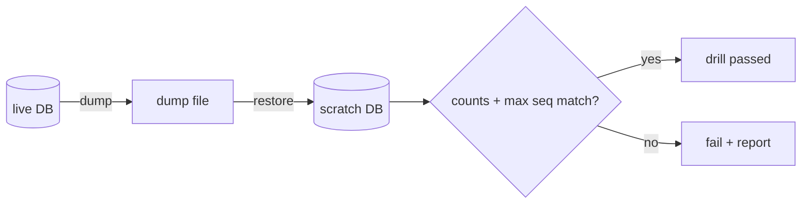

# S0040 — backup + restore drill

> **Status:** **done** 2026-11-01 · **Phase:** [[../README]] · Parent: [[../../../../feature_list/Jord/todo/jord-F0013-production-ops|jord-F0013]] · After ship: [[../../../../tech_space/jord/overview/README]]

## Routing (who / how long / which model)

| | |
|--|--|
| **Suggested agent** | mimir → **sindri** (scripts) · **heimdall** reviews what leaves the box |
| **Companion skills** | `.agents/skills/graft/` · `.agents/skills/supabase-postgres-best-practices/` |
| **Suggested model** | `gpt-5.6-sol-medium` |
| **Est. time** | **60–90 min** |
| **Parallel?** | **No** |

## Goal

`backup` / `restore-drill` scripts plus a documented drill: dump → restore into a scratch database → verify counts and outbox seq → record the transcript. Works for Postgres and the file libSQL DB.

## Why now

No restore path is stated anywhere; a production feature set without a proven restore is not deployable.

## Context (read before coding)

| Kind | Where |
|------|-------|
| Intent | [[../../../../feature_list/Jord/todo/jord-F0013-production-ops|jord-F0013]] |
| As-built | [[../../../../tech_space/jord/overview/README]] |
| Code today | `cloud/jord/scripts/backup.sh` · `restore-drill.sh` · `restore-drill-compare.mjs` · `cloud/jord/src/load-env.ts` |
| Blobs | bytes live outside SQL — the drill states blob handling explicitly (`data/blobs/` or the S3 bucket) |

**Do not break:** never restore over a live database; the script must refuse a target that matches `DATABASE_URL` / `JORD_DATABASE_URL`.

## In scope

- `scripts/backup.sh` (`pg_dump --format=custom`, or copy the libSQL file) and `scripts/restore-drill.sh` (restore into `*_drill`, compare per-table row counts and `jord_changes` max seq).
- Guard rails: target ≠ source; explicit `--yes` for the destructive restore.
- Doc section with exact commands and the pasted output from a real run.
- Blob scope: what a database backup does **not** cover.

## Out of scope

Scheduled backups · off-site upload · PITR · hosted `libsql://` provider dumps.

## Diagram

## Steps (do in order)

1. Confirm env names in `load-env.ts` (`DATABASE_URL` canonical; `JORD_DATABASE_URL` optional live alias). ✅
2. Write both scripts; POSIX bash that also runs in Git Bash on Windows. ✅
3. Run the drill against local Postgres + file libSQL; capture output. ✅
4. Write the tech_space section (commands, restore expectations, blob caveat). ✅
5. **docs_man**: overview tech_space (+ STATUS); tick card → `done/`. ✅

## Done when

- [x] Drill passes locally with pasted output
- [x] Script refuses to restore over the live URL
- [x] Blob handling stated, not implied
- [x] Proof pasted

## Proof

| Date | Command | Result |
|------|---------|--------|
| 2026-11-01 | `./scripts/backup.sh --url file:./data/jord.db` | ok · 385024 bytes · blob note printed |
| 2026-11-01 | `./scripts/restore-drill.sh --dump … --source-url file:./data/jord.db` (no `--yes`) | exit 2 · refuses |
| 2026-11-01 | same with `--target-url file:./data/jord.db --yes` | exit 1 · refuses live |
| 2026-11-01 | `./scripts/restore-drill.sh --dump … --source-url file:./data/jord.db --yes` | **PASS** · counts + `max(jord_changes.seq)` match |
| 2026-11-01 | `JORD_BACKUP_PG_CONTAINER=jord-s0037-pg ./scripts/backup.sh --url postgres://…/jord_s0040` | ok · 34084-byte custom dump |
| 2026-11-01 | `…/restore-drill.sh --dump … --source-url postgres://…/jord_s0040 --yes` | **PASS** → `jord_s0040_drill` · records=1 · max seq=1 · migrations=8 |

Shipped: `cloud/jord/scripts/backup.sh` · `restore-drill.sh` · `restore-drill-compare.mjs` (Windows fallback when `sqlite3` CLI missing) · optional `seed-restore-drill-pg.ts` for empty Postgres proof · `pnpm backup` / `pnpm restore-drill`.

## After ship

| Update | Path |
|--------|------|
| tech_space | `Docs/tech_space/jord/overview/README.md` |
| Queue | [[../README]] |
