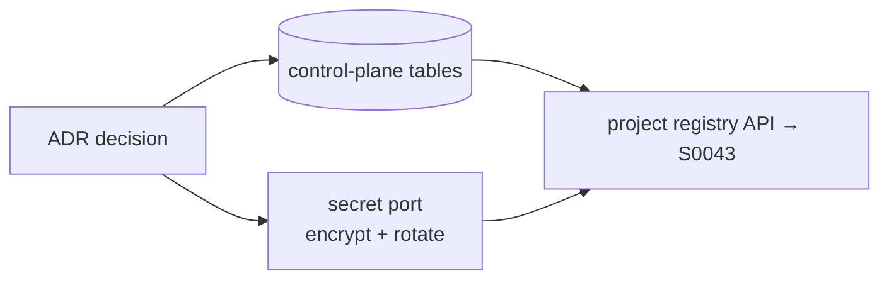

# S0042 — control-plane store + ADR

> **Status:** **done** 2026-11-01 · **Phase:** [[../README]] · Parent: [[../../../../feature_list/Jord/todo/jord-F0021-projects-provisioning|jord-F0021]] · After ship: [[../../../../tech_space/jord/studio/README]] · ADR: [[../../../../tech_space/jord/studio/ADR-control-plane-store]]

## Routing (who / how long / which model)

| | |
|--|--|
| **Suggested agent** | **saga** owns the ADR + schema; sindri wires the port |
| **Companion skills** | `.agents/skills/architecture-decision-records/` · `.agents/skills/supabase-postgres-best-practices/` · `.agents/skills/docs-man/` |
| **Suggested model** | `claude-sonnet-5-5-high` — design decision, not mechanical |
| **Est. time** | **2–3 h** |
| **Parallel?** | **No** — every Studio v2 card depends on this shape |

## Goal

Write `ADR-control-plane-store` **and** land its minimum shape: a `jord_projects` table (id, slug, engine, target, TLS mode, db user, notes, status, created/archived), the encrypted-secret port (`putSecret` / `getSecret` / `rotate`), and key rows for publishable/secret/barrier keys. Hosted provisioning stays out — the ADR picks **register + test**.

## Why now

[[../../../../feature_list/Jord/todo/jord-F0021-projects-provisioning|jord-F0021]] is the foundation of every Studio v2 card, and it has an open question (control plane vs project DB, secret-at-rest mechanism). Coding before that is decided creates two competing homes for project metadata.

## Context (read before coding)

| Kind | Where |
|------|-------|
| Intent | [[../../../../feature_list/Jord/todo/jord-F0021-projects-provisioning|jord-F0021]] · overlap [[../../../../feature_list/Jord/done/jord-F0012-studio|jord-F0012]] |
| As-built | [[../../../../tech_space/jord/studio/README]] |
| Code today | single database from env (`cloud/jord/src/load-env.ts`, `elements/jord/src/url.ts`) · Studio BFF `apps/jord-studio/src/lib/jord-proxy.ts` |
| Existing ADR style | `Docs/tech_space/jord/apis/ADR-functions-v2.md`, `Docs/plan/Jord/phase-02/Jord-S0021/ADR-threat-model.md` |

**Do not break:** the env-backed single-database mode must keep working as a zero-project install; no secret may appear in JSON.

## Options the ADR must settle

| Question | Options | Must state |
|----------|---------|-----------|
| Store | separate libSQL file · separate Postgres db/schema · encrypted JSON file | why, and migration path |
| Secret at rest | OS keyring · KMS · AES-GCM file + `JORD_MASTER_KEY` env | rotation + what happens if the key is missing |
| Create vs register | register only (intent) | what "provision" would need later |

## In scope

- ADR file with decision, consequences, rejected options.
- Migration for `jord_projects` + `jord_project_keys` (hashed secret, prefix, last4, created/rotated).
- Secret port with AES-GCM (or the decision) + unit test: encrypt → decrypt → rotate → old value rejected.
- Wiring: control-plane store injected into the app; no behavior change yet.

## Out of scope

The registry HTTP API ([[../S0043-project-registry-api|S0043]]) · wizard UI ([[../S0044-new-project-wizard|S0044]]) · route scoping ([[../S0045-project-scoped-routes|S0045]]).

## Diagram

## Steps (do in order)

1. Draft the ADR with the option table filled; get a human yes on the store choice.
2. Add the migration + schema types in `elements/jord`.
3. Implement the secret port with rotation + test.
4. Wire the store into `createJordApp` without exposing routes yet.
5. `pnpm --filter @altr/jord typecheck && pnpm --filter @altr/jord-server test`.
6. **docs_man**: ADR into `tech_space/jord/studio/`, tick card.

## Done when

- [x] ADR merged with a stated decision and rejected options
- [x] `jord_projects` / `jord_project_keys` exist on both dialects
- [x] Secret encrypt/decrypt/rotate test passes; missing master key fails loudly
- [x] No existing test changed
- [x] Proof pasted

## Proof

| Date | Command | Result |
|------|---------|--------|
| 2026-11-01 | `pnpm --filter @altr/jord typecheck` | exit 0 |
| 2026-11-01 | `pnpm --filter @altr/jord test` | **94 passed** \| 9 skipped (103) · includes `secret-port` (9) + `projects` migration (1) |
| 2026-11-01 | `pnpm --filter @altr/jord-server test` | **154 passed** \| 17 skipped (171) |

**Decision (ADR):** control-plane tables on the **server primary** `DATABASE_URL` (not project targets); secrets via **AES-256-GCM + `JORD_MASTER_KEY`**; **register + test** only.

## After ship

| Update | Path |
|--------|------|
| tech_space | `Docs/tech_space/jord/studio/README.md` + ADR |
| Queue | [[../README]] |
