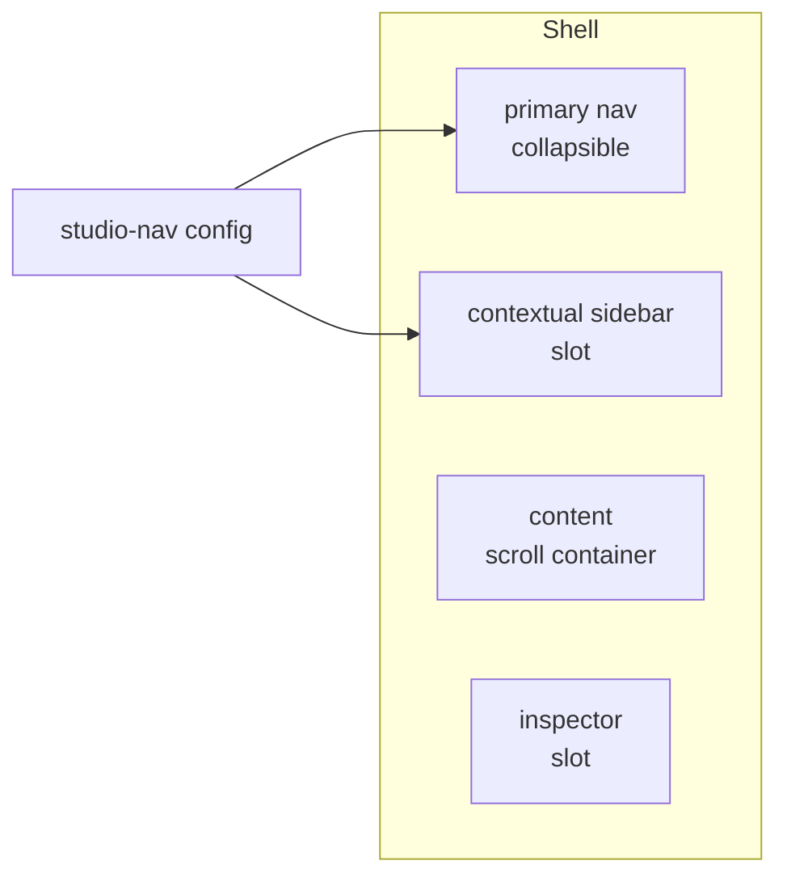

# S0046 — three-pane Studio shell

> **Status:** **done** 2026-11-01 · **Depends on** [[S0045-project-scoped-routes|S0045]] · **Phase:** [[../README]] · Parent: [[../../../../feature_list/Jord/todo/jord-F0023-studio-shell-v2|jord-F0023]] · After ship: [[../../../../tech_space/jord/studio/README]]

## Routing (who / how long / which model)

| | |
|--|--|
| **Suggested agent** | mimir → **apollo** |
| **Companion skills** | `.agents/skills/apollo/` · `.agents/skills/vercel-react-best-practices/` · `.agents/skills/fixing-accessibility/` |
| **Suggested model** | `claude-sonnet-5-5-high` |
| **Est. time** | **2.5–3 h** |
| **Parallel?** | **No** |

## Goal

One layout component renders **primary nav (icon-collapsible) + contextual sidebar slot + content + inspector slot**, and `studio-nav.ts` grows a per-section `contextual` descriptor so pages no longer invent their own column.

## Why now

Every Studio v2 screen assumes this frame. Today `studio-shell.tsx` + `studio-side-nav.tsx` are single-column and pages each build their own list.

## Context (read before coding)

| Kind | Where |
|------|-------|
| Intent | [[../../../../feature_list/Jord/todo/jord-F0023-studio-shell-v2|jord-F0023]] (pane table) |
| Code today | `apps/jord-studio/src/components/studio-shell.tsx` · `studio-side-nav.tsx` · `lib/studio-nav.ts` |
| Routes | `app/p/[project]/…` from [[S0045-project-scoped-routes|S0045]] |
| UI kit | `@altr/apolyx` `NavList`, `Sheet`, `Field`, `Tabs` — add missing pieces to the kit, not the app |

**Do not break:** Apolyx-first rule; no layout shift when the inspector opens; content keeps its scroll position across pane changes.

## In scope

- Shell grid with CSS variables for nav/sidebar widths; collapse state per project.
- Nav config: each section declares `{ id, label, icon, href, contextual?: 'tables' | 'jobs' | 'endpoints' | 'queries' | 'users' | 'buckets' }`.
- Layout primitives exported for pages: `<StudioSidebar>`, `<StudioContent>`, `<StudioInspector>` slots with correct scroll containers.
- Below tablet: contextual sidebar becomes a sheet, inspector becomes a full-height sheet.
- Empty/loading/error states for the sidebar column so a slow list does not collapse the grid.

## Out of scope

The sidebar contents themselves ([[done/S0047-contextual-sidebar|S0047]]) · the inspector behaviour ([[../S0048-right-inspector|S0048]]) · workspace tabs ([[../S0051-workspace-tabs|S0051]]) · theming.

## Diagram

## Steps (do in order)

1. Load apollo; read the current shell + nav; list every section and its future sidebar type.
2. Build the grid + slots from Apolyx primitives; keep the current visuals.
3. Extend the nav config with `contextual` and render a placeholder sidebar per section.
4. Add collapse + responsive behavior (sheet below tablet).
5. Keyboard pass: Tab order nav → sidebar → content; skip links.
6. Typecheck + build; paste proof.
7. **docs_man**: studio tech_space "shell" section; tick card.

## Done when

- [x] All existing screens render inside the new shell with no visual regression
- [x] Nav collapse persists per project
- [x] No layout shift when panes toggle
- [x] Tablet fallback uses sheets
- [x] Typecheck + build pass; proof pasted

## Proof

| Date | Command | Result |
|------|---------|--------|
| 2026-11-01 | `pnpm --filter @altr/jord-studio typecheck` | exit 0 |
| 2026-11-01 | `pnpm --filter @altr/jord-studio build` | exit 0 — `/p/[project]/…` routes intact |
| 2026-11-01 | `pnpm --filter @altr/jord-studio exec node --import tsx --test src/lib/studio-nav.test.ts` | 5 pass (contextual resolve) |

**Shipped:** CSS-var shell (`--jord-nav-w` / `--jord-sidebar-w`) · `StudioSidebar` / `StudioContent` / `StudioInspector` · nav `icon` + `contextual` · per-project collapse prefs · below-`lg` Sheets · skip links · placeholder contextual column with loading/empty/error frames.

## After ship

| Update | Path |
|--------|------|
| tech_space | `Docs/tech_space/jord/studio/README.md` |
| Queue | [[../README]] |
