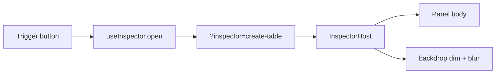

# S0048 — right inspector drawer

> **Status:** **done** 2026-11-01 · **Depends on** [[S0046-three-pane-shell|S0046]] · **Phase:** [[../README]] · Parent: [[../../../feature_list/Jord/todo/jord-F0023-studio-shell-v2|jord-F0023]] · After ship: [[../../../tech_space/jord/studio/README]]

## Routing (who / how long / which model)

| | |
|--|--|
| **Suggested agent** | mimir → **apollo** |
| **Companion skills** | `.agents/skills/apollo/` · `.agents/skills/fixing-accessibility/` · `.agents/skills/animate/` |
| **Suggested model** | `gpt-5.6-sol-medium` |
| **Est. time** | **2–3 h** |
| **Parallel?** | **No** |

## Goal

One inspector host in the shell: opens from the right over a dimmed + blurred content backdrop, traps focus, closes on ESC / click-away / back, restores focus, and is addressable as `?inspector=<id>` so a refresh or a shared link reopens the same task.

## Why now

Create table, insert row, policy editor and API details are all specified as inspector panels; without the host each page would ship its own overlay.

## Context (read before coding)

| Kind | Where |
|------|-------|
| Intent | [[../../../feature_list/Jord/todo/jord-F0023-studio-shell-v2|jord-F0023]] · [[../../../feature_list/Jord/todo/jord-F0025-tables-workspace-v2|jord-F0025]] |
| Code today | `components/{migrate-wizard-panel,record-detail,create-record-form}.tsx` (panel-ish, page-local) |
| UI kit | `@altr/apolyx` `Sheet` / overlay layer; if the mutation API is missing, add it to the kit (apollo) |
| Tests | keyboard + axe smoke via `playwright-cli` |

**Do not break:** the inspector never covers the primary nav; the page behind keeps scroll position; no double scrollbar.

## In scope

- `<InspectorHost>` + `useInspector()` (`open(id, props)`, `close()`), state in the URL (`?inspector=create-table&table=…`).
- Backdrop: dim + blur tokens only; `aria-modal`, labelled by the panel title; focus trap and restore.
- Width ~420–520 px, scrollable body, sticky footer for primary action; full-height sheet below tablet.
- ESC + click-away + browser back all close; deep link reopens with the same props.
- Motion: enter/exit under 200 ms, respects `prefers-reduced-motion`.
- Migrate the three existing page-local panels to the host as proof.

## Out of scope

Inspector contents (create table is [[../S0050-schema-picker-ui|S0050]], policies/APIs are [[../S0059-policies-apis-drawers|S0059]]) · split-pane resizing · drag-to-dock.

## Diagram

## Steps (do in order)

1. Load apollo + accessibility skills; check what `Sheet` already does.
2. Build the host + hook + URL sync.
3. Focus trap, restore, ESC/click-away, `prefers-reduced-motion`.
4. Port the migrate wizard, record detail and create-record form to it.
5. Keyboard + screen-reader smoke; typecheck + build.
6. **docs_man**: studio tech_space inspector section; tick card.

## Done when

- [x] Panels open/close with no layout shift and no lost scroll
- [x] Deep link reopens the same panel with props
- [x] Focus is trapped and restored; ESC and back close it
- [x] Reduced-motion respected
- [x] Three legacy panels migrated
- [x] Proof pasted

## Proof

| Date | Command | Result |
|------|---------|--------|
| 2026-11-01 | `pnpm --filter @altr/jord-studio exec node --import tsx --test src/lib/studio-inspector.test.ts src/lib/studio-nav.test.ts` | exit 0 |
| 2026-11-01 | `pnpm --filter @altr/jord-studio typecheck` | exit 0 |
| 2026-11-01 | `pnpm --filter @altr/jord-studio build` | exit 0 |

**Shipped:** `InspectorProvider` + `useInspector` URL sync (`?inspector=` + props); content-only `StudioInspector` with FocusScope, dim+blur backdrop, &lt;200ms motion + `useReducedMotion`; sticky chrome/footer; panels `create-record` · `record-detail` · `migrate`; legacy `/records/new` + `/records/[id]` redirect to deep links; records browser opens via hook; mobile full-height Sheet.

## After ship

| Update | Path |
|--------|------|
| tech_space | `Docs/tech_space/jord/studio/README.md` |
| Queue | [[../README]] |
