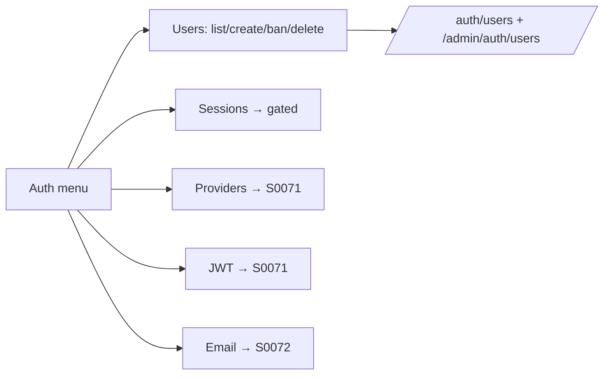

# S0070 — Auth console shell + Users section

> **Status:** done 2026-11-03 · **Depends on** [[S0069-auth-settings-store|S0069]] · **Phase:** [[../README]] · Parent: [[../../../feature_list/Jord/todo/jord-F0030-auth-console|jord-F0030]] · As-built: [[../../../tech_space/jord/studio/README#auth-console-s0070]]

## Routing (who / how long / which model)

| | |
|--|--|
| **Suggested agent** | mimir → **apollo** (Studio) with **heimdall** reviewing mutations |
| **Companion skills** | `.agents/skills/apollo/` · `.agents/skills/security-and-hardening/` · `.agents/skills/vercel-react-best-practices/` |
| **Suggested model** | `claude-sonnet-5-5-high` |
| **Est. time** | **2.5–3 h** |
| **Parallel?** | **No** |

## Goal

An **Auth** menu in Studio with sections Users · Sessions · Providers · URL configuration · JWT · Email · Rate limits · Settings, and a fully working **Users** section: list + search, create/invite, view and edit `user_metadata` / `app_metadata`, ban/disable, delete, revoke all sessions.

## Why now

Today only `/auth/users` exists with a basic panel; the requested console needs the navigation shell and one complete section to set the pattern.

## Context (read before coding)

| Kind | Where |
|------|-------|
| Intent | [[../../../feature_list/Jord/todo/jord-F0030-auth-console|jord-F0030]] (Users) |
| Depends on | [[S0069-auth-settings-store|S0069]] · [[S0047-contextual-sidebar|S0047]] (user list lives there) |
| Code today | `components/users-admin-panel.tsx` · `app/p/[project]/auth/` · `cloud/jord/src/auth/{admin,routes,identity}.ts` |
| Gate | Sections the server cannot back yet render **disabled with a reason** and a link to the owning card — never a fake toggle |

**Do not break:** existing disable/revoke semantics; no password hash or token in any response; every mutation audited.

## In scope

- Auth section nav (sub-nav or sidebar group) with the eight sections; each route exists and either works or shows the gated state with the dependency named.
- Users: list with search + pagination, row detail (id, email, created, last sign-in, metadata JSON), create/invite form, metadata editor with JSON validation, ban/disable with reason, delete with confirm, revoke all sessions.
- Sessions section shows a gated link until [[S0076-sessions-claims|S0076]].
- Empty/loading/error states; role-aware disabled actions for non-admins.

## Out of scope

Providers/URL/JWT/rate-limit forms ([[S0071-auth-console-sections|S0071]]) · email templates ([[S0072-email-templates|S0072]]) · org/team management.

## Diagram

## Steps (do in order)

1. Load apollo; read the existing users panel and auth routes.
2. Build the Auth section nav + route stubs with explicit gated states.
3. Complete Users CRUD + metadata editing + ban/delete/revoke.
4. Add audits for each mutation; role-aware UI.
5. Typecheck + build; run the flows against a local instance; paste proof.
6. **docs_man**: studio tech_space auth section map; tick card.

## As built

| Piece | Fact |
|-------|------|
| Nav | `STUDIO_NAV` gains an **Auth** group with all eight sections; Users keeps the `users` contextual sidebar; `users` left the Database group |
| Routes | `/p/[project]/auth/{users,sessions,providers,url-configuration,jwt,email,rate-limits,settings}` (Auth itself is now a scoped root in `project-scope.ts`) |
| Gated sections | `AuthSectionGate` names the owning card and what it will add — no fake toggles |
| Server | `cloud/jord/src/auth/admin-routes.ts` → `GET/POST /admin/auth/users`, `GET/PATCH/DELETE /admin/auth/users/:id`, `POST …/:id/ban`, `POST …/:id/revoke`; operator-admin only |
| Store | Migration `0017_auth_user_admin.sql` (libSQL + Postgres): `jord_users.ban_reason`, `jord_users.user_metadata`, `jord_users.last_sign_in_at` backfill-safe |
| Data layer | `cloud/jord/src/auth/admin.ts` — create/invite (password policy, confirm token + mail), metadata patch, ban with session revocation, revoke-all, cascade delete, `jord_logs` audit `source = auth.users` |
| Sidebar | `StudioUsersSidebar` — search + pagination (25/page), status badge, `?user=` / `?q=` / `?new=` URL state, create/invite actions, `jord:auth-users-changed` refresh |
| Panel | `UsersAdminPanel` — detail timestamps, two JSON metadata editors with validation, create/invite dialog, ban reason dialog, delete confirm, revoke-all, non-admin gate |
| BFF | `src/app/api/admin/auth/users/…` mirrors the server paths; old `/api/admin/users/*` routes removed |
| Security | Responses are `AdminUser` only (no hash/token); ban revokes refresh tokens; every mutation writes an audit row |

## Done when

- [x] All eight sections are reachable; unshipped ones state their dependency
- [x] User create/invite, metadata edit, ban, delete, revoke-all work
- [x] No sensitive field in responses or the UI
- [x] Non-admin sees disabled actions
- [x] Proof pasted

## Proof

| Date | Command | Result |
|------|---------|--------|
| 2026-11-03 | `pnpm --filter @altr/jord-studio typecheck` | exit 0 |
| 2026-11-03 | `pnpm --filter @altr/jord-studio build` | exit 0 — 8 auth routes emitted |
| 2026-11-03 | `pnpm --filter @altr/jord-server typecheck` | exit 0 |
| 2026-11-03 | `pnpm --filter @altr/jord-server exec vitest run src/auth/admin-users.test.ts` | **4 passed** — create/invite, metadata patch, ban + revoke + delete, validation + 403 |
| 2026-11-03 | `pnpm --filter @altr/jord-studio exec node --import tsx --test src/lib/studio-auth-users.test.ts src/lib/studio-nav.test.ts src/lib/project-scope.test.ts` | **12 passed** — status/filter/pagination/JSON, nav contextual, scoped `/auth` root |

## After ship

| Update | Path |
|--------|------|
| tech_space | `Docs/tech_space/jord/studio/README.md` · `Docs/tech_space/jord/auth/README.md` |
| Queue | [[README]] |
