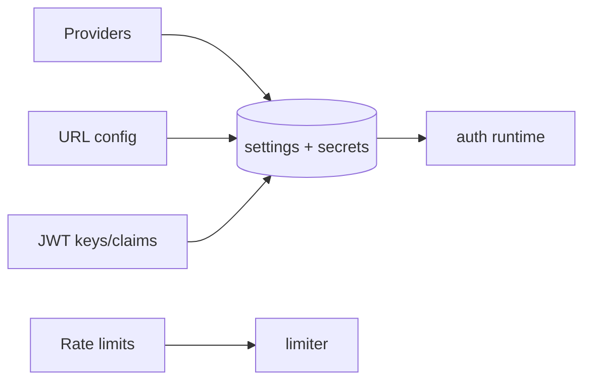

# S0071 — Auth console: providers, URL config, JWT, rate limits

> **Status:** done 2026-11-03 · **Depends on** [[S0070-auth-console-users|S0070]] + [[S0069-auth-settings-store|S0069]] · **Phase:** [[../README]] · Parent: [[../../../feature_list/Jord/todo/jord-F0030-auth-console|jord-F0030]] · As-built: [[../../../tech_space/jord/auth/README#jwt-signing-keys-s0071]]

## Routing (who / how long / which model)

| | |
|--|--|
| **Suggested agent** | mimir → **apollo** (UI) + **heimdall** (secret + JWT surface) |
| **Companion skills** | `.agents/skills/apollo/` · `.agents/skills/security-and-hardening/` · `.agents/skills/fix-security-vulnerabilities-with-strix/` |
| **Suggested model** | `claude-sonnet-5-5-high` |
| **Est. time** | **3 h** |
| **Parallel?** | **No** |

## Goal

Four configurable sections that match server capability: **Providers** (email/password, anonymous; magic link + OAuth appear once their server cards land), **URL configuration** (site URL + redirect allowlist with wildcard rules), **JWT** (signing key rotation, access-token expiry, custom claims with decoded-token preview), **Rate limits** (per-endpoint with defaults and reset).

## Why now

These are the sections operators expect from a Supabase-style auth menu; the settings store (S0069) already persists them, so this is the console half plus the secret/JWT endpoints.

## Context (read before coding)

| Kind | Where |
|------|-------|
| Intent | [[../../../feature_list/Jord/todo/jord-F0030-auth-console|jord-F0030]] (Providers, URL, JWT, Rate limits) |
| Depends on | [[S0069-auth-settings-store|S0069]] · [[done/S0042-control-plane-store-adr|S0042]] secret port |
| Code today | `cloud/jord/src/auth/{jwt,config,admin,route-inventory}.ts` · settings from S0069 |
| Gate | OAuth/magic-link provider forms enable only after [[S0074-magic-link|S0074]] / [[S0075-oauth-provider|S0075]]; until then disabled with the dependency named |

**Do not break:** client secret and signing key are write-only; rotating the JWT key follows the documented invalidation policy; no secret in the browser bundle.

## In scope

- Providers: per-provider card with enabled toggle, client id/secret (masked, write-only), scopes, callback URL display; email/password + anonymous fully functional; others gated.
- URL config: site URL + allowlist rows (exact / wildcard `https://*.example.com`), validation on save, and server-side enforcement already added in S0069 (link the test).
- JWT: rotate signing key (confirm dialog naming the invalidation window), expiry control, custom-claims JSON editor with a decoded preview using a sample principal.
- Rate limits: table of endpoints with current/default/value, reset-to-default, and a save that applies immediately.
- Server endpoints for secrets/keys with audit + role guard; tests for secret non-disclosure and claims preview shape.

## Out of scope

Actual OAuth provider implementations · MFA · SAML/SCIM · per-organization claims.

## Diagram

## Steps (do in order)

1. Read S0069 settings shape + jwt.ts; list which fields already exist.
2. Add the secret/JWT endpoints with tests for non-disclosure.
3. Build the four sections with gated states where capability is missing.
4. Wire save → immediate effect; show decoded-token preview.
5. Typecheck + build; verify secret absence in the bundle and responses.
6. **docs_man**: auth tech_space sections; tick card.

## As built

| Piece | Fact |
|-------|------|
| Migration | `0018_auth_console.sql` (libSQL + Postgres): `email_password_enabled`, `anonymous_enabled`, `custom_claims`, `jwt_key_sealed`, `jwt_key_fingerprint`, `jwt_key_rotated_at` |
| Settings | `GET/PATCH /admin/auth/settings` now also returns the provider toggles, claims, and key metadata (`jwt_key_source`, fingerprint, rotatedAt) — **never** the sealed key |
| Providers | Email/password gates `signup` + `signin` (**403** `provider_disabled`); anonymous gates `POST /auth/anon-key`; magic link + OAuth are disabled cards naming S0074 / S0075 |
| URL config | Site URL + allow-list rows; client mirror of the server pattern check; server still fails closed (S0069 tests) |
| JWT | `GET /admin/auth/jwt`; `POST /admin/auth/jwt/rotate` (new 32-byte secret sealed via `JORD_MASTER_KEY`, **503** when unset); `DELETE /admin/auth/jwt/key` reverts to `JORD_JWT_SECRET`; both audited in `jord_logs` as `auth.jwt` |
| Keyring | `cloud/jord/src/auth/keyring.ts` — sealed project key → env key → none, 5 s cache, invalidated on rotate/reset. Rotation invalidates **all access tokens immediately** (refresh tokens survive); env `previous` only applies while no stored key exists |
| Claims | `custom_claims` merged into user access tokens on sign-in + refresh; reserved claims (`iss/aud/sub/role/iat/exp/jti/nbf`) rejected at save and filtered at sign |
| Rate limits | Six endpoint rows with defaults, reset, and immediate effect through the S0036 limiter |
| Studio | `AuthProvidersSection`, `AuthUrlsSection`, `AuthJwtSection`, `AuthRateLimitsSection`, `AuthSettingsSection` in `auth-console-sections.tsx`; BFF `/api/admin/auth/{settings,jwt/rotate,jwt/key}`; non-admin sees the Admin-only alert |
| Preview | Decoded-token **shape** preview from a sample principal (never signs in the browser; reserved claims always win) |

## Done when

- [x] Providers/URL/JWT/rate limits all save and reload
- [x] Secrets never appear in responses or the bundle (asserted)
- [x] JWT rotation invalidates old tokens per the documented policy
- [x] OAuth/magic link show gated states, not dead toggles
- [x] Proof pasted

## Proof

| Date | Command | Result |
|------|---------|--------|
| 2026-11-03 | `pnpm --filter @altr/jord typecheck` | exit 0 |
| 2026-11-03 | `pnpm --filter @altr/jord-server typecheck` | exit 0 |
| 2026-11-03 | `pnpm --filter @altr/jord-server exec vitest run src/auth/console-sections.test.ts src/auth/settings.test.ts src/auth/admin-users.test.ts` | **15 passed** — provider gates, claims merge + reserved reject, rotate invalidates old token, reset to env, 503 without master key, plus S0069/S0070 regressions |
| 2026-11-03 | `pnpm --filter @altr/jord-studio typecheck` | exit 0 |
| 2026-11-03 | `pnpm --filter @altr/jord-studio build` | exit 0 — providers/jwt/rate-limits/settings/url-configuration routes + 3 BFF routes emitted |
| 2026-11-03 | `pnpm --filter @altr/jord-studio exec node --import tsx --test src/lib/studio-auth-settings.test.ts src/lib/studio-auth-users.test.ts src/lib/studio-nav.test.ts src/lib/project-scope.test.ts` | **19 passed** — defaults, rate normalization, allowlist validation, preview shape, reserved claims |

## After ship

| Update | Path |
|--------|------|
| tech_space | `Docs/tech_space/jord/auth/README.md` · `Docs/tech_space/jord/studio/README.md` |
| Queue | [[README]] |
