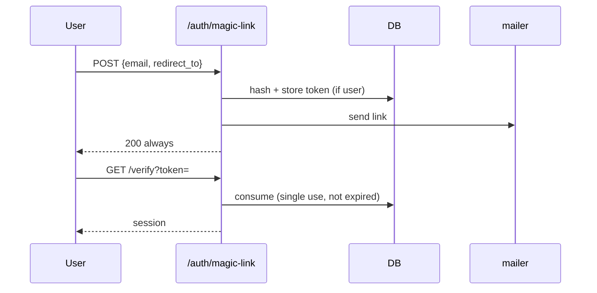

# S0074 — magic link sign-in

> **Status:** **done** 2026-11-03 · **Depends on** [[S0073-mailer-port|S0073]] · **Phase:** [[../README]] · Parent: [[../../../../feature_list/Jord/todo/jord-F0016-auth-v2|jord-F0016]] · After ship: [[../../../../tech_space/jord/auth/README]]

## Routing (who / how long / which model)

| | |
|--|--|
| **Suggested agent** | mimir → **heimdall** |
| **Companion skills** | `.agents/skills/security-and-hardening/` · `.agents/skills/graft/` |
| **Suggested model** | `claude-sonnet-5-5-high` |
| **Est. time** | **2–3 h** |
| **Parallel?** | **No** |

## Goal

`POST /auth/magic-link` issues a single-use token and emails a link; `GET /auth/magic-link/verify?token=…` exchanges it for a session. Tokens expire (15 min default), are hashed at rest, invalidated on use, rate-limited per email and IP, and the post-login redirect must be in the allowlist.

## Why now

Passwordless is one of the four `jord-F0016` capabilities and the first real consumer of the mailer.

## Context (read before coding)

| Kind | Where |
|------|-------|
| Intent | [[../../../../feature_list/Jord/todo/jord-F0016-auth-v2|jord-F0016]] |
| Depends on | [[S0073-mailer-port|S0073]] · [[S0069-auth-settings-store|S0069]] (sign-up toggle, allowlist, limits) |
| Code today | `cloud/jord/src/auth/{routes,jwt,identity,password}.ts` + token helpers |
| Tests | `cloud/jord/src/auth/token.test.ts` · `principals.test.ts` |

**Do not break:** enumeration safety — the request endpoint always returns the same response whether or not the email exists; existing password login unchanged.

## In scope

- Token table/columns: hash, principal, purpose, expires_at, used_at, created_ip.
- Request: normalize email, create token (only if the user exists and sign-ups/magic link are enabled), send via mailer, always 200.
- Verify: constant-time hash compare, single use, expiry, disabled/banned user refused, allowlist check on `redirect_to`.
- Rate limits: per email (e.g. 3/15 min) and per IP, using the shared limiter when available.
- Tests: happy path, reuse rejected, expired rejected, unknown email → same 200 and no token, off-allowlist redirect rejected.

## Out of scope

Email OTP codes · link auto-login with a one-click GET in email clients (state the trade-off and pick POST-confirm if needed) · provider-side click tracking.

## Diagram

## Steps (do in order)

1. Read token helpers + auth routes; reuse the same hashing/compare utilities.
2. Add storage columns + migration.
3. Implement request (constant response) and verify with all guards.
4. Wire mailer template + allowlist + rate limits.
5. Tests for each rejection path.
6. Typecheck + test; paste proof.
7. **docs_man**: auth tech_space magic link; tick card.

## Done when

- [x] Request is enumeration-safe (tested)
- [x] Token single-use and expiring (tested)
- [x] Banned/disabled user cannot sign in
- [x] Off-allowlist redirect rejected
- [x] Rate limit enforced per email/IP
- [x] Proof pasted

## Proof

| Date | Command | Result |
|------|---------|--------|
| 2026-11-03 | `pnpm --filter @altr/jord-server test` | **225 passed** \| 20 skipped (was 217; +8 magic-link) |
| 2026-11-03 | `pnpm --filter @altr/jord-server exec tsc --noEmit` | clean |
| 2026-11-03 | `vitest run src/auth` (after heimdall fixes) | **52 passed** |

## What shipped

| Piece | Fact |
|-------|------|
| Routes | `POST /auth/magic-link` (always 200) · `GET`/`POST /auth/magic-link/verify` (POST lets a front end confirm so mail scanners cannot burn the token) |
| Storage | `jord_auth_tokens` purpose `magic`, sha256 at rest, 15 min TTL; migration `0020_magic_link` adds `created_ip` |
| Guards | existing + enabled user only; consume gated by `UPDATE … RETURNING` (Postgres-safe single use); disabled user refused at issue and consume; `redirect_to` allowlisted on request and verify, refused redirect does not burn the token |
| Limits | 3 links / 15 min per email (silent, identical response); per-IP reuses `recover` budget on request and `signin` on verify → 429 |
| Hardening | verify sends `Cache-Control: no-store` + `Referrer-Policy: no-referrer`; email capped at 254 chars |

**Known / follow-up (heimdall review):** `consumeOneTime` (confirm/reset) has the same select-then-update race on Postgres; `x-forwarded-for` is trusted as everywhere else in auth (needs a trusted-proxy setting); issue path is slightly slower for real users than unknown emails (same as recover); per-email cap lets a third party suppress a victim's link for 15 min. No separate magic-link on/off toggle was added — console provider toggle stays with S0075 work.

## After ship

| Update | Path |
|--------|------|
| tech_space | `Docs/tech_space/jord/auth/README.md` |
| Queue | [[../README]] |
