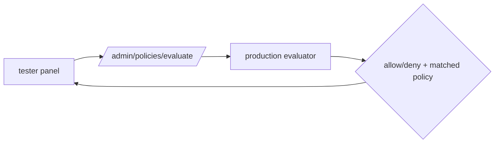

# S0077 — Studio policy tester

> **Status:** **done** 2026-11-03 (Postgres run gated; panel not viewed in a browser) · **Depends on** [[S0059-policies-apis-drawers|S0059]] + [[S0076-sessions-claims|S0076]] · **Phase:** [[../README]] · Parent: [[../../../../feature_list/Jord/todo/jord-F0016-auth-v2|jord-F0016]] · After ship: [[../../../../tech_space/jord/policies/README]]

## Routing (who / how long / which model)

| | |
|--|--|
| **Suggested agent** | mimir → **apollo** (UI) + **heimdall** (evaluation endpoint) |
| **Companion skills** | `.agents/skills/apollo/` · `.agents/skills/security-and-hardening/` · `.agents/skills/graft/` |
| **Suggested model** | `claude-sonnet-5-5-high` |
| **Est. time** | **2–3 h** |
| **Parallel?** | **No** |

## Goal

A tester in Studio: choose a user (and optionally a custom claim set), a table, an operation, and a row — see **allow/deny**, which policy matched, and the resulting row count, produced by the **same** evaluation code the request path uses.

## Why now

`jord-F0016` lists "run as user" as a shipped capability; without it operators debug policies by trial and error against the API.

## Context (read before coding)

| Kind | Where |
|------|-------|
| Intent | [[../../../../feature_list/Jord/todo/jord-F0016-auth-v2|jord-F0016]] · [[../../../../feature_list/Jord/done/jord-F0008-policies|jord-F0008]] |
| Code today | `cloud/jord/src/policies/` (evaluation) · `elements/jord/src/schema/{policies,row-scope}.ts` · `components/policies-panel.tsx` |
| Tests | `elements/jord/src/schema/row-scope.test.ts` · `cloud/jord/src/policies/*.test.ts` |

**Do not break:** the tester must not create a second evaluator — call the production function; never issue tokens for the impersonated user (no session minting).

## In scope

- `POST /admin/policies/evaluate` (`{ principalId, operation, table, schema, row? }`) returning `{ allowed, matchedPolicyId, rowsEvaluated, reason }` using the production path with the principal injected.
- Studio: tester panel reachable from the policy drawer; principal picker (from Users), claim override editor, operation + table selectors, sample row picker (by PK) or "any row".
- Show the matched policy expression + a plain-language rendering; link to edit.
- Fixture matrix test: the endpoint's decisions equal direct calls to the evaluator for the same inputs.
- Audit each evaluation (who tested whom).

## Out of scope

Batch evaluation across all users · writing data on behalf of the user · policy syntax authoring help.

## Diagram

## Steps (do in order)

1. Find the production evaluation entry point; confirm it can be called with an injected principal.
2. Add the admin endpoint + audit + role guard.
3. Build the tester UI with principal/claim/table/operation controls.
4. Add the fixture matrix test for parity.
5. Typecheck (server + studio) + tests; paste proof.
6. **docs_man**: policies tech_space tester section; tick card.

## Done when

- [x] Tester decisions match the evaluator on a fixture matrix (tested) — 150+ checks against the evaluator and real HTTP requests; libSQL only
- [x] Matched policy and plain-language reason shown — built and unit-tested; the panel has not been viewed in a browser
- [x] No token/session minted for the impersonated user
- [x] Evaluations audited
- [x] Proof pasted

## Proof

| Date | Command | Result |
|------|---------|--------|
| 2026-11-03 | `pnpm --filter @altr/jord-server test` (five cards + review fixes, one tree) | **447 passed** \| 22 skipped (54 files, 3 skipped) |
| 2026-11-03 | `tsc --noEmit` in `@altr/jord-server`, `@altr/jord`, `@altr/jord-client`, `@altr/jord-react`, `@altr/apolyx` | clean |
| 2026-11-03 | `pnpm exec tsc --noEmit` in `apps/jord-studio` (errors outside the stale ignored `.next/` types) | **0** |
| 2026-11-03 | `pnpm --filter @altr/jord test` \| `@altr/jord-client` \| `@altr/jord-react` \| `@altr/apolyx` | **138 \| 66 \| 47 \| 190 passed** |
| 2026-11-03 | `node --import tsx --test` on the Studio lib tests (policy tester, dashboard, snippets, realtime stats, live toggle, table apis) | **36 pass** |

## What shipped

| Piece | Fact |
|-------|------|
| Endpoint | `POST /admin/policies/evaluate` (operator admin only) `{principalId?, claims?, role?, operation, table, schema?, row?, values?}` -> `{allowed, matchedPolicy{id,name,effect,kind,expression,plainLanguage}, rowScope{anyOf[],lossy}, rowsEvaluated, rowCount, rowAllowed, reason, principal{kind,uid,claims,userStatus}, ignoredClaims, hypothetical, hypotheticalNote, countsIgnoreNativeRls?}` |
| Parity | the tester and `/api/v1/:table` both call `decideForPrincipal` (the table API `decide()` closure now delegates to it, behaviour unchanged) and reuse the table API own scope, count, `stampInsertScope` and `patchKeepsScope` helpers; no DML, no token or session is minted |
| Reality check | the **headline** result is for the principal as a real token builds it (user: iss / aud / sub / email from `jord_users`; anon: iss / aud) — custom claims the operator types are returned in `ignoredClaims` and replayed only in a separate advisory `hypothetical` block, because production token verification drops custom claims; a **disabled** user reports `user_disabled` (a real request is 401); `userStatus` flags unconfirmed email and no live session |
| Postgres | counts run under the simulated user RLS session (`bindRlsSession`), the admin session is restored afterwards; `countsIgnoreNativeRls` is set when the adapter cannot |
| Safety | body capped at 64 KiB (413), rate limit 30/min per actor that **fails closed** (503) and keys uid-less operators by role + token hash, `jord_*` tables are 404, identifiers validated against introspection |
| Audit | `jord_logs` source `policies.evaluate`: actor, tested principal id, table, operation, allowed, reason, matched policy id, claim-override count — no row, value or claim values |
| Studio | "Test policy" in the table policies drawer (`?inspector=policies&table=...`): Run-as picker (Anonymous + searchable users), hypothetical-claims editor (reserved claims ignored, 4 KiB cap), table, operation, one input per PK column, result region with verdict badge (icon + text), matched policy and plain-language sentence, "Edit policy" link, row scope list, simulated principal, user-status alerts, a separate "If a token carried these claims" card, and the last 10 runs; BFF `POST /api/admin/policies/evaluate` |

**Review (heimdall, opus):** the first version let operator-typed claims change the headline decision (a tester ALLOW production would deny), evaluated banned users, used the admin RLS session for counts, reported only the first scope term, used a different `env` than production, read the body before capping it, and failed open on limiter errors — all fixed and re-tested.

**Known / follow-up:** Postgres runtime not exercised here; the Studio panel was typechecked and its logic unit-tested but never viewed in a browser or called against the live endpoint; `rowCount` caps at 10 000 (`rowsEvaluated`); a guard against making the tester a general table-size oracle relies on admin-only access.

## After ship

| Update | Path |
|--------|------|
| tech_space | `Docs/tech_space/jord/policies/README.md` |
| Queue | [[../README]] |
