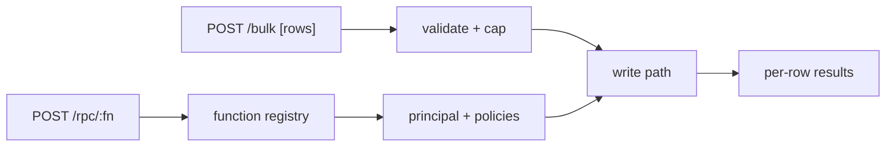

# S0080 — bulk insert/upsert + RPC

> **Status:** **done** 2026-11-03 (Postgres run gated) · **Phase:** [[../README]] · Parent: [[../../../../feature_list/Jord/todo/jord-F0017-table-api-v2|jord-F0017]] · After ship: [[../../../../tech_space/jord/apis/README]]

## Routing (who / how long / which model)

| | |
|--|--|
| **Suggested agent** | mimir → **sindri** (batch path) + **heimdall** (authorization) |
| **Companion skills** | `.agents/skills/supabase-postgres-best-practices/` · `.agents/skills/graft/` · `.agents/skills/hono-typescript/` |
| **Suggested model** | `claude-sonnet-5-5-high` |
| **Est. time** | **3 h** |
| **Parallel?** | **No** |

## Goal

`POST /api/v1/:table/bulk` accepts an array (bounded, e.g. 500) of rows for insert or upsert with an explicit conflict target, returns **per-row** results (index, status, id or error, field reasons), and reports partial success honestly. `POST /api/v1/rpc/:fn` invokes a registered function with the caller's principal.

## Why now

`jord-F0017` lists both; Studio bulk delete/duplicate and client sync both benefit, and RPC is the documented way to call server functions today missing from the table API.

## Context (read before coding)

| Kind | Where |
|------|-------|
| Intent | [[../../../../feature_list/Jord/todo/jord-F0017-table-api-v2|jord-F0017]] |
| Depends on | [[S0053-column-settings|S0053]] (validation errors) · functions registry `cloud/jord/src/functions/` · `generated-api/registry.ts` |
| Code today | `cloud/jord/src/table-api/{routes,sql,openapi}.ts` · `cloud/jord/src/functions/{runner,index}.ts` · `cloud/jord/src/queue.ts` |
| Tests | `cloud/jord/src/table-api/__tests__/` · `elements/jord/src/functions.test.ts` |

**Do not break:** single-row write contracts; the write queue remains the only writer for queued jobs; RPC must not bypass policies.

## In scope

- Bulk endpoint: array validation (size cap, per-row shape), insert or upsert with `on_conflict` columns, per-row result array, HTTP 207-style semantics (pick and document: 200 with results vs 207).
- Atomicity choice documented: per-row try (partial success) vs all-or-nothing inside one transaction. Default must be stated and tested.
- Duplicate key → per-row conflict error, not a batch abort.
- RPC: `POST /api/v1/rpc/:fn` `{ args }` → function registry lookup, args validation, execution with the caller's principal, structured result/error; 404 for unknown fn.
- OpenAPI entries for both.

## Out of scope

Streaming/bulk beyond the cap · CSV import · long-running functions (worker runtime is `jord-F0015`, gated).

## Diagram

## Steps (do in order)

1. Read the write path + function registry; decide and write down the atomicity default.
2. Implement the bulk endpoint with per-row results and the size cap.
3. Implement RPC with args validation + policy path.
4. OpenAPI + tests (partial failure, conflict, unknown fn, policy denial).
5. Typecheck + test; paste proof.
6. **docs_man**: apis tech_space bulk/RPC; tick card.

## Done when

- [x] Bulk insert/upsert return per-row results for success and conflict
- [x] Atomicity behavior is documented and tested
- [x] RPC calls a registered function with the caller's principal
- [x] Unknown function → 404; policy denial → 403 — libSQL only; the Postgres variants skip locally
- [x] Proof pasted

## Proof

| Date | Command | Result |
|------|---------|--------|
| 2026-11-03 | `pnpm --filter @altr/jord-server test` (five cards + review fixes, one tree) | **424 passed** \| 22 skipped (51 files, 3 skipped) |
| 2026-11-03 | `pnpm --filter @altr/jord-server exec tsc --noEmit` / `@altr/jord` tsc | clean / clean |
| 2026-11-03 | `pnpm --filter @altr/jord test` | **138 passed** \| 12 skipped |
| 2026-11-03 | `pnpm --filter @altr/jord-client test` | **39 passed** (typed builder + rename proof + gen types) |
| 2026-11-03 | `node --test scripts/audit-ci.test.mjs` | **12 pass** |

## What shipped

| Piece | Fact |
|-------|------|
| Bulk | `POST /api/v1/:table/bulk` — body is a bare array of 1..500 rows (more, or a body over 1 MiB including chunked = 413). Query: `on_conflict=a,b`, `resolution=merge` (default) or `ignore`, `atomic=true`. Always `200 {inserted, updated, ignored, failed, results[]}` (207 is not used); each result is `{index, status, op, id?, data?}` or `{index, status, error, message, field?, reason?}` |
| Atomicity | **per-row by default**: the batch is one transaction and each row has its own SAVEPOINT, so a conflict or validation failure never aborts the batch. `atomic=true` rolls everything back on the first failure and returns that row status with its `index` (nothing written, no change events) |
| Conflict target | `on_conflict` must exactly match the primary key or a non-partial, valid, immediate unique index, checked live against the database; otherwise 400. A plain insert reports a duplicate as that row only: `{status:409, error:"conflict"}` |
| Authorization | each row is authorized like the single-row write: the same `evaluatePolicies` for insert and for update; insert stamps the owner scope; the update branch needs UPDATE permission, `patchKeepsScope`, and the existing row inside the caller scope (scoped prior-select, scoped UPDATE), so an upsert cannot overwrite or reassign another owner row. Change events are emitted once per written row in the same transaction. Driver errors are mapped to stable codes |
| RPC | `POST /api/v1/rpc/:fn` `{args}` -> `{result}` or `{error:{code,message}}`; runs the registered function as the **caller** (never service). Service principals and operator admins may call any enabled function; **everyone else only reaches a function that has an enabled POST custom API bound to it and is not in `JORD_CUSTOM_API_DISABLED`** (same exposure rule and kill switch as `/x/:slug`, via the shared `isCustomApiExposed`). Everything else, including unknown names, is the same `404 unknown_function` |
| Other | OpenAPI documents both; idempotency keys cover both |

**Review (heimdall, opus) fixes:** RPC no longer reaches every enabled function for user/anon callers; the idempotency middleware streams the body under the JSON cap (a chunked body used to bypass 1 MiB); anon callers no longer share one idempotency namespace; Postgres unique-index check requires `indisvalid` / `indisready` / `indimmediate`; the Postgres existence probe no longer takes `FOR UPDATE` on rows outside the caller scope.

**Known / follow-up:** `/functions` and `/functions/:id/invoke` are still callable by user and anon — a separate card is needed; a bulk request counts as one rate-limit hit (the store has no weight); on Postgres a row hidden by RLS reports 409 instead of 403 (nothing is written either way); `rpc` as a table name cannot be bulk-written; Postgres runtime not exercised here.

## After ship

| Update | Path |
|--------|------|
| tech_space | `Docs/tech_space/jord/apis/README.md` |
| Queue | [[../README]] |
