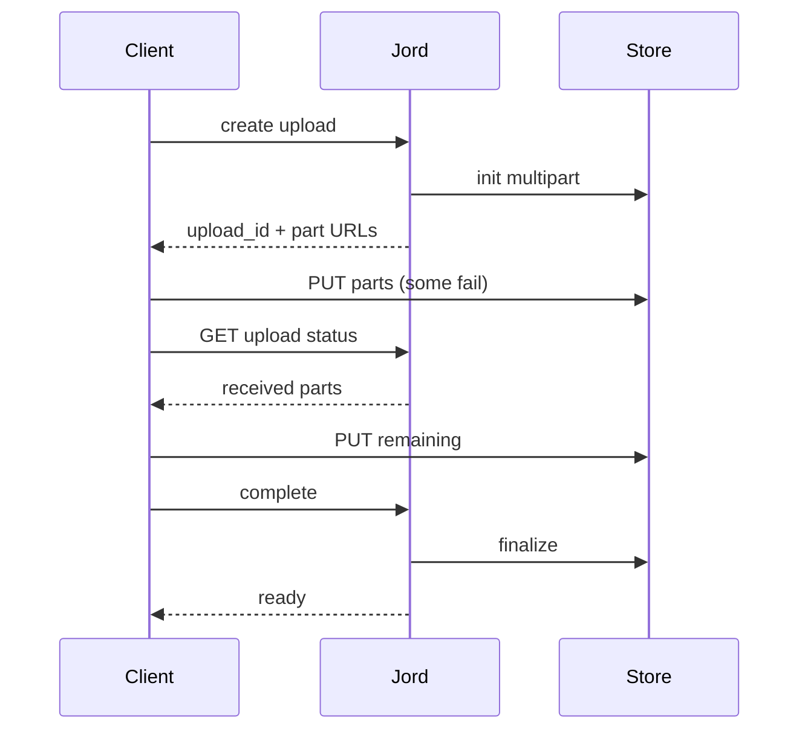

# S0081 — multipart + resumable uploads

> **Status:** **done** 2026-11-03 (1 GiB drill and live MinIO gated) · **Depends on** [[S0066-bucket-registry|S0066]] · **Phase:** [[../README]] · Parent: [[../../../../feature_list/Jord/todo/jord-F0018-storage-realtime-v2|jord-F0018]] · After ship: [[../../../../tech_space/jord/blobs/README]]

## Routing (who / how long / which model)

| | |
|--|--|
| **Suggested agent** | mimir → **sindri** |
| **Companion skills** | `.agents/skills/supabase-postgres-best-practices/` · `.agents/skills/graft/` |
| **Suggested model** | `claude-sonnet-5-5-high` |
| **Est. time** | **3 h** |
| **Parallel?** | **No** |

## Goal

A 1 GiB upload survives a disconnect: create session → upload parts (presigned part URLs for S3, chunked PUT for local) → resume from the last acknowledged part → finalize → `ready`, with abandon/GC keeping the existing pending-expiry rule.

## Why now

`jord-F0018` acceptance is exactly this; today's path is one-shot PUT, so large files fail on any hiccup.

## Context (read before coding)

| Kind | Where |
|------|-------|
| Intent | [[../../../../feature_list/Jord/todo/jord-F0018-storage-realtime-v2|jord-F0018]] |
| As-built | [[../../../../tech_space/jord/blobs/README]] (lifecycle, `upload_id` column already reserved) |
| Depends on | [[S0066-bucket-registry|S0066]] (per-bucket provider + limits) |
| Code today | `cloud/jord/src/storage/{s3,local,lifecycle}.ts` · `cloud/jord/src/blobs/routes.ts` · `jord_blobs.upload_id` |
| Tests | `cloud/jord/src/storage/s3-live.test.ts` (MinIO, env-gated) |

**Do not break:** pending → finalize → `blobs_gc`, `PresignResult` shape, size/MIME limits from the bucket, the `502 storage_delete_failed` contract.

## In scope

- Session endpoints: `POST /blobs/:bucket/uploads` → `{ upload_id, parts_expected }`; `POST …/uploads/:id/parts/sign` (batch); `POST …/uploads/:id/complete`; `DELETE …/uploads/:id` (abort).
- S3: `CreateMultipartUpload` + presigned `UploadPart` + `CompleteMultipartUpload`; local: append chunks to a temp file with an offset contract.
- Resume: `GET …/uploads/:id` returns received parts/bytes so a client continues without restarting.
- Validation: chunk size bounds, part numbering, content-type allowlist from the bucket, total size cap.
- Tests: local resume after simulated disconnect; MinIO multipart when `JORD_TEST_S3_ENDPOINT` is set; expired session GC.

## Out of scope

Parallel part concurrency tuning · client-side chunking SDK (note it as the consumer) · resumable uploads through a browser form without the API.

## Diagram

## Steps (do in order)

1. Read the lifecycle + S3 adapter; confirm `upload_id` usage.
2. Add session storage (row fields) + endpoints.
3. Implement S3 multipart and local chunk append.
4. Wire resume status + abort + GC.
5. Tests: local resume, MinIO multipart, expired session cleanup.
6. Typecheck + test; paste proof.
7. **docs_man**: blobs tech_space multipart section; tick card.

## Done when

- [ ] 1 GiB local upload resumes after a simulated disconnect
- [ ] MinIO multipart path works when the live env is set
- [x] Abandoned sessions are GC'd; finalized objects behave as today
- [x] Size/MIME limits still enforced
- [x] Proof pasted

## Proof

| Date | Command | Result |
|------|---------|--------|
| 2026-11-03 | `pnpm --filter @altr/jord-server test` (all three cards + review fixes, one tree) | **310 passed** \| 22 skipped (42 files, 3 skipped) |
| 2026-11-03 | `pnpm --filter @altr/jord-server exec tsc --noEmit` | clean |
| 2026-11-03 | `pnpm --filter @altr/jord test` | **138 passed** \| 12 skipped |

## What shipped

| Piece | Fact |
|-------|------|
| Routes | under `/blobs/:bucket/uploads` (editor+): `POST` create `{key, content_type?, size, part_size?}` · `GET /:id` (parts, received_bytes, missing_parts) · `POST /:id/parts/sign` (up to 100 parts) · `POST /:id/complete` (idempotent; missing parts = 409 `incomplete_upload`) · `DELETE /:id` abort |
| Storage | migration `0023_multipart` (`jord_uploads`); `JordStoragePort` gains `listMultipartParts` / `writeMultipartPart`; local adapter keeps multipart state on disk (survives restart) and assembles by streaming to a temp file; S3 adapter presigns `UploadPart` and uses `ListParts` |
| Lifecycle | `open -> completing / aborting` transitions are conditional UPDATEs (concurrent complete/abort: the loser gets 409); `blobs_gc` also sweeps expired sessions with a conditional claim, and rescues sessions stuck in `completing` > 1 h |
| Limits | part count 1..10000, 256 MiB part cap, per-upload byte total bounded by the declared size, 50 open sessions per principal (insert-then-count); bucket MIME/size policy re-checked at complete |
| Part size | enforced on write: streaming byte cap = declared part size, short or chunked bodies rejected, S3 presign signs `content-length` |
| Errors | routes log details server-side and answer `storage_error`; GC reports `<id8>:storage_error` only; dirs 0700, files 0600 |

**Not proven here (live-env gated):** the 1 GiB local upload with a simulated disconnect (the largest local test is 64 MiB; the resume path itself is tested) and the MinIO multipart path (`multipart-live.test.ts` skips without `JORD_TEST_S3_ENDPOINT`). Postgres SQL for `jord_uploads` was not exercised.

**Known / follow-up:** local uploads use per-part PUTs rather than offset-append; an object can be orphaned if the metadata write fails after local assembly; a part URL can be rewritten during `completing` within its TTL (small window, etag rechecked before streaming).

## After ship

| Update | Path |
|--------|------|
| tech_space | `Docs/tech_space/jord/blobs/README.md` |
| Queue | [[../README]] |
