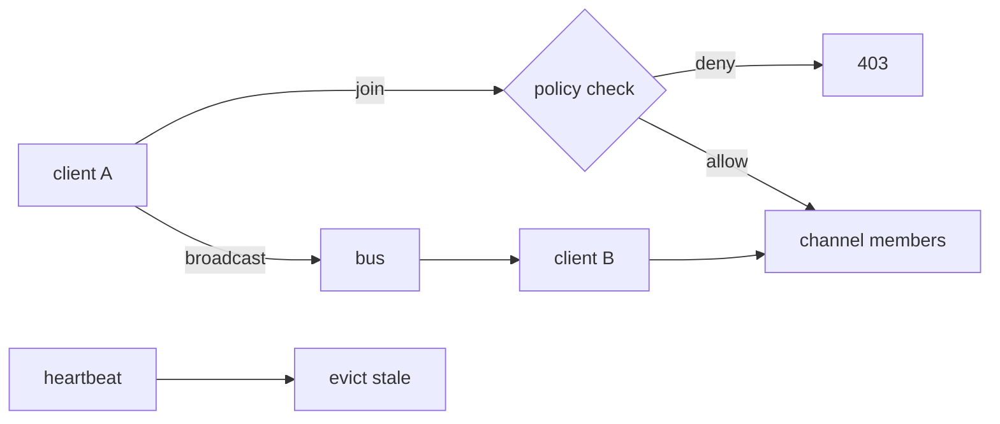

# S0083 — realtime presence + broadcast

> **Status:** **done** 2026-11-03 (two-instance live proof gated) · **Depends on** [[S0037-listen-seq-fanout|S0037]] · **Phase:** [[../README]] · Parent: [[../../../../feature_list/Jord/todo/jord-F0018-storage-realtime-v2|jord-F0018]] · After ship: [[../../../../tech_space/jord/realtime/README]]

## Routing (who / how long / which model)

| | |
|--|--|
| **Suggested agent** | mimir → **sindri** (transport) + **heimdall** (authorization) |
| **Companion skills** | `.agents/skills/security-and-hardening/` · `.agents/skills/hono-typescript/` · `.agents/skills/graft/` |
| **Suggested model** | `claude-sonnet-5-5-high` |
| **Est. time** | **3 h** |
| **Parallel?** | **No** |

## Goal

Clients join a channel (`presence:room-1`), announce a state, and receive join/leave/sync events; `broadcast` sends an ephemeral message to everyone else on the channel. Join is authorized by the channel's declared policy (table + row), not by possession of a key alone, and nothing is persisted.

## Why now

`jord-F0018` pairs storage with realtime presence/broadcast; today realtime is change-feed only.

## Context (read before coding)

| Kind | Where |
|------|-------|
| Intent | [[../../../../feature_list/Jord/todo/jord-F0018-storage-realtime-v2|jord-F0018]] |
| Depends on | [[S0037-listen-seq-fanout|S0037]] (multi-instance delivery) · `jord-F0009` transport |
| Code today | `cloud/jord/src/realtime/{bus,deliver,types}.ts` · `cloud/jord/src/policies/` |
| Tests | `cloud/jord/src/realtime/ws-policy.test.ts` |

**Do not break:** change-feed ordering and retention; presence must not grow unbounded (heartbeat timeout evicts).

## In scope

- Channel join protocol (WS message or SSE query): `{ type: 'join', channel, config }` with authorization via a policy check on the channel's table/row.
- Presence: join/leave/sync events, state payload (bounded size), heartbeat + eviction after timeout, per-channel member count.
- Broadcast: fan out to channel members except the sender, per-message size cap, rate limit per connection.
- Multi-instance: route through the bus so presence/broadcast reach subscribers on other processes (LISTEN from S0037 makes this possible; state can be per-instance with a TTL and merged on read).
- Tests: join denied by policy → 403 and no membership; broadcast reaches one other client only; stale presence evicted.

## Out of scope

Persisted chat history · message acknowledgements/replay · typing indicators (a client concern).

## Diagram

## Steps (do in order)

1. Read the realtime types + `ws-policy.test.ts`; extend the message vocabulary, keep feed events untouched.
2. Implement join authorization through the existing policy path.
3. Add presence state + heartbeat eviction.
4. Add broadcast with size/rate caps through the bus.
5. Tests for denial, fan-out, eviction.
6. Typecheck + test; paste proof.
7. **docs_man**: realtime tech_space presence section; tick card.

## Done when

- [x] Denied join returns 403 and creates no membership
- [x] Broadcast reaches other members only
- [x] Stale presence evicted after the timeout
- [ ] Works across two instances
- [x] Proof pasted

## Proof

| Date | Command | Result |
|------|---------|--------|
| 2026-11-03 | `pnpm --filter @altr/jord-server test` (all three cards + review fixes, one tree) | **310 passed** \| 22 skipped (42 files, 3 skipped) |
| 2026-11-03 | `pnpm --filter @altr/jord-server exec tsc --noEmit` | clean |
| 2026-11-03 | `pnpm --filter @altr/jord test` | **138 passed** \| 12 skipped |

## What shipped

| Piece | Fact |
|-------|------|
| Endpoint | `GET /realtime/channel?channel=<table>` or `<table>:<rowId>` upgraded to a WebSocket. Refused **before** upgrade: 403 `policy_denied` (same body for a missing row), 400 bad channel, 429 `too_many_connections`, 503 `realtime_full` |
| Client -> server | `join`/`track {state}` · `leave`/`untrack` · `broadcast {event,payload}` · `heartbeat` · `sync` |
| Server -> client | `joined {channel,key,limits}` · `presence` (`sync` / `join` / `update` / `leave`) · `broadcast {event,payload,from}` · `error {code}` (400 / 413 / 429) · `ping` |
| Authorization | row channel: the row must exist and the caller's `select` policy must allow it; table channel: select must be allowed with **no** row scope. Any error refuses. Policy and session re-checked every 30 s (revoked session: close 4401; policy change: 4403) |
| Caps | 256 channels, 64 local members/channel, 256 local members, 8 sockets per principal (`JORD_PRESENCE_MAX_PER_PRINCIPAL`), state 1 KB, payload 4 KB, frame 6 KB, 10 msg/s burst 20, heartbeat timeout 60 s, `bufferedAmount` > 1 MiB closes 1013, ws `maxPayload` 64 KiB (1009) |
| Cross-instance | Postgres `NOTIFY jord_presence`; remote entries expire after 45 s; only the owning origin can update or leave a remote key; `sync_req` answered at most once per 2 s per channel; own-origin messages ignored |
| Trust | member keys are random and no user id is exposed; presence state and payload are **client-asserted and untrusted**; the server stamps only `kind` |
| S0076 follow-up | open SSE and WS feeds now re-check the session: SSE emits `expired: session_revoked`, WS closes 4401 |

**Review fixes (heimdall, opus):** per-principal cap (one caller could hold every hub slot), `maxPayload` set on the ws server, oversize/binary frames charged a token and strike, send backpressure, policy decision before the row read, `setTimeout` clamp.

**Not proven here:** the two-instance done-when is proven in memory only — `presence-pg.test.ts` skips without `JORD_TEST_POSTGRES_URL`.

**Known / follow-up:** `maxPayload` is global to the node-ws server (safe: `/realtime/ws` reads only pongs); a forged `pg_notify` from any DB role is only partly constrained; tokens without `sid` are never re-checked; `posts:1` and `posts:01` address one row on two channels (a split, not a bypass).

## After ship

| Update | Path |
|--------|------|
| tech_space | `Docs/tech_space/jord/realtime/README.md` |
| Queue | [[../README]] |
