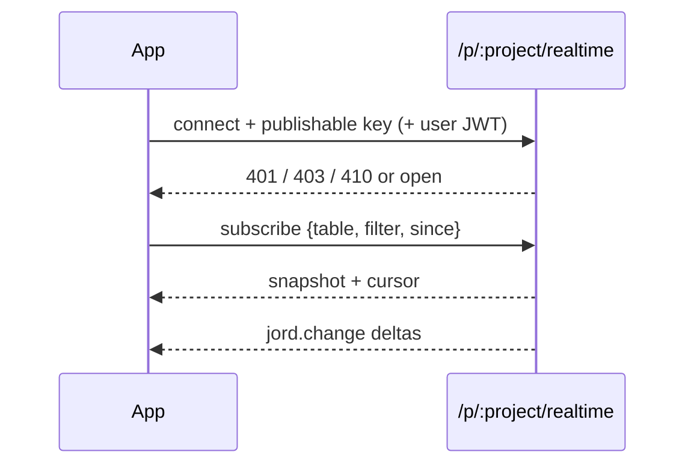

# S0084 — app-facing realtime endpoint

> **Status:** **done** 2026-11-03 (shared data plane documented) · **Depends on** [[S0043-project-registry-api|S0043]] + [[S0037-listen-seq-fanout|S0037]] · **Phase:** [[../README]] · Parent: [[../../../../feature_list/Jord/todo/jord-F0026-live-data-client|jord-F0026]] · After ship: [[../../../../tech_space/jord/realtime/README]]

## Routing (who / how long / which model)

| | |
|--|--|
| **Suggested agent** | mimir → **sindri** · **heimdall** reviews key handling |
| **Companion skills** | `.agents/skills/security-and-hardening/` · `.agents/skills/graft/` · `.agents/skills/hono-typescript/` |
| **Suggested model** | `claude-sonnet-5-5-high` |
| **Est. time** | **3 h** |
| **Parallel?** | **No** |

## Goal

A client app connects to `wss://<server>/p/<project>/realtime` (SSE fallback) with the **publishable** key and an optional end-user JWT, subscribes to one table with an optional filter, receives a snapshot plus a `since` cursor, then `jord.change` deltas with policies applied at delivery. Bad key → 401, wrong project → 403, archived/paused project → 410 with a reason.

## Why now

Today realtime is Studio-oriented; `jord-F0026` is the contract apps integrate against, and every subsequent client feature assumes it.

## Context (read before coding)

| Kind | Where |
|------|-------|
| Intent | [[../../../../feature_list/Jord/todo/jord-F0026-live-data-client|jord-F0026]] (endpoint, auth, delivery, failure) |
| Depends on | [[S0043-project-registry-api|S0043]] (keys) · [[S0037-listen-seq-fanout|S0037]] (fan-out) |
| Code today | `cloud/jord/src/realtime/{deliver,bus,types}.ts` · `cloud/jord/src/auth/{access,principal}.ts` |
| Tests | `cloud/jord/src/realtime/ws-policy.test.ts` |

**Do not break:** the existing Studio stream; secret key must never be accepted from a browser (publishable or JWT only).

## In scope

- Route + handshake: publishable key header/query, optional `Authorization: Bearer <user JWT>`; reject the **secret** key outright with a clear error.
- Subscribe: `{ table, filter?, since? }`, one table per subscription (documented limit).
- Deliver: snapshot (bounded, with cursor) → deltas from `since`; policy evaluated per row at delivery; filtered rows skipped silently.
- Errors: 401 bad/missing key, 403 wrong project key or denied table, 410 archived/paused with `reason`, 409 cursor too old → resync required (documented).
- Rate/size caps: subscriptions per connection, max filter complexity.
- Tests: snapshot + delta sequencing; denied table; secret-key rejection; archived project 410.

## Out of scope

Reconnect/backoff logic ([[S0085-realtime-reconnect|S0085]]) · Studio live toggle ([[S0086-live-toggle-snippet|S0086]]) · presence ([[S0083-presence-broadcast|S0083]]).

## Diagram

## Steps (do in order)

1. Read the deliver path + principal resolution; sketch the subscription state machine.
2. Add the route + handshake auth (publishable only).
3. Implement snapshot with cursor, then delta streaming with policy filtering.
4. Add the error contract + caps.
5. Tests for each status code and the snapshot/delta equivalence.
6. Typecheck + test; paste proof.
7. **docs_man**: realtime tech_space app endpoint; tick card.

## Done when

- [x] Snapshot + deltas produce the same final state as a fresh snapshot (tested)
- [x] Denied table → 403 and no rows delivered
- [x] Secret key rejected from this endpoint
- [x] Archived/paused project → 410 with reason — an open socket closes `4410 project_unavailable` (tested); a fresh handshake to an archived project gets the generic 401 because archiving deletes its keys, so the status is not leaked
- [x] Proof pasted

## Proof

| Date | Command | Result |
|------|---------|--------|
| 2026-11-03 | `pnpm --filter @altr/jord-server test` (five cards + review fixes, one tree) | **424 passed** \| 22 skipped (51 files, 3 skipped) |
| 2026-11-03 | `pnpm --filter @altr/jord-server exec tsc --noEmit` / `@altr/jord` tsc | clean / clean |
| 2026-11-03 | `pnpm --filter @altr/jord test` | **138 passed** \| 12 skipped |
| 2026-11-03 | `pnpm --filter @altr/jord-client test` | **39 passed** (typed builder + rename proof + gen types) |
| 2026-11-03 | `node --test scripts/audit-ci.test.mjs` | **12 pass** |

## What shipped

| Piece | Fact |
|-------|------|
| Route | `/p/:project/realtime` — WebSocket upgrade with an SSE fallback on the same path; reuses the existing feed (outbox seq, `listAfter`, `RealtimeBus`, policy at delivery, session re-check) — no second pipeline |
| Credentials | project **publishable** key in `x-jord-key` or `apikey` (or `?apikey=` on the WebSocket upgrade only; on SSE it is a 400), plus an optional end-user JWT as Bearer (none = `anon`). **Any privileged credential gets `401 secret_key_not_allowed` before any key lookup**: project secret and barrier keys (current or retiring), the raw server token, operator session tokens, and any JWT whose role is not user or anon |
| Errors | 401 `missing_key` / `invalid_key` / `invalid_token` / `session_revoked`; 403 `wrong_project` (only after a valid key); 410 `project_unavailable` with `reason` (closes open sockets with 4410); 429; 503. A bad key gets the same 401 whatever the slug, so project status cannot be enumerated |
| Frames | `ready`; client `subscribe {table, filter?, since?, limit?}` / `unsubscribe`; server `snapshot {rows, pk, cursor, truncated}` (or `subscribed {cursor}` when `since` is given), `jord.change {…, seq, row}`, `resync`, `error {status}`. A row that leaves the filter or the policy arrives as `op:"delete"` with `row:null`. Cursor too old = `409 resync_required` |
| Limits | one subscription per connection (pending counts; a second one is `409 already_subscribed`), at most 4 filter predicates, `in` up to 20 values, no `like`; snapshot 500 rows (max 1000, 2 MiB serialized, then `truncated:true`); per IP / key / principal 20 / 500 / 8 connections; 60 handshakes per minute per IP; 30 messages per 10 s; ws `maxPayload` 64 KiB; backpressure closes 1013 above 1 MiB buffered |
| Hygiene | request logs and OpenTelemetry record the path only and the HTTP instrumentation now redacts query strings (`telemetry/redact.ts`), so `?apikey=` never reaches traces; CORS allows the `X-Jord-Key` and `apikey` headers on the existing exact-origin allowlist |

**Review (heimdall, opus) fixes:** a subscribe-then-close race and a subscribe/unsubscribe/subscribe race leaked bus subscribers (a client could exhaust the global slots) — fixed with a closed flag and per-request generation, regression-tested to fail without the fix; OTel query-string redaction; send backpressure and snapshot byte cap; key checked before project status; service-role JWTs now report `secret_key_not_allowed`.

**Known / follow-up:** **all projects share one data plane** — keys are bound to the project slug but tables, policies and the outbox come from the primary database, so any project publishable key reads the same tables (a warning is logged when more than one active project exists); `seq` / `at` gaps reveal overall write volume; per-IP caps trust `x-forwarded-for` (project-wide pattern); there is no per-project origin allowlist for publishable keys; revocation reaches open sockets at the next 30 s recheck; sid-less tokens are never re-checked; `records` is not supported; insert deltas carry the values as written, not database defaults.

## After ship

| Update | Path |
|--------|------|
| tech_space | `Docs/tech_space/jord/realtime/README.md` |
| Queue | [[../README]] |
