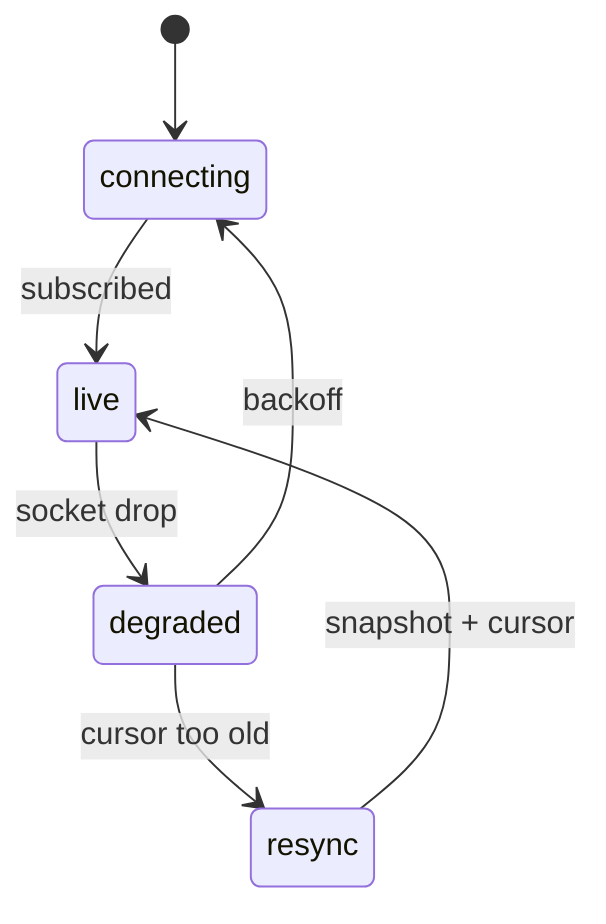

# S0085 — realtime reconnect, resume and ordering

> **Status:** **done** 2026-11-03 · **Depends on** [[S0084-realtime-app-endpoint|S0084]] · **Phase:** [[../README]] · Parent: [[../../../../feature_list/Jord/todo/jord-F0026-live-data-client|jord-F0026]] · After ship: [[../../../../tech_space/jord/apis/README]]

## Routing (who / how long / which model)

| | |
|--|--|
| **Suggested agent** | mimir → **sindri** (client + server resume) |
| **Companion skills** | `.agents/skills/graft/` · `.agents/skills/nodejs-backend-patterns/` |
| **Suggested model** | `gpt-5.6-sol-medium` |
| **Est. time** | **2–3 h** |
| **Parallel?** | **No** |

## Goal

`@altr/jord-client` realtime survives a 30 s network drop: backoff reconnect, heartbeat detection, resume from the last cursor, duplicate events dropped by sequence number, and a deterministic resync (snapshot again) when the server reports the cursor is past retention — never a silent gap.

## Why now

`jord-F0026` acceptance includes the reconnect scenario, and apps cannot ship a subscription that silently misses writes.

## Context (read before coding)

| Kind | Where |
|------|-------|
| Intent | [[../../../../feature_list/Jord/todo/jord-F0026-live-data-client|jord-F0026]] (Reconnect, Ordering) |
| Depends on | [[S0084-realtime-app-endpoint|S0084]] |
| Code today | `elements/jord-client` (client SDK) · server retention in `elements/jord/src/schema/` / `cloud/jord/src/realtime/outbox.ts` |
| Tests | `elements/jord-client` test setup; add a fault-injection harness (close the socket server-side) |

**Do not break:** existing client methods; no unbounded in-memory event buffer.

## In scope

- Client: connect state machine (`connecting → live → degraded → resync`), exponential backoff with jitter and a cap, heartbeat timeout detection.
- Resume: send `since`, apply deltas > cursor, drop duplicates by `(table, seq)`, persist the cursor in memory (optional localStorage opt-in).
- Server: distinguish "cursor too old" (explicit `resync_required`) from a transient error; keep retention configurable.
- Tests: drop mid-stream → reconnect → no duplicates/no gaps; cursor past retention → resync_required → snapshot path taken; backoff values bounded.
- Doc: the exact event/state contract for consumers.

## Out of scope

Offline-first writes · client-side conflict resolution · presence reconnection (covered by S0083 semantics).

## Diagram

## Steps (do in order)

1. Read the client SDK + server resume path; define the state machine in the card.
2. Implement backoff + heartbeat + resume with dedupe.
3. Add `resync_required` on the server and handle it in the client.
4. Build the fault-injection test (server closes the connection mid-stream).
5. Typecheck + test (client + server); paste proof.
6. **docs_man**: apis/realtime tech_space client contract; tick card.

## Done when

- [x] 30 s drop then reconnect → no duplicate and no missed rows (tested) — against a fake WebSocket with fake timers, not a live server
- [x] Cursor past retention triggers a documented resync, not a gap
- [x] Backoff is bounded and jittered
- [x] Event/state contract documented for consumers
- [x] Proof pasted

## Proof

| Date | Command | Result |
|------|---------|--------|
| 2026-11-03 | `pnpm --filter @altr/jord-server test` (five cards + review fixes, one tree) | **447 passed** \| 22 skipped (54 files, 3 skipped) |
| 2026-11-03 | `tsc --noEmit` in `@altr/jord-server`, `@altr/jord`, `@altr/jord-client`, `@altr/jord-react`, `@altr/apolyx` | clean |
| 2026-11-03 | `pnpm exec tsc --noEmit` in `apps/jord-studio` (errors outside the stale ignored `.next/` types) | **0** |
| 2026-11-03 | `pnpm --filter @altr/jord test` \| `@altr/jord-client` \| `@altr/jord-react` \| `@altr/apolyx` | **138 \| 66 \| 47 \| 190 passed** |
| 2026-11-03 | `node --import tsx --test` on the Studio lib tests (policy tester, dashboard, snippets, realtime stats, live toggle, table apis) | **36 pass** |

## What shipped

| Piece | Fact |
|-------|------|
| Client | dependency-free `createRealtime({url, project, key, token?, WebSocket?, now?, random?, setTimeout?, refreshToken?, cursorStore?, heartbeatTimeoutMs?, backoffBaseMs?, backoffCapMs?, stableLiveMs?, maxConsecutiveResyncs?, ...})` in `elements/jord-client/src/realtime/`; `subscribe({table, filter?, since?, limit?, onChange, onState?, onSnapshot?, onError?})` returns `{unsubscribe(), state, partial, dropped}`; `close()` is idempotent. The contract is the header comment of `client.ts` |
| States | `connecting -> live -> degraded` (waiting out a backoff, event carries `delayMs`) `-> resync -> live`, and a terminal `closed` with `reason` and `code` |
| Resume | the last applied cursor is sent as `since`; deltas with `seq <=` the cursor are dropped; `seq` gaps are **not** loss (the outbox seq is global across tables); only a server `resync` frame or a 409 `resync_required` triggers a resync, which discards the cursor, resubscribes without `since`, and delivers nothing but the fresh snapshot first |
| Backoff | full jitter `floor(random * min(30 s, 500 ms * 2^n))` with a 50 ms floor; the counter resets only after `stableLiveMs` (10 s) of live time or the first applied delta, so a server that accepts and immediately closes cannot cause a tight loop; 4429 waits at least 5 s even with a small cap |
| Terminal codes | 4403 / 4410 and other non-retryable errors never reconnect; 4401 calls `refreshToken` once per stable period then backs off, and is terminal without a callback (the browser upgrade carries no token); a resync loop ends in `closed` / `resync_loop` after 5 consecutive resyncs |
| Validation | change frames must match the subscribed table and carry a sane integer `seq`, else they are dropped and counted; a non-array snapshot is a retryable `invalid_snapshot`; a truncated snapshot sets `truncated` / `partial` until a full one arrives; a throwing `onChange` reports `callback_error` and the cursor still advances |
| Secrets | the key and every token ever used (including refreshed ones) and server-supplied `code` / `reason` text are redacted from errors; the optional `cursorStore` key is `project:table:<hash of url|project|table|filter>` and never contains the key; the key goes in `x-jord-key` where the transport allows headers, and in `?apikey=` only on the browser upgrade |
| Server | verified, no source change: a `since` older than retention yields a 409 `resync_required` error frame (HTTP 409 on SSE), a transient DB failure is a retryable 500 `subscribe_failed` and never a resync, retention is still resolved through `resolveRetention`; one new server test covers the transient case |

**Review (heimdall) fixes:** early backoff reset, unbounded resync loop, 4401 refresh loop, unchecked cross-table deltas and absurd `seq` values, token redaction after refresh, shared-store cursor mixing, the unused `fetch` option removed. 27 client tests (66 in the package).

**Known / follow-up:** tested only against a fake WebSocket, not a live server; no SSE transport; a browser connection cannot send a JWT (the server reads tokens only from the `Authorization` header), so it stays `anon`.

## After ship

| Update | Path |
|--------|------|
| tech_space | `Docs/tech_space/jord/apis/README.md` |
| Queue | [[../README]] |
