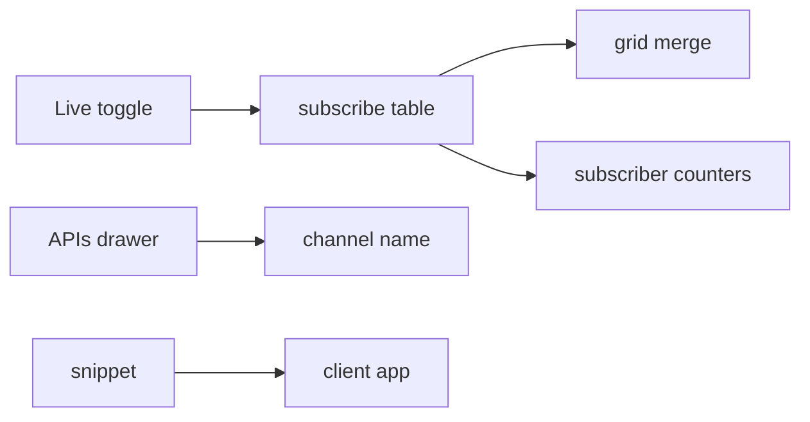

# S0086 — Studio live toggle, subscriber counters and client snippet

> **Status:** **done** 2026-11-03 (UI not viewed; snippet not run in a scratch app) · **Depends on** [[S0084-realtime-app-endpoint|S0084]] · **Phase:** [[../README]] · Parent: [[../../../../feature_list/Jord/todo/jord-F0026-live-data-client|jord-F0026]] · After ship: [[../../../../tech_space/jord/studio/README]]

## Routing (who / how long / which model)

| | |
|--|--|
| **Suggested agent** | mimir → **apollo** (UI) + **sindri** (counters) |
| **Companion skills** | `.agents/skills/apollo/` · `.agents/skills/graft/` |
| **Suggested model** | `gpt-5.6-sol-medium` |
| **Est. time** | **2–3 h** |
| **Parallel?** | **No** |

## Goal

Operators can see live data working: a **Live** toggle on the tables grid that subscribes/unsubscribes, subscriber count + recent events on the project dashboard, per-table channel names in the APIs drawer, and a generated per-project snippet (env block + connect + subscribe) that matches the real contract.

## Why now

The app contract shipped (S0084) but nothing in Studio proves it; the snippet also keeps docs and code from drifting.

## Context (read before coding)

| Kind | Where |
|------|-------|
| Intent | [[../../../../feature_list/Jord/todo/jord-F0026-live-data-client|jord-F0026]] (Studio, Client snippet) |
| Depends on | [[S0084-realtime-app-endpoint|S0084]] · [[S0058-inline-edit-live-sync|S0058]] (grid merge) · [[S0066-bucket-registry|S0066]] unrelated |
| Code today | `lib/realtime-table.ts` · `components/{table-browser,table-api-playground}.tsx` · dashboard cards from [[S0096-dashboard-ui|S0096]] (coordinate, do not duplicate) |
| Tests | typecheck + build; subscriber counter asserted via a server endpoint test |

**Do not break:** the grid merge from S0058 stays the single merge path; snippet never embeds the secret key.

## In scope

- Live toggle per table tab: on → subscribe with the active filter, badge shows "live"; off → unsubscribe. Errors surface as a dismissible banner.
- Dashboard counters: current subscribers, events/min, last event age (endpoint `GET /admin/projects/:id/realtime-stats`).
- APIs drawer: channel name per table (`p:<project>:<schema>.<table>`), copy button.
- Snippet generator: language tabs (JS/TS, Python, cURL where applicable) with the publishable key placeholder, env var names, connect + subscribe + unsubscribe, and a note that the secret key is server-only.
- Test: snippet output references only real endpoints/fields (assert against a fixture).

## Out of scope

Multi-table subscriptions · presence UI · SDK publishing.

## Diagram

## Steps (do in order)

1. Read `realtime-table.ts` + S0058 merge; wire the toggle into that path.
2. Add the stats endpoint + dashboard cards (coordinate with S0096).
3. Add channel names + snippet generator.
4. Tests for snippet accuracy and counter endpoint.
5. Typecheck + build; paste proof.
6. **docs_man**: studio tech_space live section; tick card.

## Done when

- [ ] Toggle subscribes/unsubscribes and shows a live badge
- [ ] Dashboard shows subscribers + events/min
- [ ] APIs drawer shows the channel name
- [ ] Snippet connects successfully in a scratch app
- [x] Proof pasted

## Proof

| Date | Command | Result |
|------|---------|--------|
| 2026-11-03 | `pnpm --filter @altr/jord-server test` (five cards + review fixes, one tree) | **447 passed** \| 22 skipped (54 files, 3 skipped) |
| 2026-11-03 | `tsc --noEmit` in `@altr/jord-server`, `@altr/jord`, `@altr/jord-client`, `@altr/jord-react`, `@altr/apolyx` | clean |
| 2026-11-03 | `pnpm exec tsc --noEmit` in `apps/jord-studio` (errors outside the stale ignored `.next/` types) | **0** |
| 2026-11-03 | `pnpm --filter @altr/jord test` \| `@altr/jord-client` \| `@altr/jord-react` \| `@altr/apolyx` | **138 \| 66 \| 47 \| 190 passed** |
| 2026-11-03 | `node --import tsx --test` on the Studio lib tests (policy tester, dashboard, snippets, realtime stats, live toggle, table apis) | **36 pass** |

## What shipped

| Piece | Fact |
|-------|------|
| Server | `GET /admin/projects/:id/realtime-stats` (operator admin; 401 / 403 / 404 / 410 like the stats route) -> `{version:1, generated_at, subscribers, eventsPerMin, lastEventAt, lastEventAgeMs, tables[{table,events}]}`; the existing single bus counter gained `lastEventAt()` and `topTables(n)` (top 10 over 60 s, at most 64 tracked tables via an O(1) `lastSeen` map, `jord_*` tables excluded from `tables` and `lastEventAt`); 2 s cached; mounted inside the stats routes so `app.ts` needed no edit |
| Grid | a per-tab **Live** toggle keeps the existing `/api/realtime` SSE and the single S0058 merge path; badge shows live / connecting / "Degraded - reconnecting"; a stream that closes for good turns the toggle off with a dismissible banner; deltas for another table are ignored defensively; state is a reducer, not persisted |
| Dashboard | the realtime section shows subscribers, events/min, "Last event Ns ago" (ticks each second), top tables, polls every 10 s while visible with loading / empty ("No live subscribers yet") / error-with-retry states |
| APIs drawer | per-table channel name `p:<project>:<schema>.<table>` with a copy button, plus a collapsible client snippets section |
| Snippets | one shared `lib/studio-snippets.ts` (also used by the S0096 connect card): JS/TS (real `createRealtime` from `@altr/jord-client`), Python (`websockets`, header `x-jord-key`, real `/p/<project>/realtime` path) and cURL (SSE with the `x-jord-key` **header**, because `?apikey=` is rejected on SSE); env var names `JORD_URL` / `JORD_PROJECT` / `JORD_PUBLISHABLE_KEY`; the secret key never appears and the panel says it is server-only; table, filter and key values are quoted per language (cURL uses `shellQuote` after review); tests assert every path, frame type, header and import against a fixture |

**Review (heimdall) fixes:** counter hot path made O(1), `lastEventAt` no longer moved by internal events, id validation on the BFF route, a defensive table check in the live merge, shell quoting of the table in the cURL snippet.

**Not verified (checklist items left open on purpose):** the toggle, dashboard counters and APIs drawer were typechecked and their logic unit-tested, and `/p/default` compiled and returned 200 in a dev server, but the authenticated UI was never viewed and the `realtime-stats` BFF route never returned a response; the snippets were not run against a live server or in a scratch app; `pnpm --filter @altr/jord-studio build` was not run.

**Known / follow-up:** the grid feed is table-level and unfiltered, so the grid filters apply client-side; `rtCache` is process-wide (one data plane); the old `realtimeChannelName` in `studio-table-apis.ts` is unused but kept for its test.

## After ship

| Update | Path |
|--------|------|
| tech_space | `Docs/tech_space/jord/studio/README.md` |
| Queue | [[../README]] |
