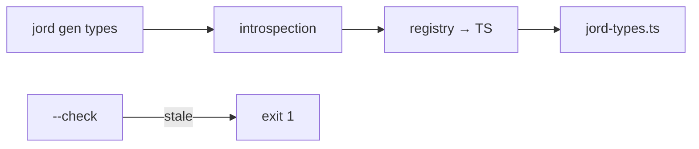

# S0087 — `jord gen types`

> **Status:** **done** 2026-11-03 · **Phase:** [[../README]] · Parent: [[../../../../feature_list/Jord/todo/jord-F0014-typed-dx|jord-F0014]] · After ship: [[../../../../tech_space/jord/apis/README]]

## Routing (who / how long / which model)

| | |
|--|--|
| **Suggested agent** | mimir → **sindri** (CLI + generation) with **saga** for the type mapping |
| **Companion skills** | `.agents/skills/graft/` · `.agents/skills/supabase-postgres-best-practices/` |
| **Suggested model** | `gpt-5.6-sol-medium` |
| **Est. time** | **2–3 h** |
| **Parallel?** | **No** — S0088 builds on the generated types |

## Goal

`jord gen types --url … --out lib/jord-types.ts [--schema app]` prints TypeScript: one interface per table (`Row`, `Insert`, `Update`), nullable columns as `| null`, a `Database` map keyed `schema.table`, and deterministic ordering/formatting so diffs are reviewable. Fails loudly on an unreachable database.

## Why now

`jord-F0014` starts with types; the client builder and React hooks are useless without them.

## Context (read before coding)

| Kind | Where |
|------|-------|
| Intent | [[../../../../feature_list/Jord/todo/jord-F0014-typed-dx|jord-F0014]] |
| Depends on | [[S0052-type-registry|S0052]] (type → TS mapping) · [[S0049-schema-scoped-introspection|S0049]] (schema scope) |
| Code today | CLI entry in `elements/jord` or `cloud/jord` (locate it) · `cloud/jord/src/table-api/openapi.ts` as an alternative source |
| Tests | snapshot test of the generated file for a fixture schema |

**Do not break:** no network calls at runtime — output is a plain `.ts` file; no secrets in it.

## In scope

- Command registration + flags (`--url`/env, `--schema`, `--out`, `--check` to fail when the file is stale).
- Mapping: registry id → TS type (int → number, bigint → string, numeric → string, json → unknown, timestamptz → string, bytea → Uint8Array/string — decide and document).
- `Insert` (defaults/identity optional) and `Update` (all optional) derivations; PK marked.
- Deterministic output (sorted tables/columns, single quotes, no timestamps) + header comment with the command that produced it.
- `--check` used in CI: failing when the schema changed but types were not regenerated.
- Tests: snapshot fixture; `--check` exit codes; unreachable URL → clear error, non-zero exit.

## Out of scope

Runtime validation (zod) · generating client methods ([[S0088-typed-client-builder|S0088]]) · watching mode.

## Diagram

## Steps (do in order)

1. Locate the CLI entry and the introspection API usable from a script.
2. Implement mapping + deterministic emitter.
3. Add `--check` and the CI hook note (do not wire CI yet if it needs secrets).
4. Snapshot tests + error paths.
5. Typecheck + test; paste the generated header in proof.
6. **docs_man**: apis tech_space typed DX; tick card.

## Done when

- [x] Generates valid TypeScript for a fixture schema on both dialects — the generator is dialect-agnostic (it reads the server introspection JSON); proven on fixtures, not against live Postgres
- [x] Output is deterministic across runs
- [x] `--check` fails on stale types
- [x] Unreachable database exits non-zero with a clear message
- [x] Proof pasted

## Proof

| Date | Command | Result |
|------|---------|--------|
| 2026-11-03 | `pnpm --filter @altr/jord-server test` (four cards + review fixes, one tree) | **347 passed** \| 22 skipped (44 files, 3 skipped) |
| 2026-11-03 | `pnpm --filter @altr/jord-server exec tsc --noEmit` / `@altr/jord` tsc | clean / clean |
| 2026-11-03 | `pnpm --filter @altr/jord test` | **138 passed** \| 12 skipped |
| 2026-11-03 | `pnpm --filter @altr/jord-client test` | **16 passed** |

## What shipped

| Piece | Fact |
|-------|------|
| Home | no `jord` CLI existed, so it lives in `@altr/jord-client` (`elements/jord-client/src/cli/{gen-types,run,bin}.ts`), node built-ins only (`fetch`, `util.parseArgs`), no new dependency. Run: `pnpm --filter @altr/jord-client jord gen types --url <server> [--token T] [--schema S] [--out F] [--check]` (script uses `tsx`, which is not a dependency of the package — see follow-up) |
| Source | HTTP introspection with a Bearer token: `GET /schema/tables?schema=` then `GET /schema/tables/:name` (columns, `logicalType`, `foreignKeys`). Token from `--token`, `JORD_TOKEN` or `JORD_SERVER_TOKEN`; URL from `JORD_URL` |
| Output | per table `Row` / `Insert` / `Update`, nullable as `| null`, `Database` map keyed `schema.table`, PK noted; sorted, single quotes, no timestamps, header comment with the command (never the token; absolute `--out` paths reduced to the file name) |
| Mapping | integer / smallint / real / double -> number; bigint / numeric / decimal -> string; boolean; text, varchar, uuid, enum, date/time types, inet/cidr/macaddr -> string; json/jsonb -> unknown; blob/bytea -> string (base64); array -> unknown[]; vector / halfvec / f32_blob -> number[]; anything else -> unknown with a comment |
| Exit codes | 0 ok · 1 unreachable, unauthorized, stale or missing file · 2 usage error; errors never print stack traces or the token |
| Hardening | review fixes: prototype-named types (`constructor`, `__proto__`) map to unknown, 16 MiB response cap, 2000-table cap, server JSON shape validated, redirects refused (the Authorization header is never forwarded) |

**Known / follow-up:** identity columns are guessed as a single-column integer PK (introspection has no identity flag); vectors match by type name only; `tsx` is invoked by the script but not declared, so the CLI is only exercised through the injected-I/O tests, not as a real process; no `bin` entry yet; the mapping table lives in the generated header and this page, not in a package README; the token over plain `http://` is not warned about.

## After ship

| Update | Path |
|--------|------|
| tech_space | `Docs/tech_space/jord/apis/README.md` |
| Queue | [[../README]] |
