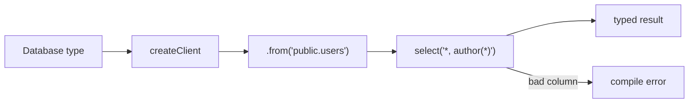

# S0088 — typed table builder in `@altr/jord-client`

> **Status:** **done** 2026-11-03 (server gaps listed) · **Depends on** [[S0087-gen-types-cli|S0087]] · **Phase:** [[../README]] · Parent: [[../../../../feature_list/Jord/todo/jord-F0014-typed-dx|jord-F0014]] · After ship: [[../../../../tech_space/jord/apis/README]]

## Routing (who / how long / which model)

| | |
|--|--|
| **Suggested agent** | mimir → **sindri** (client SDK) |
| **Companion skills** | `.agents/skills/graft/` · `.agents/skills/vercel-react-best-practices/` |
| **Suggested model** | `claude-sonnet-5-5-high` — generic typing over a schema map |
| **Est. time** | **3 h** |
| **Parallel?** | **No** |

## Goal

`createClient<Database>({ url, key })` exposes `.from('public.users')` with typed `select`, `insert`, `update`, `delete`, `eq/neq/gt/lt/in/or`, `order`, `limit`, `range`, and `select` strings that type the result — including the `author(*)` embed from [[S0078-fk-embeds|S0078]]. Wrong column names and wrong insert shapes are compile errors.

## Why now

`jord-F0014` acceptance is "a column rename breaks the consumer app's typecheck"; that only exists once the builder is typed end to end.

## Context (read before coding)

| Kind | Where |
|------|-------|
| Intent | [[../../../../feature_list/Jord/todo/jord-F0014-typed-dx|jord-F0014]] |
| Depends on | [[S0087-gen-types-cli|S0087]] · [[S0078-fk-embeds|S0078]] · [[S0079-keyset-pagination|S0079]] |
| Code today | `elements/jord-client` (existing untyped HTTP client — extend, do not fork) |
| Tests | type-level tests (`expectTypeOf` / `@ts-expect-error` cases) + runtime tests against a stub server |

**Do not break:** existing client methods and their response shapes; no runtime dependency added for types.

## In scope

- `createClient<Database>()` with a table builder over the `schema.table` map.
- Filter operators typed by column type (no `gt` on boolean unless allowed), `order` restricted to columns, `range`/`limit` numeric.
- Select-string typing for a reasonable subset (`*`, explicit columns, one-level embeds with alias).
- `single()`/`maybeSingle()` result typing; insert returns the selected projection.
- Type tests: valid calls compile; wrong column, wrong insert shape, bad embed all fail with `@ts-expect-error`.
- Consumer proof: a small fixture app (or test file) that fails to typecheck after a simulated column rename.

## Out of scope

Codegen of methods per table · zod runtime validation · React hooks ([[S0089-react-bindings|S0089]]).

## Diagram

## Steps (do in order)

1. Read the existing client; keep its transport, add the builder facade.
2. Implement types + operators.
3. Add select-string typing incl. one embed.
4. Type tests + runtime stub tests.
5. Prove the rename scenario breaks the fixture typecheck; paste output.
6. Typecheck + test; **docs_man** tick card.

## Done when

- [x] Builder compiles for valid chains and rejects invalid ones (type tests)
- [x] Embed select returns typed nested objects
- [x] Renaming a column breaks the fixture typecheck (pasted) — the consumer-proof test renames `title` to `headline` through the TypeScript compiler API and asserts diagnostics
- [x] Existing client tests still green
- [x] Proof pasted

## Proof

| Date | Command | Result |
|------|---------|--------|
| 2026-11-03 | `pnpm --filter @altr/jord-server test` (five cards + review fixes, one tree) | **424 passed** \| 22 skipped (51 files, 3 skipped) |
| 2026-11-03 | `pnpm --filter @altr/jord-server exec tsc --noEmit` / `@altr/jord` tsc | clean / clean |
| 2026-11-03 | `pnpm --filter @altr/jord test` | **138 passed** \| 12 skipped |
| 2026-11-03 | `pnpm --filter @altr/jord-client test` | **39 passed** (typed builder + rename proof + gen types) |
| 2026-11-03 | `node --test scripts/audit-ci.test.mjs` | **12 pass** |

## What shipped

| Piece | Fact |
|-------|------|
| Entry | `createClient<Database>({url, key, fetch?})` in `@altr/jord-client` (`src/typed/`); `.from('schema.table')` or `.from('table')` returns `select / insert / update / delete`; zero runtime dependencies, existing untyped client untouched |
| Query | filters `eq neq gt gte lt lte in like ilike is or` typed by column type (`gt`/`lt` only on number and string columns), `order`, `limit`, `range`, `count`, `cursor`, `single`, `maybeSingle`, and an async `paginate()` generator (stops on a repeated cursor, `maxPages` default 1000, validates `pageSize`, reads only); mutations chain `.select('id')` |
| Result | every call resolves to `{data, error, status, count, nextCursor, hasMore}`; HTTP and network errors never throw; each awaited query sends exactly one request |
| Typed selects | `'*'`, `'a,b'`, `'*,author(*)'`, `'id,author:users(name)'`; many-to-one embeds type as `T | null`, one-to-many as arrays; an invalid select resolves to a readable `SelectError` type; at most 24 items |
| Tests | 39 package tests: type tests with genuinely required `@ts-expect-error`s, wire-format tests (escaping of commas, parens, quotes, unicode), consumer proof (column rename breaks the fixture) |

**Review (heimdall) fixes:** column, schema and table names are validated against an identifier pattern at runtime (types are erased, so `as any` callers cannot inject query grammar), requests use `redirect:"error"` so `apikey` and `Authorization` are never forwarded to another origin, `paginate()` is loop-safe.

**Known gaps — server and generator do not yet match the client:** the Table API has no `or=` filter, does not unquote `in.(...)` values (values holding commas will not round-trip), ignores the `apikey` header (it reads `Authorization`), and accepts one JSON object per POST, so an **array insert returns 400 until it is pointed at `/api/v1/:table/bulk` (S0080)**; `gen-types` emits no `Relationships`, so an embed name must equal a table name in the same schema and is assumed many-to-one; nested embeds and column aliases are rejected; embed selects on mutations type-check but the server answers 400.

## After ship

| Update | Path |
|--------|------|
| tech_space | `Docs/tech_space/jord/apis/README.md` |
| Queue | [[../README]] |
