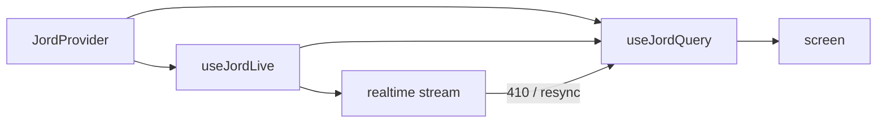

# S0089 — React bindings package

> **Status:** **done** 2026-11-03 (no consumer screen yet) · **Depends on** [[S0088-typed-client-builder|S0088]] + [[S0085-realtime-reconnect|S0085]] · **Phase:** [[../README]] · Parent: [[../../../../feature_list/Jord/todo/jord-F0014-typed-dx|jord-F0014]] · After ship: [[../../../../tech_space/jord/apis/README]]

## Routing (who / how long / which model)

| | |
|--|--|
| **Suggested agent** | mimir → **sindri** (package) + **apollo** (consumer screen) |
| **Companion skills** | `.agents/skills/vercel-react-best-practices/` · `.agents/skills/apollo/` · `.agents/skills/graft/` |
| **Suggested model** | `claude-sonnet-5-5-high` |
| **Est. time** | **3 h** |
| **Parallel?** | **No** |

## Goal

A **separate** package (`@altr/jord-react`) with `<JordProvider>`, `useJordQuery` (typed fetch with cache + refetch) and `useJordLive` (subscription merged into the cached list, resync on `resync_required`/410). One Apolyx app screen consumes it as the first real user.

## Why now

`jord-F0014` explicitly keeps React bindings out of the core client; without them every app reimplements cache + live merge.

## Context (read before coding)

| Kind | Where |
|------|-------|
| Intent | [[../../../../feature_list/Jord/todo/jord-F0014-typed-dx|jord-F0014]] |
| Depends on | [[S0088-typed-client-builder|S0088]] · [[S0085-realtime-reconnect|S0085]] |
| Code today | `elements/jord-client` · workspace conventions for new packages (`elements/*` naming, `@altr/*` scope) |
| Consumer | an existing Apolyx app screen (pick the smallest real one) |

**Do not break:** base has no element dependency; keep the package independently add/removable per the dependency rules doc.

## In scope

- Package scaffold matching workspace conventions (`elements/jord-react`, `@altr/jord-react`, typecheck/test/lint scripts).
- `JordProvider` (client, defaults), `useJordQuery({ table, select, filter, order, limit })` with in-memory cache keyed by the query, stale/refetch semantics, and abort on unmount.
- `useJordLive(query)` = query + subscription: apply deltas to the cached list by PK, drop duplicates, resync (refetch snapshot) on `resync_required` or 410.
- Optimistic helpers optional: expose `mutate` to update the cache after a write.
- Tests: cache reuse, abort, live merge, resync path (stub transport).
- Consumer screen migrated and typechecked.

## Out of scope

Suspense data fetching · server-side rendering integration · offline persistence · publishing to npm.

## Diagram

## Steps (do in order)

1. Scaffold the package per workspace conventions; confirm dependency rules.
2. Implement provider + query cache.
3. Implement live merge + resync.
4. Write transport-stub tests.
5. Migrate one screen; typecheck the whole workspace.
6. **docs_man**: apis tech_space + elements README entry; tick card.

## Done when

- [x] Package typechecks and tests independently
- [x] `useJordQuery` caches and refetches correctly
- [x] `useJordLive` applies deltas and resyncs on 410
- [ ] One real screen uses it; workspace typecheck green
- [x] Proof pasted

## Proof

| Date | Command | Result |
|------|---------|--------|
| 2026-11-03 | `pnpm --filter @altr/jord-server test` (five cards + review fixes, one tree) | **447 passed** \| 22 skipped (54 files, 3 skipped) |
| 2026-11-03 | `tsc --noEmit` in `@altr/jord-server`, `@altr/jord`, `@altr/jord-client`, `@altr/jord-react`, `@altr/apolyx` | clean |
| 2026-11-03 | `pnpm exec tsc --noEmit` in `apps/jord-studio` (errors outside the stale ignored `.next/` types) | **0** |
| 2026-11-03 | `pnpm --filter @altr/jord test` \| `@altr/jord-client` \| `@altr/jord-react` \| `@altr/apolyx` | **138 \| 66 \| 47 \| 190 passed** |
| 2026-11-03 | `node --import tsx --test` on the Studio lib tests (policy tester, dashboard, snippets, realtime stats, live toggle, table apis) | **36 pass** |
| | `pnpm typecheck` (or the workspace equivalent) | |

## What shipped

| Piece | Fact |
|-------|------|
| Package | `elements/jord-react` (`@altr/jord-react`, private workspace package): depends on `@altr/jord-client`, `react` is a peer (`^18 || ^19`); dev-only additions `react` / `react-dom` / `@types/*` 19.3.0, `@testing-library/react` 16.3.3, `@testing-library/dom` 10.4.2, `jsdom` 26.1.0 |
| API | `<JordProvider client realtime? scope? gcTimeMs? maxEntries?>`, `useJordClient()`, `useJordRealtime()`, `useJordCache()` (`invalidate`, `clear`), `useJordQuery({table, select, filter, order, limit, pk?, enabled?, staleTimeMs?})` -> `{data, error, status, isLoading, isFetching, refetch, setData, mutate, invalidate}`, `useJordLive(q)` (same plus `liveState`, `liveError`); credentials are never inputs to a cache key |
| Cache | one `QueryCache` per provider via `useSyncExternalStore` (stable server snapshot); stable query keys; one request for concurrent identical queries; stale-while-revalidate; superseded or unobserved results are ignored (the client fetch takes no `AbortSignal`); unobserved entries dropped after `gcTimeMs` (5 min); LRU beyond 100 entries (observed entries are never evicted, one warning); errors reduced to `{status, code, message}`; StrictMode sends exactly one request |
| Live | one shared, ref-counted subscription per query; deltas merge by primary key only when the list is unordered and unlimited and the PK is in the selection, rows are projected to the selected columns, merges are immutable; anything else (order, limit, embeds, missing PK or filter column) marks the entry stale and refetches debounced 250 ms; deltas are deduplicated by `seq`; a resync snapshot replaces the list or refetches; **fetch / delta race:** deltas that arrive during a fetch are buffered and replayed by `seq` after the payload lands, and a realtime snapshot mid-fetch cancels that fetch |
| Identity | changing `client`, `realtime` or `scope` disposes the old cache (timers cleared, live subscriptions closed, entries dropped), so one user rows are never served to the next — apps must pass `scope` (user id or auth epoch) whenever the same client object can change identity, and `useJordCache().clear()` belongs in sign-out |

**Review (heimdall) fixes:** a late fetch could resurrect a deleted row (the race above), cached rows leaked across a user switch, partial selects without the PK appended duplicates, rows missing the filter column were merged, StrictMode duplicated the request, snapshots were mutated without notifying, throwing listeners broke others. 47 tests (17 added for the fixes). React 18.3.1 was run once from the old pnpm store with a local alias config (47 pass) — that run is **not** in CI.

**Not done (checklist item left open):** "One real screen uses it" — no Studio screen consumes the package yet (Studio talks to the server through an admin BFF, not publishable keys, so the natural first consumers are a dashboard or Auth users list wired through a project client); the workspace-wide typecheck was run per package, not as one command.

**Known / follow-up:** `JordClientLike` is structural, so row types are `Record<string, unknown>` and not inferred from `Database`; the SSR test runs in jsdom with `window` removed, not a Node environment.

## After ship

| Update | Path |
|--------|------|
| tech_space | `Docs/tech_space/jord/apis/README.md` |
| Queue | [[../README]] |
