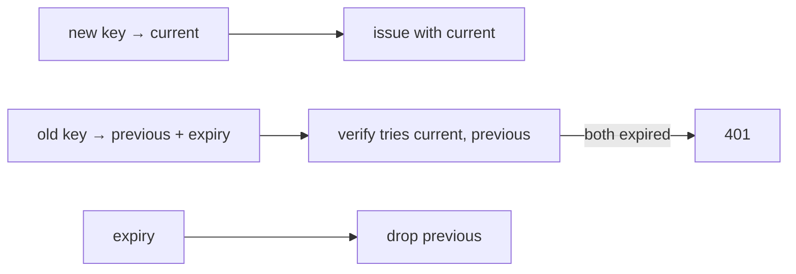

# S0093 — key-rotation runbook

> **Status:** **done** 2026-11-03 (drill is a test, not a live rehearsal) · **Phase:** [[../README]] · Parent: [[../../../../feature_list/Jord/todo/jord-F0019-security-pass|jord-F0019]] · After ship: [[../../../../tech_space/jord/auth/README]]

## Routing (who / how long / which model)

| | |
|--|--|
| **Suggested agent** | **heimdall** (runbook) + **sindri** (multi-key verification) |
| **Companion skills** | `.agents/skills/security-and-hardening/` · `.agents/skills/graft/` · `.agents/skills/documentation-and-adrs/` |
| **Suggested model** | `claude-sonnet-5-5-high` |
| **Est. time** | **2–3 h** |
| **Parallel?** | **No** |

## Goal

Every signing secret can be rotated without an outage: JWT signing key, local blob HMAC key, project secret/publishable keys, and (from S0067/S0071) provider credentials. Verification accepts old **and** new during a documented overlap window; the runbook says exactly what to run, in what order, and how to prove it.

## Why now

`jord-F0019` requires a rotation runbook; without multi-key verification, rotating the JWT key logs every user out at once.

## Context (read before coding)

| Kind | Where |
|------|-------|
| Intent | [[../../../../feature_list/Jord/todo/jord-F0019-security-pass|jord-F0019]] |
| Code today | `cloud/jord/src/auth/{jwt,token}.ts` · `cloud/jord/src/storage/{sign-policy,local}.ts` · project keys from [[S0043-project-registry-api|S0043]] |
| As-built | [[../../../../tech_space/jord/auth/README]] · [[../../../../tech_space/jord/blobs/README]] |
| Tests | `cloud/jord/src/auth/token.test.ts` |

**Do not break:** existing tokens during rotation; the signed-URL 1 h TTL clamp; revoke semantics from [[S0076-sessions-claims|S0076]].

## In scope

- Key sets (not single keys): `current` + `previous` with an expiry; verification tries each; issuance always uses `current`.
- Commands: rotate JWT key, rotate blob HMAC key, rotate a project key, revoke a compromised key immediately (no overlap).
- Runbook: pre-checks, order of operations, overlap duration, what breaks if you skip a step, rollback.
- Drill: rotate in a local instance, prove a token minted before rotation still verifies (within overlap) and fails after `previous` expires.
- Tests: dual-key verification; expired previous key rejected; re-signed URLs with the new key work.

## Out of scope

KMS integration (the runbook states it as the production hardening path) · automatic rotation schedules.

## Diagram

## Steps (do in order)

1. Read jwt/token + sign-policy; list every secret with a verification path.
2. Implement the key-set model for each.
3. Add rotation commands/endpoints.
4. Write the runbook with the drill transcript.
5. Tests: overlap, expiry, immediate revoke.
6. Typecheck + test; paste proof.
7. **docs_man**: auth + blobs tech_space rotation sections; tick card.

## Done when

- [x] Rotation accepts old + new during the overlap (tested)
- [x] After overlap, old keys fail (tested)
- [x] Immediate revoke path exists for a compromised key
- [x] Runbook has exact commands and a pasted drill — the drill is the automated combined test in `key-rotation.test.ts`; it has not been run against a deployed instance
- [x] Proof pasted

## Proof

| Date | Command | Result |
|------|---------|--------|
| 2026-11-03 | `pnpm --filter @altr/jord-server test` (five cards + review fixes, one tree) | **424 passed** \| 22 skipped (51 files, 3 skipped) |
| 2026-11-03 | `pnpm --filter @altr/jord-server exec tsc --noEmit` / `@altr/jord` tsc | clean / clean |
| 2026-11-03 | `pnpm --filter @altr/jord test` | **138 passed** \| 12 skipped |
| 2026-11-03 | `pnpm --filter @altr/jord-client test` | **39 passed** (typed builder + rename proof + gen types) |
| 2026-11-03 | `node --test scripts/audit-ci.test.mjs` | **12 pass** |

## What shipped

| Piece | Fact |
|-------|------|
| Runbook | `security/key-rotation-runbook.md`: pre-checks, order per key type, overlap table, exact calls, how to prove it, what breaks if a step is skipped, rollback, emergency revoke |
| JWT | `POST /admin/auth/jwt/rotate {overlap_seconds?, revoke_previous?}` and `POST /admin/auth/jwt/revoke-previous`; the previous key is sealed in `jord_key_sets` with an expiry that is checked on every call (max 7 days); a token minted with `kid=current` before a rotation verifies against `previous` during the overlap. A bare rotate still invalidates old tokens at once (existing S0071 behaviour); overlap is opt-in |
| Blob HMAC | key set (current + previous with expiry) in `jord_key_sets`; `/admin/storage/keys` `GET`, `rotate`, `revoke-previous`; signed URLs (download, transform, multipart PUT) verify against every live key and are always issued with the current one; default overlap 2 h |
| Project keys | `rotate-keys` with overlap/revoke options (default 24 h) and `revoke-previous-keys`; keys stored as hashes only; the plaintext secret is returned once, at rotation; one constant-time verifier is shared with the realtime app endpoint |
| Defaults | `overlap_seconds` omitted = per-type default (JWT 0, blob 2 h, project 24 h); an explicit 0 = no overlap everywhere |
| Safety | rotation writes current + previous in **one transaction** (a failed second statement leaves the old state intact, tested for all three key types); **fails closed**: if a stored key exists but cannot be read or unsealed, verification gets no keys and issuance is 503 — the env key is used only when the database confirms there is no stored key; revoke also disables the env previous key (`previous_revoked`); fingerprints are a keyed 12-hex HMAC so a weak base secret cannot be tested offline |
| Anon keys | signed with the current JWT key and long-lived: the rotate response carries `anon_keys_affected` and `anon_keys_valid_until`, and the runbook says to reissue them and redeploy clients before the overlap ends |
| Audit | every rotate or revoke writes a `jord_logs` row (`auth.jwt`, `storage.keys`, `projects.keys`) with no key material |
| Migration | `0028_key_sets` (both dialects): `jord_key_sets`, `jord_project_key_previous` |

**Review (heimdall, opus) fixes:** non-atomic rotation, fallback to a superseded env key on read errors, revoke not stopping the env previous key, inconsistent overlap-0 semantics, unsalted fingerprints, a half-archived project state, and several runbook inaccuracies.

**Known / follow-up:** a development database that already ran the first draft of `0028` fails the migration checksum and must be recreated; peers see a rotation or revoke within about 5 s (wait 10 s between rotations); open realtime sockets drop at their next recheck; background jobs (`jobs/kinds.ts`) still build storage from the env blob secret (they only garbage-collect, nothing is signed); env fallback keys never expire; the Postgres runtime and RLS for the new tables were not exercised here.

## After ship

| Update | Path |
|--------|------|
| tech_space | `Docs/tech_space/jord/auth/README.md` |
| Queue | [[../README]] |
