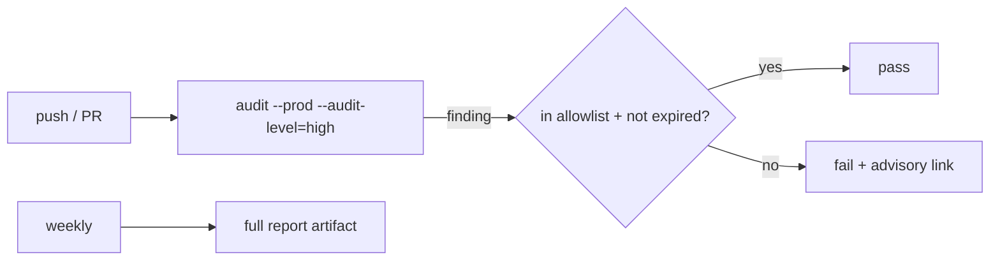

# S0094 — dependency audit in CI

> **Status:** **done** 2026-11-03 (CI workflow not yet run; 9 findings open) · **Phase:** [[../README]] · Parent: [[../../../../feature_list/Jord/todo/jord-F0019-security-pass|jord-F0019]] · After ship: [[../../../../tech_space/jord/overview/README#ci]]

## Routing (who / how long / which model)

| | |
|--|--|
| **Suggested agent** | **heimdall** |
| **Companion skills** | `.agents/skills/security-and-hardening/` · `.agents/skills/ci-security-scanning-with-strix/` (only if a deeper scan is wanted) |
| **Suggested model** | `composer-2.5-fast` — one workflow job plus a policy file |
| **Est. time** | **45–75 min** |
| **Parallel?** | **No** |

## Goal

CI fails on a known high/critical vulnerability in **production** dependencies, with a checked-in allowlist (package, advisory id, reason, expiry) so a false positive or an unavoidable transitive cannot silently break the build, and a non-blocking weekly report for dev dependencies.

## Why now

`jord-F0019` asks for it, and the workspace has grown (`@aws-sdk`, OTel, Monaco, image codecs) exactly where advisories appear.

## Context (read before coding)

| Kind | Where |
|------|-------|
| Intent | [[../../../../feature_list/Jord/todo/jord-F0019-security-pass|jord-F0019]] |
| CI today | `.github/workflows/jord.yml` (`jord` + `jord-postgres` jobs, MinIO) |
| Package manager | pnpm workspace (`pnpm-lock.yaml`) |
| Tests | the workflow job itself is the proof; run locally with the same command |

**Do not break:** do not add a job that needs secrets; keep the existing jobs' runtime reasonable.

## In scope

- `pnpm audit --prod --audit-level=high` (or the equivalent that respects the lockfile) as a blocking job.
- Allowlist file with expiry dates; expired entries fail the job.
- Weekly scheduled run over all dependencies (non-blocking) with a summary artifact.
- Local script `pnpm audit:ci` so developers reproduce the failure.
- Doc: how to triage, how to add an exception, when to drop one.

## Out of scope

SAST of source code (that is S0092's pentest) · license compliance · container image scanning.

## Diagram

## Steps (do in order)

1. Read the workflow; add the job to the existing file (same runner + pnpm cache).
2. Add the allowlist file + expiry validation.
3. Add the scheduled full report.
4. Run the command locally; paste real output.
5. **docs_man**: overview CI section; tick card.

## Done when

- [x] PR job fails on a high production advisory — demonstrated locally: `pnpm audit:ci` exits 1 on real advisories (see below); the GitHub workflow itself has **not** run yet
- [x] Allowlist entry requires a reason + expiry; expired entry fails (unit-tested)
- [ ] Weekly job runs without secrets
- [x] Proof pasted

## Proof

| Date | Command | Result |
|------|---------|--------|
| 2026-11-03 | `pnpm --filter @altr/jord-server test` (four cards + review fixes, one tree) | **347 passed** \| 22 skipped (44 files, 3 skipped) |
| 2026-11-03 | `pnpm --filter @altr/jord-server exec tsc --noEmit` / `@altr/jord` tsc | clean / clean |
| 2026-11-03 | `pnpm --filter @altr/jord test` | **138 passed** \| 12 skipped |
| 2026-11-03 | `pnpm --filter @altr/jord-client test` | **16 passed** |

## What shipped

| Piece | Fact |
|-------|------|
| Gate | `scripts/audit-ci.mjs` (`pnpm audit:ci`) runs `pnpm audit --prod --audit-level=high --json`, applies `security/audit-allowlist.json` (entries need package, advisory, reason, expiry; max 90 days), fails on any remaining high/critical advisory and on any expired entry, and separates a **network failure** ("not a vulnerability finding") from a vulnerability failure |
| Workflow | `.github/workflows/audit.yml`: blocking `audit` job on pull_request + push to main; weekly `audit-full` job (non-blocking) uploading a summary artifact. Matches the pins in `jord.yml` (pnpm 10.27.0, node 22) |
| Docs | `security/README.md`: triage, adding an exception, dropping one, running locally. Root scripts `audit:ci`, `audit:all` |
| Tests | `node --test scripts/audit-ci.test.mjs`: **12 pass** (expired entry fails, active entry suppresses, unlisted high fails, low/moderate ignored, malformed entry rejected, network vs vulnerability classified) |

**Real result of `pnpm audit:ci` on 2026-11-03 (exit 1):** 17 advisories (critical 2, high 7); **9 un-allowlisted high/critical production findings**: `drizzle-orm` (GHSA-gpj5-g38j-94v9), `postcss` x2 and `source-map-js` (via Apolyx / Next), `sharp`, `next` critical (GHSA-2464-fhr4-w9xw) and high (GHSA-p3m5-59mp-jv5r), `dompurify` critical and high (via `monaco-editor`). **Nothing was allowlisted to make it pass.** Until these are upgraded or triaged with expiring exceptions, the blocking CI job will fail.

**Not verified:** the workflow on GitHub (only the YAML parse and the script were run); the card's "weekly job runs without secrets" item stays unchecked for that reason. The `audit` job skips `pnpm install` and relies on `pnpm audit` working from the lockfile alone.

## After ship

| Update | Path |
|--------|------|
| tech_space | `Docs/tech_space/jord/overview/README.md` |
| Queue | [[../README]] |
