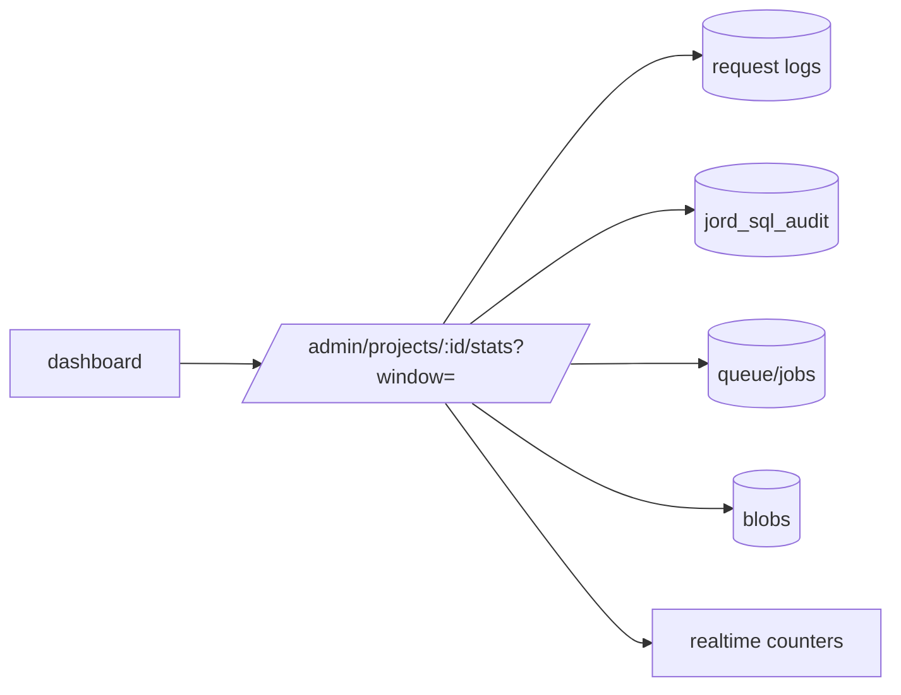

# S0095 — `GET /admin/projects/:id/stats`

> **Status:** **done** 2026-11-03 (index-plan proof open) · **Depends on** [[S0043-project-registry-api|S0043]] · **Phase:** [[../README]] · Parent: [[../../../../feature_list/Jord/todo/jord-F0022-project-dashboard|jord-F0022]] · After ship: [[../../../../tech_space/jord/studio/README]]

## Routing (who / how long / which model)

| | |
|--|--|
| **Suggested agent** | mimir → **sindri** |
| **Companion skills** | `.agents/skills/supabase-postgres-best-practices/` · `.agents/skills/graft/` |
| **Suggested model** | `claude-sonnet-5-5-high` — aggregate query correctness |
| **Est. time** | **2.5–3 h** |
| **Parallel?** | **No** — the dashboard UI is built against this shape |

## Goal

One endpoint returns the dashboard's numbers for a window (`?window=1h|24h|7d`): request counts by method/status, error rate, p50/p95 latency, write-queue depth, table count + row estimates, database size, blob bytes, policy count, job failures, realtime subscribers/events. No second telemetry pipeline — read existing logs/audit/queue tables.

## Why now

`jord-F0022` names this endpoint; building charts against ad-hoc client queries would drift from what the server actually records.

## Context (read before coding)

| Kind | Where |
|------|-------|
| Intent | [[../../../../feature_list/Jord/todo/jord-F0022-project-dashboard|jord-F0022]] (Blocks + "not a second telemetry pipeline") |
| Code today | `cloud/jord/src/logs/` · `jord_sql_audit` · `cloud/jord/src/queue.ts` · `cloud/jord/src/jobs/` · `blobs/` |
| Realtime | subscriber counters from [[S0086-live-toggle-snippet|S0086]] |
| Tests | `cloud/jord/src/app.test.ts` + a fixtures test for the aggregate |

**Do not break:** read-only route, admin-only, no full table scans on large request logs (bound the window and use indexes).

## In scope

- Response shape (versioned): `{ window, requests: { total, byStatus, byMethod, series[] }, latency: { p50, p95 }, errors: [...], queue: { depth }, db: { tables, rowsEstimate, sizeBytes }, blobs: { bytes, objects }, policies: n, jobs: { failures }, realtime: { subscribers, eventsPerMin } }`.
- Aggregates from existing sources only; percentile computation documented (approximate vs exact).
- Bounded cost: window + limit, index check, and a timeout that returns partial data with a flag rather than hanging.
- Tests: fixed fixture → known counts/percentiles; large-window cost check; unreachable DB → error shape the UI can render.
- OpenAPI entry.

## Out of scope

Retention/Prometheus · alerting · per-table breakdown beyond "top N".

## Diagram

## Steps (do in order)

1. Inventory what each source already records; drop anything not recorded instead of inventing instrumentation.
2. Write the aggregate queries + percentile approach.
3. Implement the endpoint with the window + timeout + partial flag.
4. Fixtures test with exact expected numbers.
5. OpenAPI + docs.
6. Typecheck + test; paste proof.
7. **docs_man**: studio tech_space dashboard data section; tick card.

## Done when

- [x] Numbers reconcile with recorded requests for a fixed window (tested)
- [ ] Window bounded; query plan uses indexes
- [x] Unreachable DB returns a renderable error — `503 stats_unavailable` with `partial_sections`; unit-tested at `collectProjectStats`
- [x] No new telemetry pipeline added — one in-process bus listener counts realtime events
- [x] Proof pasted

## Proof

| Date | Command | Result |
|------|---------|--------|
| 2026-11-03 | `pnpm --filter @altr/jord-server test` (five cards + review fixes, one tree) | **424 passed** \| 22 skipped (51 files, 3 skipped) |
| 2026-11-03 | `pnpm --filter @altr/jord-server exec tsc --noEmit` / `@altr/jord` tsc | clean / clean |
| 2026-11-03 | `pnpm --filter @altr/jord test` | **138 passed** \| 12 skipped |
| 2026-11-03 | `pnpm --filter @altr/jord-client test` | **39 passed** (typed builder + rename proof + gen types) |
| 2026-11-03 | `node --test scripts/audit-ci.test.mjs` | **12 pass** |

## What shipped

| Piece | Fact |
|-------|------|
| Route | `GET /admin/projects/:id/stats?window=1h|24h|7d` (operator admin only; 401 / 403 / 400 `invalid_window` / 404 unknown project / 410 archived) |
| Shape | `{project_id, version:1, window, generated_at, partial, partial_sections[], requests{total, byStatus (2xx/4xx/5xx), byMethod, series[], bucketMs, errorRate, truncated, sampled}, latency{p50, p95, method}, errors[top 10], sqlAudit{total, failures}, queue{depth}, db{tables, rowsEstimate, sizeBytes, top[]}, blobs{bytes, objects}, policies, jobs{failures}, realtime{subscribers, eventsPerMin}}` |
| Sources | request counts and latency from persisted `jord_logs` rows (`source='http'`, newest 20 000 in the window, read backwards through `jord_logs_at_idx`); `jord_sql_audit`; failed rows in `jord_job_runs`; the write-queue `pending()`; introspection for tables, row estimates and size (libSQL: `sqlite_master` + page count; Postgres: `pg_class.reltuples` + `pg_database_size`); capped sums over `jord_blobs`; policy count |
| Percentiles | exact nearest-rank over the sampled rows (error bound 0); when more than 20 000 requests fall in the window `truncated:true` and the numbers describe the newest 20 000 |
| Cost bounds | every section has a 2 s timeout and becomes `null` with `partial:true`; counts cap at 100k; if every database section fails the route answers `503 stats_unavailable`; a single-flight plus 5 s cache per window stops repeated polls from stacking queries on the single connection |
| Privacy | the `errors` list templates paths (`/blobs/<bucket>/objects/:key`, ids and long or `@` segments become `:id`), so record ids and user-chosen object keys never reach the dashboard |

**Review fixes:** error-path templating and the single-flight cache (both from the heimdall review).

**Not done / known:** "query plan uses indexes" is unchecked — the scan relies on `jord_logs_at_idx` by design, but no `EXPLAIN` output was captured; the admin routes have no OpenAPI host, so `PROJECT_STATS_OPENAPI` is exported but not served; `:id` only has to be an active project (stats always describe this data plane); a timed-out query is not cancelled in the driver; the route-level 503 is tested only at the collector level; the realtime counter takes one bus subscriber slot and is never disposed on shutdown; the Postgres branch is untested.

## After ship

| Update | Path |
|--------|------|
| tech_space | `Docs/tech_space/jord/studio/README.md` |
| Queue | [[../README]] |
