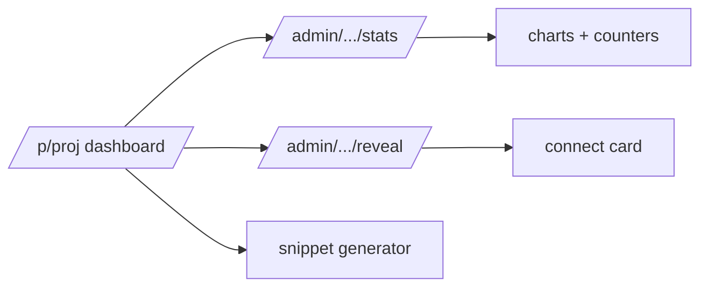

# S0096 — project dashboard UI

> **Status:** **done** 2026-11-03 (not viewed authenticated; reconcile / bundle-scan / rotation checks open) · **Depends on** [[S0095-project-stats-endpoint|S0095]] · **Phase:** [[../README]] · Parent: [[../../../../feature_list/Jord/todo/jord-F0022-project-dashboard|jord-F0022]] · After ship: [[../../../../tech_space/jord/studio/README]]

## Routing (who / how long / which model)

| | |
|--|--|
| **Suggested agent** | mimir → **apollo** |
| **Companion skills** | `.agents/skills/apollo/` · `.agents/skills/animate/` (chart motion, restrained) · `.agents/skills/web-design-guidelines/` |
| **Suggested model** | `claude-sonnet-5-5-high` |
| **Est. time** | **3 h** |
| **Parallel?** | **No** |

## Goal

`/p/[project]` lands on a dashboard: health, request charts (reads/writes/errors, p50/p95, queue depth) with a 1 h · 24 h · 7 d switch, database report (tables, row estimates, size, blob bytes, policies, job failures), top tables, realtime counters, recent errors, and a **connect card** with the DB URL, publishable key, secret key reveal-once + rotate, barrier key, and a copy-ready env block + client init snippet.

## Why now

`jord-F0022` is the first menu item of every project and the handoff surface for app teams; everything else in Studio v2 assumes operators land here.

## Context (read before coding)

| Kind | Where |
|------|-------|
| Intent | [[../../../../feature_list/Jord/todo/jord-F0022-project-dashboard|jord-F0022]] |
| Depends on | [[S0095-project-stats-endpoint|S0095]] · [[S0043-project-registry-api|S0043]] (keys, reveal/rotate) |
| Code today | `apps/jord-studio/src/app/p/[project]/page.tsx` (placeholder) · `components/connection-panel.tsx` |
| Charts | Apolyx charts (SVG + visx per kit rules) — do not add a chart library |
| Realtime snippet | reuse the generator from [[S0086-live-toggle-snippet|S0086]] |

**Do not break:** no credential in page HTML or the client bundle — reveal is a separate audited call; archived project shows the 410 state; unreachable DB shows the failure, not empty charts.

## In scope

- Layout: health row → charts (window switch) → database report → top tables → realtime → recent errors → connect card.
- Charts: reads/writes/errors series, latency percentiles, queue depth; accessible (labels, values available as text, no color-only meaning).
- Connect card: fields with copy buttons, secret key reveal (audited) + rotate with confirm, and a reveal-once note; env block + client snippet tabs.
- States: loading skeletons, empty (new project), error (DB unreachable), archived.
- Window switch persists in the URL (`?window=24h`).

## Out of scope

Alerting thresholds · long-term history beyond the windows · billing/quota cards.

## Diagram

## Steps (do in order)

1. Load apollo; read the placeholder page + connection panel.
2. Build the layout + data binding to the stats endpoint.
3. Build the charts from Apolyx primitives with accessible text equivalents.
4. Build the connect card (reveal/rotate audited; snippet tabs).
5. Wire loading/empty/error/archived states; window in the URL.
6. Typecheck + build; verify no secret in the bundle; paste proof.
7. **docs_man**: studio tech_space dashboard section; tick card.

## Done when

- [ ] Dashboard loads real numbers and reconciles with the endpoint
- [ ] Window switch works and is URL-persisted
- [ ] Secret key is reveal-once and never in HTML/bundle (checked)
- [ ] Rotation invalidates the old secret (checked with a client request)
- [x] Unreachable DB shows a failure state — the 503 / 410 / 404 / network mapping is unit-tested and the error state with retry is implemented; it was not rendered against a real outage
- [x] Proof pasted

## Proof

| Date | Command | Result |
|------|---------|--------|
| 2026-11-03 | `pnpm --filter @altr/jord-server test` (five cards + review fixes, one tree) | **447 passed** \| 22 skipped (54 files, 3 skipped) |
| 2026-11-03 | `tsc --noEmit` in `@altr/jord-server`, `@altr/jord`, `@altr/jord-client`, `@altr/jord-react`, `@altr/apolyx` | clean |
| 2026-11-03 | `pnpm exec tsc --noEmit` in `apps/jord-studio` (errors outside the stale ignored `.next/` types) | **0** |
| 2026-11-03 | `pnpm --filter @altr/jord test` \| `@altr/jord-client` \| `@altr/jord-react` \| `@altr/apolyx` | **138 \| 66 \| 47 \| 190 passed** |
| 2026-11-03 | `node --import tsx --test` on the Studio lib tests (policy tester, dashboard, snippets, realtime stats, live toggle, table apis) | **36 pass** |

## What shipped

| Piece | Fact |
|-------|------|
| Page | `/p/[project]` rewritten: health row, charts with a 1h / 24h / 7d switch (`?window=`, default 1h, invalid falls back, written with `history.replaceState`), database report, top tables, realtime section, recent errors, connect card; refresh every 30 s while visible with "updated Ns ago" and an in-flight guard (a scheduled refresh never aborts a running request) |
| Data flow | the page calls `fetchProjectStats` -> BFF `GET /api/admin/projects/[id]/stats` (admin session, `window` whitelisted, project id pattern-checked, `Cache-Control: no-store` on all proxied admin responses) -> `GET /admin/projects/:id/stats` |
| States | loading skeletons; empty project (connect card first); partial (notice lists `partial_sections`, `truncated` notice); 503 `stats_unavailable` (error with retry; the last good numbers stay with a warning if a refresh fails); 410 reuses `ProjectArchived`; the default project shows an info state because its stats return 404 |
| Kit (`@altr/apolyx`) | new `StatTile`, `CopyButton`, `SegmentedControl` (radiogroup with roving tabindex and arrow / Home / End keys) and `TimeSeriesChart` (SVG, text summary, labelled axes, keyboard-focusable plot with live readout, "Show data table" toggle, series told apart by dash and marker as well as colour); 190 kit tests pass |
| Connect card | env block + client snippet tabs (shared generator from S0086) and a Realtime tab; the page receives only the key prefix and last 4 characters, the publishable key is copyable only when it came from a rotation in this browser session, the secret key is shown through the existing reveal-once / rotate-with-confirm flow (`ProjectKeyReveal`) and has no copy button |

**Review (heimdall) fixes:** `no-store` on proxied admin data, project id validated in the BFF, polling effect no longer rebuilt after every load and a slow server can no longer starve it.

**Not verified (checklist items left open on purpose):** numbers reconciling with the endpoint in a running app, the bundle / HTML scan for the secret key, and a rotation invalidating the old secret were not done; the page was never viewed authenticated; `pnpm --filter @altr/jord-studio build` and the dataviz palette validator on the chart tokens were not run; `next lint` is not configured in this repo (it prompts for setup).

**Decision for you:** keys are stored hashed, so the cloud has no "reveal publishable key" endpoint — the card shows `prefix...last4` and copy works only after a rotation; making it always copyable needs a server change.

## After ship

| Update | Path |
|--------|------|
| tech_space | `Docs/tech_space/jord/studio/README.md` |
| Queue | [[../README]] |
