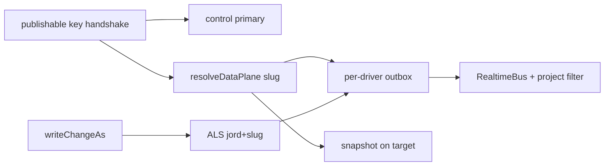

# S0098 — per-project realtime data plane

> **Status:** done 2026-11-25 · **Phase:** [[../README]] · Parent: [[../../../../feature_list/Jord/todo/jord-F0021-projects-provisioning|jord-F0021]] · Depends on [[S0097-project-data-plane|S0097]] · As-built: [[../../../../tech_space/jord/realtime/README]]

## Routing (who / how long / which model)

| | |
|--|--|
| **Parent feature** | `jord-F0021` |
| **Suggested agent** | mimir → **sindri** |
| **Companion skills** | `.agents/skills/graft/` · `.agents/skills/nodejs-backend-patterns/` |
| **Suggested model** | `claude-sonnet-5-5-high` |
| **Est. time** | 2–3 h |
| **Parallel?** | **No** |

## Goal

After S0097, Studio writes go to the project target, but `/p/:project/realtime` and the shared outbox still read the primary. Close that gap: each project's change feed and app realtime snapshot come from that project's database; bus subscribers only see their project's events.

## In scope

- Plane ALS carries `{ jord, slug }`
- Per-driver outbox (watermark + `jord_changes` on the active target)
- `JordChangeEvent.project` + bus filter
- App realtime: key lookup on primary; data/session/outbox on project target after handshake
- Drop/update the multi-project shared-plane warning when isolation holds
- Focused tests

## Out of scope

Postgres LISTEN bridges per remote project · presence/broadcast channels · origin allowlists

## Diagram



## Steps (done)

1. ALS `PlaneContext` + per-driver `createOutboxRegistry`.
2. Tag `JordChangeEvent.project`; bus `trySubscribeFiltered` filters by slug.
3. App realtime: `controlJord` / `outboxFor` / `resolveDataPlane`; plan/run/recheck use plane.
4. Wire `createAppRealtime` in `app.ts`.
5. Isolation + S0084 regression vitest; docs_man.

## Done when

- [x] Write under project A does not appear on project B's app realtime feed
- [x] Snapshot for `/p/A/realtime` lists A's tables only
- [x] Key lookup still uses the control-plane primary

## Proof

```text
cd cloud/jord && pnpm exec vitest run src/realtime/app-endpoint.test.ts
# ✓ 25 passed (includes S0098 per-project realtime isolation)
cd cloud/jord && pnpm exec vitest run src/projects/plane.test.ts src/realtime/outbox.test.ts
# ✓ plane + outbox green
```

## Out of scope / follow-ups

Postgres LISTEN remains primary-only · presence/broadcast still process-wide · per-project origin allowlists
