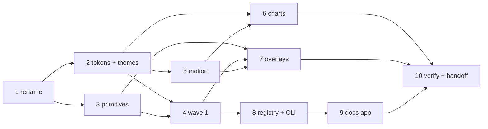

# plan / ui-kit — Apolyx v1 sprint

> Who: **apollo** (executes the cards in order) and anyone checking sprint progress. Intent lives in [[../../feature_list/ui-kit/00-intent]]; this folder only turns it into ordered tasks. When the sprint ends, durable truth moves to `tech_space/ui-kit/` and this folder is closed out.

**Status:** active — opened 2026-10-11 · **Owner:** apollo · **Docs steward:** docs_man

## Starting point (code truth, 2026-10-11)

What `elements/ui-kit` contains today, before any Apolyx work:

| Area | Today | Gap to Apolyx v1 |
|------|-------|------------------|
| Package | `@altr/ui-kit`, ~30 files reference it | Rename to `@altr/apolyx` |
| Components | `Button`, `Card`, `Badge`, `ThemeProvider` (thin next-themes wrap), `ThemeToggle`, `FadeIn` | Wave 1 + 1b catalog |
| Radix | `@radix-ui/react-slot` in `Button` | Apolyx `Slot`, zero Radix |
| Tokens | One neutral palette, HSL triplets (`hsl(var(--x))`), light + `.dark` | 3 families × light/dark in OKLCH, chart + motion tokens |
| Theme API | `themeModes` + `cssVariableTokens` in `src/theme` | `theme` (family) + `mode` axes |
| Storybook | 9.x, a11y + themes addon, class switcher light/dark | Family × mode switcher |
| Tests / lint | None | Vitest for primitives + CLI |
| Registry / CLI / docs app | Not started | `elements/apolyx-cli`, `apps/apolyx` |

App code that will break on token change: `apps/hub/src/app/page.tsx` uses `hsl(var(--muted))` and `hsl(var(--accent))` in arbitrary classes.

## Phases

Run in order. A phase is done when every box in its card is ticked **and** its verify commands pass.

| # | Card | Delivers | Depends on | Status |
|---|------|----------|------------|--------|
| 1 | [[01-rename-package]] | `@altr/apolyx` everywhere, metadata, README | — | todo |
| 2 | [[02-tokens-and-themes]] | OKLCH tokens, 3 families × 2 modes, `ApolyxProvider`, Storybook switcher | 1 | todo |
| 3 | [[03-primitives]] | `Slot`, refs/ids/state hooks, focus scope, dismissable layer, portal, roving focus; Radix removed | 1 | todo |
| 4 | [[04-wave-1-components]] | 14 simple components with stories | 2, 3 | todo |
| 5 | [[05-motion-recipes]] | Motion tokens, `FadeIn`, `Stagger`, `Pressable`, `HoverLift` | 2 | todo |
| 6 | [[06-charts]] | `ChartContainer`, tooltip, legend, `LineChart`, `BarChart` (SVG + visx) | 2, 5 | todo |
| 7 | [[07-wave-1b-overlays]] | Dialog, DropdownMenu, Tabs, Tooltip, Toast | 3, 4, 5 | todo |
| 8 | [[08-registry-and-cli]] | Registry manifests + build, `apolyx init` / `add` | 4 (Button at minimum) | todo |
| 9 | [[09-docs-app]] | `apps/apolyx` MDX docs, previews, theme switcher, `/r/*.json` | 8 | todo |
| 10 | [[10-verify-and-handoff]] | Acceptance sweep, docs_man handoff | all | todo |

Phases 2 and 3 can run in parallel after the rename. Phases 5 and 6 can run while 4 is in progress.

## Plan-level decisions

The intent note left these to the plan. apollo may revise one with a short note in the card if code proves it wrong.

| Topic | Decision |
|-------|----------|
| Color format | OKLCH. CSS variables hold full colors (`--primary: oklch(…)`); `@theme inline` maps `--color-primary: var(--primary)`. No more `hsl(var(--x))`. |
| Mode engine | Keep `next-themes` for light / dark / system on the `.dark` class. |
| Family engine | Apolyx-owned: `data-theme` on `<html>`, persisted in `localStorage` (`apolyx-theme`), set before paint by a tiny inline script to avoid flash. |
| React patterns | React 19: `ref` as a regular prop, no new `forwardRef`. Multi-part components are named exports (`Dialog`, `DialogTrigger`, `DialogContent`) sharing state through context — easy to copy-paste and tree-shake. |
| Controlled / uncontrolled | Every stateful component accepts `value` / `defaultValue` / `onValueChange` (or `open` / `defaultOpen` / `onOpenChange`) via one `useControllableState` hook. |
| Data attributes | Styling hooks via `data-state="open|closed|checked|unchecked"` and `data-disabled`, like the ecosystem expects, but produced by Apolyx code. |
| Kit-internal imports | Components import shared code by relative path (`../../lib/utils`, `../../primitives/slot`). The registry maps each path to a target alias so the CLI can rewrite imports. |
| Tests | Vitest + Testing Library + `jsdom` in `elements/ui-kit` for primitives and keyboard behavior; Vitest in the CLI for file writes and import rewrites. |
| Registry output | `elements/ui-kit/dist/r/<name>.json` (fits existing turbo `build` output `dist/**`). Docs app copies it to `public/r/` at build. |
| CLI stack | Node 20+, `tsup` bundle, `commander` for args, `@clack/prompts` for prompts. |
| Docs app | Next.js App Router + `@next/mdx`, port **3004** (`hub` 3000, `dashboard` 3001, `trading-ui` 3002, `web` 3003). |
| Charts deps | `@visx/scale`, `@visx/shape`, `@visx/curve` only. Resize via own `useResizeObserver` hook, not `@visx/responsive`. |
| Fonts | Font tokens `--font-sans` / `--font-mono` / `--font-display`; family choice is a taste call in phase 2 (avoid default Inter). Apps keep loading fonts via `next/font`. |

## How apollo runs this plan

1. Open the next `todo` card; set its row above to `in progress`.
2. Load 1–3 skills listed in the card (see [[../../agents/apollo/skills/README]]).
3. Do the tasks; tick boxes in the card as they land.
4. Run the card's verify commands; set the row to `done`.
5. After phases 4, 8, and 10, run `update_docs` (docs_man) so `tech_space/ui-kit/` grows with the code.

Keep each phase in its own commit (or small commit series). The rename is a mechanical commit by itself.

## Out of scope for this sprint

- Publishing `apolyx` to npm, registering domains, deploying the docs site
- Remote registry fetch in the CLI (local path only; URL support is designed for, not shipped)
- `diff` / `update` CLI commands
- Candlestick / canvas OHLC charts, blocks / recipes pages, docs search
- Migrating dashboard / trading-ui screens beyond the rename and token fix-ups

## Links

- Intent: [[../../feature_list/ui-kit/00-intent]]
- Builder: [[../../agents/apollo/00-index]] · [[../../agents/apollo/instructions/00-workflow]]
- Prior as-built: [[../../tech_space/01-hub-ui-kit-base]] · [[../../tech_space/02-ui-kit-storybook]]
- Status: [[../../report/STATUS]]
- Code: `elements/ui-kit` · `elements/apolyx-cli` (new) · `apps/apolyx` (new)
