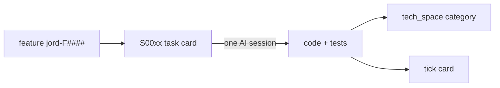

# Jord phase-03 — AI handoff brief

> **Purpose:** One file you can paste/send to another AI to discuss and implement remaining Jord work.  
> **Not vault truth.** Living sources: `Docs/feature_list/Jord/INDEX.md`, `todo/jord-F####-*.md`, `Docs/plan/Jord/phase-03/`.  
> Generated: 2026-10-27.

---

## How to use this with another AI

1. Attach **this file** as the product backlog brief.
2. Tell the AI which **feature id** to work on (`jord-F0013` … `jord-F0019`), or ask it to help split/prioritize.
3. For **implementation**, prefer one bite-sized task at a time (see “Plan shape” below). Existing example cards: `S0034` health probes, `S0035` JSON logs under parent `jord-F0013`.
4. Cite features by **`jord-F####`**, not old P1/P2 labels.

### What to send instead (if you have the repo open)

| Goal | Send |
|------|------|
| Full registry | `Docs/feature_list/Jord/INDEX.md` |
| One feature deep-dive | matching `Docs/feature_list/Jord/todo/jord-F####-*.md` |
| Executable next slice | `Docs/plan/Jord/phase-03/S00xx-*.md` |
| This chat (no vault) | **this file** |

---

## Context (what Jord already is)

Jord is altr.lab’s data/backend platform (Postgres dialects, writes, schema, auth, table APIs, jobs, policies, realtime, blobs, vectors, Studio). Phase-01 / 02 / 02.5 / 02.75 are **closed**. Shipped intent ids:

`jord-F0001` overview · `F0002` dialects · `F0003` writes · `F0004` schema · `F0005` auth · `F0006` apis · `F0007` jobs · `F0008` policies · `F0009` realtime · `F0010` blobs · `F0011` vectors · `F0012` studio

Phase-03 = **extend** those surfaces; do not reopen closed phase folders for new scope. Apps stay **Apolyx-first** (UI from `@altr/apolyx`).

### Plan shape (from phase-03 on)

- **1 markdown task file = 1 simple AI session** (~45–180 min).
- Each task cites a **parent** `jord-F####`.
- Template fields: agent · skills · model · est. time · mermaid · steps · done-when · proof.
- If work > ~3 hours or needs two coding hats → **split** before implementing.



---

## Open features (implement these)

Priority order below matches historical P1→P7. Soft leftovers are last and are **not** automatic sprint work.

---

### jord-F0013 — production ops (multi-instance ready) — P1

**Why:** Rate limits, idempotency, SQL history, and realtime fan-out are process-local. A second instance breaks them.

**What:**
- Postgres-backed rate-limit + idempotency tables (**no Redis** for this)
- `LISTEN/NOTIFY` seq fan-out (trigger exists; LISTEN deferred earlier)
- Shared commit watermark
- `/health/live` + `/health/ready`
- OpenTelemetry
- Structured JSON logs
- Backup + restore drill
- Dockerfile + one deploy recipe
- `JORD_PG_WRITE_CONCURRENCY`

**Acceptance:** Two server instances behind one URL: shared rate limit, cross-instance idempotent replay, SSE on B sees write on A. Restore drill documented with command output.

**Touches shipped:** `jord-F0009` realtime (finish LISTEN) · `jord-F0006` apis (in-memory rate/idempotency → Postgres) · `jord-F0003` writes (PG write concurrency) · `jord-F0002` dialects (multi-instance assumptions)

**Plan tasks filed:**
| Id | Task | Est. | Status |
|----|------|------|--------|
| S0034 | `/health/live` + `/health/ready` | ~45–75 min | todo |
| S0035 | Structured JSON request logs | ~60–90 min | todo |
| — | rate-limit store, LISTEN, PG concurrency, OTel, backup, Dockerfile | — | **not filed yet** |

---

### jord-F0014 — typed developer experience — P2

**Why:** Apps call `/api/v1` with untyped rows. Client exists; types do not.

**What:**
- `jord gen types` → TS row types from introspection/OpenAPI
- Typed `@altr/jord-client` table builder
- React bindings (`useJordQuery`, `useJordLive`) in a **separate** package
- First consumer: one Apolyx app screen

**Acceptance:** Column rename breaks the consumer app’s typecheck; live hook resyncs on 410.

**Touches shipped:** `jord-F0006` apis — extend client SDK; do not fork table HTTP.

**Plan tasks:** none filed yet.

---

### jord-F0015 — Functions v2 runtime — P3

**Why:** ADR accepted; Functions are still phase-01 built-in kinds only.

**What:**
- `worker_threads` pool
- Timeout + memory cap
- Scoped Jord client inside worker (principal-bound, through policies)
- Logs to `jord_logs`

**Acceptance:** Infinite loop killed at timeout; worker cannot read env secrets; writes respect policies.

**Touches shipped:** `jord-F0006` apis (ADR → runtime) · `jord-F0008` policies (same policy path) · `jord-F0012` studio (function editor targets new runtime)

**Plan tasks:** none filed yet. ADR lives under `Docs/tech_space/jord/apis/ADR-functions-v2`.

---

### jord-F0016 — auth v2 — P4

**What:**
- Real `MailerPort` (Resend or SES)
- Magic link
- One OAuth provider
- Studio “run as user” policy tester
- Session list + revoke
- Custom JWT claims

**Acceptance:** Enumeration tests still pass; OAuth state/PKCE tested; policy tester matches server decisions on a fixture matrix.

**Touches shipped:** `jord-F0005` auth · `jord-F0012` studio

**Plan tasks:** none filed yet.

---

### jord-F0017 — table API v2 — P5

**What:**
- One-level FK embeds (`select=*,author(*)`) with **policies per embedded table**
- Cursor (keyset) pagination
- Bulk insert/upsert with per-row results
- RPC to registered server functions

**Acceptance:** Embed never returns a row the caller could not read directly; keyset paging stable under concurrent inserts.

**Touches shipped:** `jord-F0006` apis · `jord-F0008` policies

**Plan tasks:** none filed yet.

---

### jord-F0018 — storage and realtime v2 — P6

**What:**
- Multipart + resumable uploads
- Image transforms (prefer non-native)
- MinIO CI
- Realtime presence + broadcast with policy-gated join

**Acceptance:** 1 GiB upload resumes after disconnect; MinIO CI job green.

**Touches shipped:** `jord-F0010` blobs (extend S3/MinIO, don’t replace) · `jord-F0009` realtime

**Plan tasks:** none filed yet.

---

### jord-F0019 — security pass — P7

**What:**
- Authorized Strix pentest of `/api/v1`, `/auth`, `/blobs`, `/realtime`
- JWT/HMAC/blob-signing key-rotation runbook
- Dependency audit in CI

**Acceptance:** Findings triaged into cards; no open high/critical.

**Touches shipped:** `jord-F0005` auth · `jord-F0006` apis

**Plan tasks:** none filed yet. Threat model: phase-02 ADR under plan.

---

### jord-F0020 — soft leftovers (not automatic sprint)

Promote each into a **new** `jord-F####` when a product asks — do not overload this id.

| Candidate | Note |
|-----------|------|
| Artemis scratchpad on `records` bucket `artemis` | product-gated |
| Redis-compatible cache | **Not** for F0013 rate-limit (Postgres on purpose) |
| Bot / second cloud process | multi-process |
| Hosted embed API · embedding CDC | breaks F0011 “caller supplies floats” unless product asks |
| Embedded Turso replicas | dialect extension |

Also out unless asked: Bun · Artemis trading tables in `records.body` · multi-project · npm publish.

---

## Suggested discussion prompts for the other AI

Copy one:

1. **Prioritize:** “Given `jord-F0013`…`F0019`, propose a 2-week cut that maximizes multi-instance readiness first. Split into ~1-hour task titles.”
2. **Deep dive one feature:** “Design the Postgres rate-limit + idempotency tables for `jord-F0013` without Redis. List migrations, APIs to change, and acceptance tests.”
3. **Split into plan cards:** “Turn `jord-F0013` remainder into S0036+ task cards: agent, skills, model, est. time, mermaid, steps, done-when.”
4. **Implement next:** “Implement only S0034 health probes under parent `jord-F0013`. Do not expand scope.”

---

## Repo paths (for AIs that can read the vault)

```
Docs/feature_list/Jord/INDEX.md
Docs/feature_list/Jord/todo/jord-F0013-production-ops.md
Docs/feature_list/Jord/todo/jord-F0014-typed-dx.md
Docs/feature_list/Jord/todo/jord-F0015-functions-runtime.md
Docs/feature_list/Jord/todo/jord-F0016-auth-v2.md
Docs/feature_list/Jord/todo/jord-F0017-table-api-v2.md
Docs/feature_list/Jord/todo/jord-F0018-storage-realtime-v2.md
Docs/feature_list/Jord/todo/jord-F0019-security-pass.md
Docs/feature_list/Jord/todo/jord-F0020-soft-leftovers.md
Docs/plan/Jord/phase-03/README.md
Docs/plan/Jord/phase-03/S0034-health-probes.md
Docs/plan/Jord/phase-03/S0035-structured-json-logs.md
Docs/tech_space/jord/README.md
Docs/agents/templates/plan-task.md
```

Next free feature id: **jord-F0021**.
